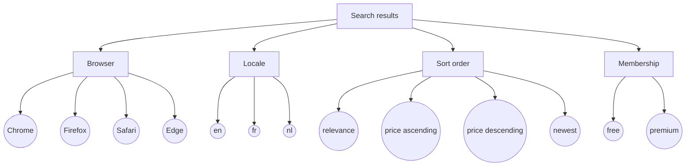

# Worked Example: Classification Tree and Pairwise

## Input

> **SRCH-12** - Search results depend on browser (Chrome, Firefox, Safari, Edge), locale (en, fr, nl), sort order (relevance, price ascending, price descending, newest) and membership tier (free, premium). Free members cannot sort by price. Exhaustive coverage is too large.

## Test design plan

| Unit | Source | Logic | Technique | Why this technique |
|---|---|---|---|---|
| U1 | SRCH-12 | four interacting parameters, 96 raw combinations | Classification Tree / N-Wise (pairwise) | no rule defines a result per combination; the risk is in interactions, and exhaustive testing is out of budget |
| U2 | SRCH-12 | free members cannot sort by price | Equivalence Partitioning | a business rule that also acts as a constraint on U1; it needs its own negative test |

## Assumptions and open questions

| ID | Assumption or question | Why it matters | Affects |
|---|---|---|---|
| ASM-1 | Premium members see premium listings in addition to the standard results | defines the expected effect of the premium class | C02-C04, C06, C09-C12, C14, C16 |
| Q-1 | How is price sorting blocked for free members: option hidden, disabled, or an error message? | expected result of TC-U2-01 | TC-U2-01 |

## Classification tree



## Classes and expectations

| Classification | Classes | Chosen with | Class expectations |
|---|---|---|---|
| Browser | Chrome, Firefox, Safari, Edge | supported-browser list | same results and layout in every browser |
| Locale | en, fr, nl | EP (one class per language) | labels, dates and prices in that locale's language and format |
| Sort order | relevance, price ascending, price descending, newest | EP | results ordered by the chosen key |
| Membership | free, premium | EP | premium adds premium listings (ASM-1) |

## Model and generation

```json
{
  "parameters": {
    "Browser": ["Chrome", "Firefox", "Safari", "Edge"],
    "Locale": ["en", "fr", "nl"],
    "Sort order": ["relevance", "price ascending", "price descending", "newest"],
    "Membership": ["free", "premium"]
  },
  "constraints": [
    {"Membership": "free", "Sort order": "price ascending"},
    {"Membership": "free", "Sort order": "price descending"}
  ],
  "strength": 2
}
```

`python ./scripts/nwise.py search.json` reports: *Pairwise (2-wise) coverage: 60/60 feasible 2-tuples covered (100%). Tests: 16 instead of 72 allowed combinations (96 before constraints).*

## Combination set (U1)

| Test | Browser | Locale | Sort order | Membership | Expected result |
|---|---|---|---|---|---|
| C01 | Chrome | en | relevance | free | standard results, most relevant first, English |
| C02 | Chrome | fr | price ascending | premium | standard + premium results, cheapest first, French |
| C03 | Firefox | nl | relevance | premium | standard + premium results, most relevant first, Dutch |
| C04 | Safari | en | price descending | premium | standard + premium results, most expensive first, English |
| C05 | Safari | fr | newest | free | standard results, newest first, French |
| C06 | Edge | en | newest | premium | standard + premium results, newest first, English |
| C07 | Edge | fr | relevance | free | standard results, most relevant first, French |
| C08 | Chrome | nl | newest | free | standard results, newest first, Dutch |
| C09 | Firefox | en | price ascending | premium | standard + premium results, cheapest first, English |
| C10 | Firefox | fr | price descending | premium | standard + premium results, most expensive first, French |
| C11 | Safari | nl | price ascending | premium | standard + premium results, cheapest first, Dutch |
| C12 | Edge | nl | price descending | premium | standard + premium results, most expensive first, Dutch |
| C13 | Firefox | en | newest | free | standard results, newest first, English |
| C14 | Chrome | en | price descending | premium | standard + premium results, most expensive first, English |
| C15 | Safari | en | relevance | free | standard results, most relevant first, English |
| C16 | Edge | en | price ascending | premium | standard + premium results, cheapest first, English |

## Constraint rule (U2)

| ID | Title | Covers | Test data | Expected result | Trace |
|---|---|---|---|---|---|
| TC-U2-01 | Free member cannot sort by price | constraint Membership=free x Sort=price | free member, any browser, locale en | price sorting is not available (form per Q-1); results keep their current order | SRCH-12 |

## Coverage

| Unit | Technique | Coverage items | Covered | Coverage | Not covered / residual risk |
|---|---|---|---|---|---|
| U1 | Pairwise | 60 feasible pairs | 60 | 100% | interactions of 3 or more parameters (for example Safari + nl + price descending) |
| U2 | Equivalence Partitioning | 1 rejected class | 1 | 100% | blocking behaviour unknown (Q-1) |
