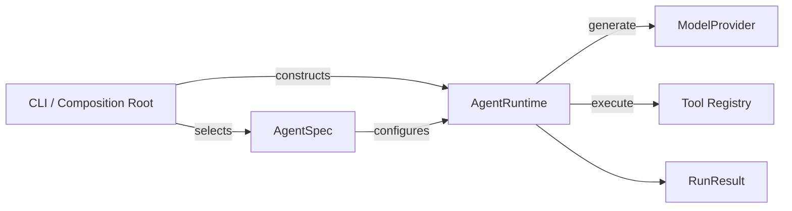

# miniAgent

miniAgent 是一个使用 Python 从零实现的最小 Agent Runtime。它让模型在有界循环中调用工具完成任务，并由 Runtime 统一负责步骤限制、异常处理、连续失败检测和外部取消。

项目目前处于早期开发阶段，重点是建立清晰、可测试的 Agent 执行边界，而不是提供完整的 Coding Agent 产品。

## 当前能力

- 使用 OpenAI-compatible API 调用模型，目前提供 `QwenProvider`。
- 使用 `AgentSpec` 声明 system prompt、模型、生成参数和工具权限。
- 提供 `read_file` 和 `shell` 两个工具。
- 对模型响应和 Tool Call 使用 Pydantic 结构化建模。
- 支持正常完成、最大步数、模型异常、连续失败和外部取消等退出机制。
- 通过 Typer 提供命令行入口。
- 使用标准库 `unittest` 覆盖 Agent Runtime 的主要终止路径。

## 运行流程



命令行入口负责选择 Agent、构造 Provider 和工具，并将它们交给 `AgentRuntime`。Runtime 执行模型循环，但不依赖具体 Agent 或具体 Provider 的实现。

一次 Step 包含一次模型请求，以及该响应产生的全部 Tool Call。项目术语的精确定义见 [CONTEXT.md](./CONTEXT.md)。

## 环境要求

- Python 3.13+
- [uv](https://docs.astral.sh/uv/)
- 一个兼容 OpenAI Chat Completions API 的模型服务

## 安装

```bash
uv sync
```

在项目根目录创建 `.env`：

```dotenv
OPENAI_API_KEY=your-api-key
OPENAI_BASE_URL=https://your-openai-compatible-endpoint/v1
```

不要将包含真实凭证的 `.env` 提交到版本库。

## 命令行使用

使用 Default Agent 的默认模型 `qwen3.8-flash`：

```bash
uv run miniagent "model qwen 的 providers 实现路径是？"
```

在同一个 Provider 下覆盖模型名称：

```bash
uv run miniagent \
  "model qwen 的 providers 实现路径是？" \
  --model deepseek-v4-flash
```

查看完整参数：

```bash
uv run miniagent --help
```

`--model` 只替换 Default Agent 的模型名称，不切换 Provider。Provider 由 `AgentSpec.model.provider` 决定。

## Agent 配置

Default Agent 定义在 `src/miniagent/agents/default.py`：

```python
DEFAULT_AGENT = AgentSpec(
    name="default",
    system_prompt=SYSTEM_PROMPT,
    model=ModelTarget(provider="qwen", model="qwen3.8-flash"),
    allowed_tools=["read_file", "shell"],
    temperature=0,
    max_output_tokens=1_000_000,
)
```

主要字段：

| 字段 | 含义 |
| --- | --- |
| `name` | Agent 的稳定名称 |
| `system_prompt` | Agent 的系统指令 |
| `model.provider` | 应用入口用于选择 Provider 的标识 |
| `model.model` | 发送给模型服务的模型名称 |
| `allowed_tools` | Runtime 允许该 Agent 调用的工具白名单 |
| `temperature` | 模型生成温度 |
| `max_output_tokens` | 单次模型响应的最大 Token 数 |

Runtime 会在执行前验证工具白名单。如果模型请求未授权工具，Runtime 会返回 `TOOL_NOT_ALLOWED`，而不会执行该工具。

## Runtime 退出机制

每次 Run 都返回结构化的 `RunResult`，而不是依赖打印内容或未受控异常表示结果。

| 场景 | `RunStatus` | `TerminationReason` |
| --- | --- | --- |
| 模型正常返回最终内容 | `COMPLETED` | `MODEL_COMPLETED` |
| 达到最大 Step 数 | `FAILED` | `MAX_STEPS_REACHED` |
| Provider 异常或模型异常结束 | `FAILED` | `MODEL_FAILED` |
| 连续不可推进的 Tool Step 达到阈值 | `FAILED` | `CONSECUTIVE_FAILURE_LIMIT` |
| 收到 `CancellationToken` 取消请求 | `CANCELLED` | `CANCEL_REQUESTED` |

默认限制：

- 最大 Step 数：50。
- 最大连续失败 Step 数：3。

只有同时满足以下条件才视为模型正常完成：

- `finish_reason == stop`。
- 响应不包含 Tool Call。
- 响应包含非空最终内容。

`length`、`content_filter`、`error`、`unknown` 以及互相矛盾的响应结构都会被视为模型异常结束。

`COMPLETED` 仅表示 Agent Loop 正常结束，不代表任务结果已经通过独立验证。

## 项目结构

```text
src/miniagent/
├── agents/          # AgentSpec、ModelTarget 和 Default Agent
├── cli/             # CLI 与依赖装配入口
├── config/          # 环境配置
├── models/          # 模型消息、请求、响应和工具数据模型
├── providers/       # 模型服务适配器
├── runtime/         # Agent Loop、状态、终止判断和取消机制
└── tools/           # 工具接口及具体工具
tests/
└── test_runtime.py  # Runtime 单元测试
```

核心依赖方向：

```text
CLI → AgentSpec + AgentRuntime + ModelProvider + Tools
AgentRuntime → AgentSpec + ModelProvider 抽象 + Tool 抽象
QwenProvider → OpenAI-compatible SDK
```

Provider 只负责一次模型请求的协议适配。Agent 循环、Tool 调度和终止策略始终由 Runtime 控制。

## 测试与类型检查

运行单元测试：

```bash
uv run python -m unittest discover -s tests -v
```

检查当前 Agent Runtime 相关代码：

```bash
uv run --with ty ty check \
  src/miniagent/agents \
  src/miniagent/cli \
  src/miniagent/runtime \
  src/miniagent/providers/qwen.py \
  tests
```

目前对整个 `src` 执行类型检查时，`src/miniagent/environments/__init__.py` 中尚未实现的 `CommandResult` 会产生一个既有错误。

## 扩展方式

### 添加 Agent

创建新的 `AgentSpec`，声明模型目标、Prompt、行为参数和允许使用的工具。应用入口负责选择该配置并传入 Runtime。

### 添加 Provider

实现 `ModelProvider.generate()`，将外部服务响应归一化成 `ModelResponse`，然后在 CLI 的 Provider 构造逻辑中注册该实现。Provider 不应实现 Agent Loop。

### 添加工具

实现 `Tool` 接口，将工具加入 CLI 创建的工具集合，并在需要使用它的 Agent 的 `allowed_tools` 中授权。

## 安全说明

当前版本不能被视为安全沙箱：

- `ReadFileTool` 会拒绝读取工作区之外的路径。
- `ShellTool` 只把工作目录设置为项目目录，但仍然通过宿主机 Shell 执行模型生成的命令。
- `ShellTool` 尚未限制命令类型、网络访问、进程权限或工作区外路径访问。
- 模型请求和 Tool 输出可能被发送到配置的外部模型服务。

不要在包含敏感源码、凭证或不可信输入的环境中直接运行当前版本。

## 当前限制与后续方向

当前尚未实现：

- 一个 Run 内的 Agent handoff。
- 多 Provider 注册、路由和故障转移。
- Provider 重试和指数退避。
- 工作区隔离、审批和危险命令策略。
- 事件持久化、Checkpoint、崩溃恢复和上下文压缩。
- 独立 Evaluator 和任务成功验证。

长期设计和阶段性路线见 [Recoverable Coding Agent 项目蓝图](./recoverable-coding-agent-project-blueprint.md)。
