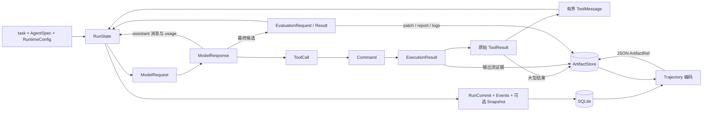
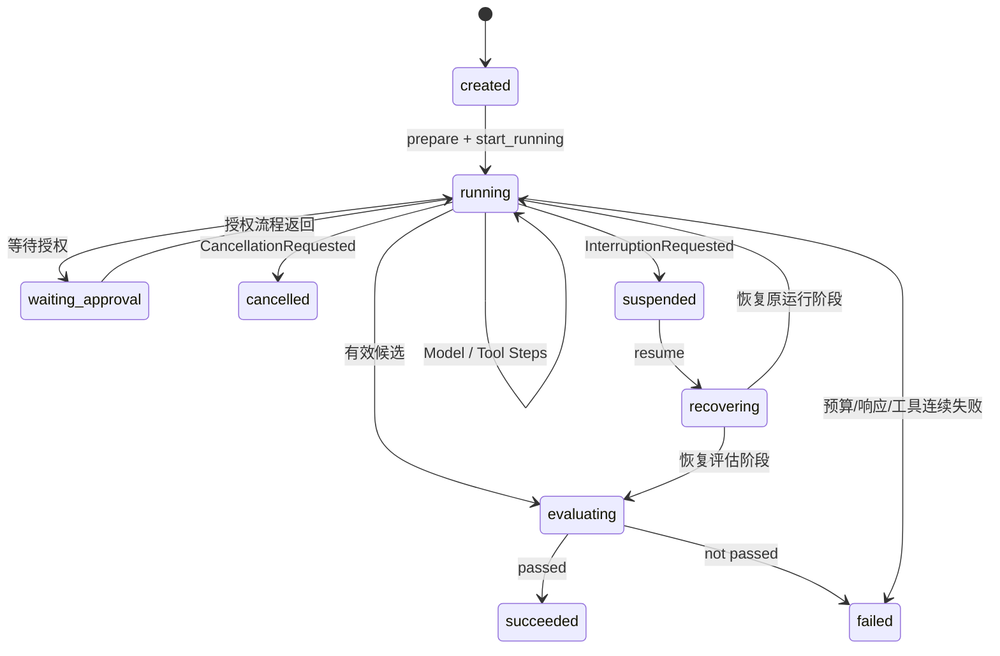
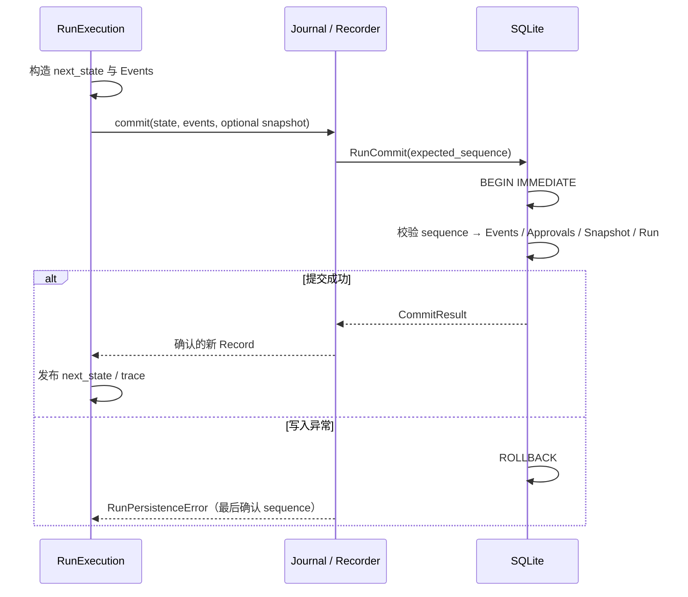

# 数据与状态流

[架构总览](overview.md) · [执行流程](execution-flows.md)

本文沿用总览的工作树基线与证据约定。图是源码行为的归纳；示例是按类型与转移函数构造的说明，不是实测运行记录。

## 1. 三条相连的数据流

调用依据：[loop.py:1169](../../src/miniagent/runtime/loop.py#L1169)、[transitions.py:126](../../src/miniagent/runtime/transitions.py#L126)、[tool_runner.py:222](../../src/miniagent/runtime/tool_runner.py#L222)、[execution.py:1386](../../src/miniagent/runtime/execution.py#L1386)、[recording.py:98](../../src/miniagent/runtime/recording.py#L98)、[cli/trajectory.py:133](../../src/miniagent/cli/trajectory.py#L133)。

这三条流分别是：送往模型的 conversation、负责继续执行的 RunState、保留历史证据的 Event/Artifact。它们有关联，但不是同一份数据：conversation 会压缩，原始工具结果可能大于模型观察，Event 保存请求/响应与关联信息。证据：[context.py:500](../../src/miniagent/runtime/context.py#L500)、[execution.py:1338](../../src/miniagent/runtime/execution.py#L1338)、[execution.py:1464](../../src/miniagent/runtime/execution.py#L1464)。

## 2. 对象、来源与生命周期

### Task / Run / 恢复上下文

| 对象及定义 | 创建与主要字段 | 持久化、读取及生命周期 |
| --- | --- | --- |
| `AgentSpec`，[agents/spec.py:10](../../src/miniagent/agents/spec.py#L10) | name、system_prompt、model、generation、allowed_tools；默认定义经 CLI 覆盖和 limits 调整 | 深拷贝进 RunDefinition；每次请求使用冻结定义，恢复时检查工具契约。[loop.py:215](../../src/miniagent/runtime/loop.py#L215)、[loop.py:1169](../../src/miniagent/runtime/loop.py#L1169) |
| `RunIdentity` / `RunDefinition`，[state.py:58](../../src/miniagent/runtime/state.py#L58) | identity 为 run_id、task 字符串、created_at；definition 为 AgentSpec、RuntimeConfig、工具定义及契约 metadata | 启动时创建，随 RunState 写入 Run 与 Snapshot。主路径没有额外的通用 Task/聊天 Session 容器；task 是 RunIdentity 的字段。[state.py:173](../../src/miniagent/runtime/state.py#L173)、[sqlite.py:555](../../src/miniagent/storage/sqlite.py#L555) |
| `RunState`，[state.py:150](../../src/miniagent/runtime/state.py#L150) | identity、definition、lifecycle、conversation、execution、approval、recovery、context、usage；frozen Pydantic model | Runtime 通过新 state 值推进；SQLite Run 保存最新已提交值，Snapshot 保存版本值。终态禁止活跃 phase/operation/current_step/tool_batch。[state.py:196](../../src/miniagent/runtime/state.py#L196)、[sqlite.py:607](../../src/miniagent/storage/sqlite.py#L607) |
| `RunRecoveryContext`，[recovery.py:38](../../src/miniagent/runtime/recovery.py#L38) | workspace_id/spec、原 Workspace attachment、application envelope、policy/pricing revision；bootstrap 生成 | 与 Run/Snapshot 一起保存，resume 用其 attach 原环境。application envelope 保存 payload 及摘要；凭证用环境变量引用，bootstrap 的 ProviderReference 指向 OPENAI_API_KEY/BASE_URL。[bootstrap.py:375](../../src/miniagent/cli/bootstrap.py#L375)、[bootstrap.py:395](../../src/miniagent/cli/bootstrap.py#L395)、[cli/resume.py:573](../../src/miniagent/cli/resume.py#L573) |

这里 `recovery.session` 是恢复期间的状态，不能解读为多轮用户聊天 Session；`RunState` 的主执行数据围绕一个 task 和一个 run_id。此为基于字段结构的术语归纳：[state.py:138](../../src/miniagent/runtime/state.py#L138)。

### Message / Context / Model Request / Response

| 对象及定义 | 来源、字段与转换 | 保存与读取 |
| --- | --- | --- |
| `Message` 联合，[messages.py:8](../../src/miniagent/models/messages.py#L8) | system/user 为 content；assistant 为 content + tool_calls；tool 为 content + tool_call_id。初始 system=Agent prompt、user=task | `ConversationState.messages` 元组；模型返回追加 assistant，工具完成追加 tool。[loop.py:220](../../src/miniagent/runtime/loop.py#L220)、[transitions.py:136](../../src/miniagent/runtime/transitions.py#L136)、[transitions.py:190](../../src/miniagent/runtime/transitions.py#L190) |
| `ConversationState` / `StepRange`，[state.py:83](../../src/miniagent/runtime/state.py#L83) | messages 与 completed_steps；每个 StepRange 记录 step_number 和半开消息区间 `[message_start,message_end)` | 每个完整工具 Step 完成时添加 range；压缩依此选择完整旧 Step 并重定位保留范围。当前值随 state 保存，历史消息仍可从事件和旧 Snapshot 定位。[transitions.py:207](../../src/miniagent/runtime/transitions.py#L207)、[context.py:500](../../src/miniagent/runtime/context.py#L500) |
| `ModelRequest`，[protocol.py:11](../../src/miniagent/models/protocol.py#L11) | model、messages、tools、generation；由冻结 Run 定义与当前 conversation 构造 | 完整 request 进入 ModelRequested；Provider 将 tool arguments 编为 JSON 字符串、ToolDefinition 编为 function schema。[execution.py:732](../../src/miniagent/runtime/execution.py#L732)、[qwen.py:70](../../src/miniagent/providers/qwen.py#L70)、[qwen.py:145](../../src/miniagent/providers/qwen.py#L145) |
| `ModelResponse`，[protocol.py:69](../../src/miniagent/models/protocol.py#L69) | assistant message、finish_reason、usage/usage_issue、provider_request_id、timing、error；从 API 首个 choice 归一化 | ModelResponded 保存 response、cost、disposition；message 进 conversation。归一化失败保存 ProviderResponseEvidence，不编造有效 assistant 响应。[qwen.py:198](../../src/miniagent/providers/qwen.py#L198)、[loop.py:980](../../src/miniagent/runtime/loop.py#L980)、[execution.py:926](../../src/miniagent/runtime/execution.py#L926) |
| `ModelUsage`，[protocol.py:20](../../src/miniagent/models/protocol.py#L20) | input、cached input、output、reasoning output、total；缓存是 input 子集，reasoning 是 output 子集，total=input+output | 有效 usage 累计进 RunUsage，并按 pricing 计费；缺失/无效 usage 增加未确认请求计数，不能把其当作确认为零的消耗。[transitions.py:133](../../src/miniagent/runtime/transitions.py#L133)、[execution.py:914](../../src/miniagent/runtime/execution.py#L914)、[loop.py:1058](../../src/miniagent/runtime/loop.py#L1058) |
| `CompactionPlan` / `CompactionSummary`，[context.py:83](../../src/miniagent/runtime/context.py#L83)、[context.py:244](../../src/miniagent/runtime/context.py#L244) | plan 指定覆盖消息/Step、保留位置、预算与源 Snapshot/Event 边界；summary 包含 current_goal、user_constraints、verified_evidence、workspace_changes、rejected_attempts、uncertainties、open_items、next_action | 校验 verified_evidence 后转换为模板化 AssistantMessage；context.current_version 增加，CompactionCompleted + 新 Snapshot 原子发布。失败不发布半成品 conversation。[context.py:456](../../src/miniagent/runtime/context.py#L456)、[journal.py:123](../../src/miniagent/runtime/journal.py#L123) |

### Tool Call / Command / Result / Approval

| 对象及定义 | 来源与主要字段 | 转换、保存与生命周期 |
| --- | --- | --- |
| `ToolCall` / `ToolBatch`，[tools/contracts.py:23](../../src/miniagent/tools/contracts.py#L23)、[state.py:100](../../src/miniagent/runtime/state.py#L100) | Provider 解析生成 id/name/arguments；ToolBatch 保存 calls、next_index，同一批 ID 必须唯一 | assistant 消息保留调用；运行游标从 0 前进，完成一个工具才增加 next_index；跨 Step ID 不能单独充当全局主键，需结合 Run/Step/call_index。[transitions.py:148](../../src/miniagent/runtime/transitions.py#L148)、[transitions.py:177](../../src/miniagent/runtime/transitions.py#L177)、[context.py:128](../../src/miniagent/runtime/context.py#L128) |
| `PreparedToolCall`，[registry.py:18](../../src/miniagent/tools/registry.py#L18) | 严格校验后的 canonical_arguments 与调用闭包 | 进程内对象，不保存闭包；canonical_arguments 用于策略和执行开始记录。[registry.py:36](../../src/miniagent/tools/registry.py#L36)、[tool_runner.py:202](../../src/miniagent/runtime/tool_runner.py#L202)、[tool_runner.py:229](../../src/miniagent/runtime/tool_runner.py#L229) |
| `Command` / `ExecutionResult`，[environments/contracts.py:18](../../src/miniagent/environments/contracts.py#L18) | Command 为 argv/cwd/environment/stdin/timeout；Result 为状态、exit code、stdout/stderr、截断标记、duration、artifacts、output_evidence | Tool 转命令，Workspace 执行；命令输出证据与用于返回的 stdout/stderr 分开关联；结果再转换为 ToolResult。[shell.py:53](../../src/miniagent/tools/shell.py#L53)、[local.py:693](../../src/miniagent/environments/local.py#L693)、[docker.py:834](../../src/miniagent/environments/docker.py#L834) |
| `ToolResult`，[tools/contracts.py:89](../../src/miniagent/tools/contracts.py#L89) | tool_call_id、status、content、data、error、artifacts、metrics、workspace_delta、output | 原始返回先 capture；JSON 编码不超过 65536 bytes 内联，否则保存 tool_result artifact。经返回校验与 render_tool_result 形成有界 JSON observation；ToolEnded 同时关联 raw_result、validation、effective result 和 ToolMessage。[execution.py:1338](../../src/miniagent/runtime/execution.py#L1338)、[execution.py:1411](../../src/miniagent/runtime/execution.py#L1411)、[execution.py:1464](../../src/miniagent/runtime/execution.py#L1464) |
| `PendingApprovalRef` / `StoredApproval`，[state.py:127](../../src/miniagent/runtime/state.py#L127)、[store_contracts.py:69](../../src/miniagent/runtime/store_contracts.py#L69) | 当前 pending 保存 approval_id、Step/call 定位；StoredApproval 带 version 及请求、解决、失效事件 ID | 命中 approval 分支创建，等待结束再决定执行/拒绝/终止；审批变化与 RunCommit 一起提交。恢复会处理旧 pending，不将其无条件视为新授权。[tool_runner.py:146](../../src/miniagent/runtime/tool_runner.py#L146)、[sqlite.py:629](../../src/miniagent/storage/sqlite.py#L629)、[cli/resume.py:533](../../src/miniagent/cli/resume.py#L533) |

### Event / Snapshot / Artifact / Evaluation / Trajectory

| 对象及定义 | 来源与字段 | 保存、读取和寿命 |
| --- | --- | --- |
| `NewRunEvent → RunEvent`，[events.py:603](../../src/miniagent/runtime/events.py#L603) | Runtime 生成 event_id、run_id、payload、step_number、span/parent_span、artifact refs；已存事件增加 sequence、occurred_at | SQLite 分配连续序列；历史读取受 through_sequence 限制。resume、压缩校验、trajectory 使用事件事实。[sqlite.py:624](../../src/miniagent/storage/sqlite.py#L624)、[history.py:8](../../src/miniagent/runtime/history.py#L8) |
| `RunRecord` / `RunCommit`，[store_contracts.py:60](../../src/miniagent/runtime/store_contracts.py#L60)、[store_contracts.py:119](../../src/miniagent/runtime/store_contracts.py#L119) | Record 保存最新 state、last_event_sequence、latest_snapshot_version、recovery context；Commit 带期望序列、新 state、events、approval changes 和可选 SnapshotChange | Recorder 使用最后确认 sequence 提交；冲突或异常不假定成功。SQLite 事务同时写入事件、审批、Snapshot 和最新 Run。[recording.py:98](../../src/miniagent/runtime/recording.py#L98)、[sqlite.py:607](../../src/miniagent/storage/sqlite.py#L607) |
| `RunSnapshot`，[snapshots.py:22](../../src/miniagent/runtime/snapshots.py#L22) | state、recovery context、event_sequence、snapshot_id、version、created_at | 起跑、完整 Step、压缩等边界创建；load_version/load_latest 读取。Snapshot 版本不等于每次 Event 的 sequence，也不等于 Context version。[journal.py:229](../../src/miniagent/runtime/journal.py#L229)、[journal.py:254](../../src/miniagent/runtime/journal.py#L254)、[journal.py:207](../../src/miniagent/runtime/journal.py#L207) |
| `ArtifactWrite → ArtifactRecord → ArtifactRef`，[artifacts/contracts.py:10](../../src/miniagent/artifacts/contracts.py#L10) | Write 指定 run_id/type/name/media_type/metadata；Record 加 artifact_id、uri、size、sha256；Ref 是传递用引用 | FileArtifactStore 根下有 content 与 manifests；manifest 按 run_id.hex/artifact_id.json 索引。读取验证引用、大小、hash。Workspace 清理和 artifact 存储是不同生命周期。[artifacts/file.py:24](../../src/miniagent/artifacts/file.py#L24)、[artifacts/file.py:135](../../src/miniagent/artifacts/file.py#L135)、[application.py:236](../../src/miniagent/cli/application.py#L236) |
| `CandidateOutput / EvaluationRequest / EvaluationResult`，[evaluation/contracts.py:10](../../src/miniagent/evaluation/contracts.py#L10) | 候选 text + optional patch；请求为 run_id/task/candidate/optional plan；结果为 passed/output/error/checks/artifacts | STOP 文本触发；Docker 包装器附上提交 patch。结果写入 state.execution.evaluation.result 和 EvaluationResultRecorded，再决定终态。[candidate_submission.py:392](../../src/miniagent/cli/candidate_submission.py#L392)、[execution.py:1191](../../src/miniagent/runtime/execution.py#L1191) |
| `TrajectoryHeader / Boundary` 的编码使用，[trajectory/export.py:155](../../src/miniagent/trajectory/export.py#L155) | 从已提交 Record 生成 run_id、trace_id、producer/export time、through_sequence、status、terminal/suspended/abnormal boundary、冻结定义及汇总 | 遍历该边界内 Events、关联 ArtifactStore 证据，最终发布 type=run_trajectory JSON。返回的 ArtifactRef 单独放入 ApplicationResult.trajectory_export；不是新的业务 Run/Event。[cli/trajectory.py:124](../../src/miniagent/cli/trajectory.py#L124)、[cli/trajectory.py:149](../../src/miniagent/cli/trajectory.py#L149)、[application.py:62](../../src/miniagent/cli/application.py#L62) |

## 3. 一次工具型 Agent Step 中状态如何变化

设起始已有 N 条消息、k 个 started Steps，模型本轮返回两个工具调用。以下只展示工具型 Step；最终文本 Step 走评估分支。

| 时点 | phase / operation | conversation / tool cursor | 计数与提交 |
| --- | --- | --- | --- |
| 请求前 | REQUEST_MODEL，current_step=None | N 条消息；batch=None | 检查 max_steps/连续失败；可能先压缩 |
| `begin_step` | REQUEST_MODEL，current_step=k+1，active_operation=model attempt | 消息数不变，记录 message_start=N | steps_started +1、model_requests +1；StepStarted + ModelRequested 提交 |
| `record_model_response` | EXECUTE_TOOLS，清除 model operation | 追加 assistant，N+1；batch.calls=2，next_index=0 | 有效 usage/cost 累计；ModelResponded 提交 |
| 第一个工具执行开始 | EXECUTE_TOOLS，active_operation=tool attempt | next_index 仍为 0 | 真正执行才递增 tool_calls；策略拒绝不算实际执行 |
| 第一个 `complete_tool` | EXECUTE_TOOLS，清除 operation | 追加 ToolMessage，N+2；next_index=1 | ToolEnded 与新 state 提交 |
| 第二个 `complete_tool` | COMPLETE_STEP，清除 operation | N+3；next_index=2 | 第二个 ToolEnded 提交 |
| `complete_tool_step` | REQUEST_MODEL，清空 current_step/batch/disposition，重置 request_progress | 保存 StepRange(k+1, N, N+3) | 全部结果非成功则连续失败 +1，否则归零；StepCompleted + Snapshot 提交 |

对应实现：[execution.py:681](../../src/miniagent/runtime/execution.py#L681)、[transitions.py:116](../../src/miniagent/runtime/transitions.py#L116)、[transitions.py:126](../../src/miniagent/runtime/transitions.py#L126)、[transitions.py:170](../../src/miniagent/runtime/transitions.py#L170)、[transitions.py:177](../../src/miniagent/runtime/transitions.py#L177)、[transitions.py:207](../../src/miniagent/runtime/transitions.py#L207)、[execution.py:990](../../src/miniagent/runtime/execution.py#L990)。

**Step 与 attempt 不相同**：模型网络重试在当前 Step 内生成新 attempt；summary 请求属于 Context 工作，也有自己的记录。不能用 steps_started 代替总模型请求数。证据：[loop.py:916](../../src/miniagent/runtime/loop.py#L916)、[execution.py:827](../../src/miniagent/runtime/execution.py#L827)、[execution.py:480](../../src/miniagent/runtime/execution.py#L480)。

## 4. lifecycle 与 execution phase 是两个维度

这是**主路径简图，不是全部合法转移集合**：prepare 中间有 PREPARING，其他非终态也可能暂停/取消；完整允许关系以 [transitions.py:36](../../src/miniagent/runtime/transitions.py#L36) 为准。状态和 phase 的运行约束见 [state.py:196](../../src/miniagent/runtime/state.py#L196)。

尤其模型 STOP 到达后先设置 `phase=EVALUATE_CANDIDATE` 与 candidate_output，再由 begin_evaluation 进入评估生命周期；评估结果先持久化为 TERMINATE disposition，后由 `_drive` 调 finish 提交终态。不可仅凭收到 STOP 或存在候选文本判断 SUCCEEDED。[transitions.py:155](../../src/miniagent/runtime/transitions.py#L155)、[execution.py:1033](../../src/miniagent/runtime/execution.py#L1033)、[execution.py:1191](../../src/miniagent/runtime/execution.py#L1191)、[loop.py:424](../../src/miniagent/runtime/loop.py#L424)。

## 5. 持久化边界与读取视角

上述原子性限定在 **SQLite 一次 RunCommit**；不能由此推断文件系统、模型 HTTP 请求、命令副作用与数据库处在同一事务。大型原始工具证据先写 ArtifactStore，再由 Event 引用；外部执行用 attempt、operation、执行身份与结束证据关联。证据：[sqlite.py:542](../../src/miniagent/storage/sqlite.py#L542)、[sqlite.py:607](../../src/miniagent/storage/sqlite.py#L607)、[recording.py:109](../../src/miniagent/runtime/recording.py#L109)、[execution.py:1360](../../src/miniagent/runtime/execution.py#L1360)、[execution.py:1484](../../src/miniagent/runtime/execution.py#L1484)。

默认保存位置由 Settings 决定：数据库 `~/.miniagent/runs.sqlite3`，产物 `~/.miniagent/artifacts`，Local Workspace 根 `~/.miniagent/workspaces`；路径可由配置覆盖，不是本次文档生成创建的运行数据。[settings.py:13](../../src/miniagent/cli/settings.py#L13)、[settings.py:28](../../src/miniagent/cli/settings.py#L28)。

| 读取者 | 使用的数据与边界 |
| --- | --- |
| 下一次模型请求 | 当前 conversation + 冻结工具/模型配置，不读取完整历史作为 prompt。[loop.py:1169](../../src/miniagent/runtime/loop.py#L1169) |
| Context 验证 | 指定源 Snapshot 和固定 Event sequence 内的证据，验证 summary 中已验证事实。[loop.py:532](../../src/miniagent/runtime/loop.py#L532)、[context.py:475](../../src/miniagent/runtime/context.py#L475) |
| resume | RunRecord、事件/审批事实与现场 Workspace attachment；已终态或未知副作用等条件会拒绝续跑。[runtime/resume.py:309](../../src/miniagent/runtime/resume.py#L309)、[runtime/resume.py:373](../../src/miniagent/runtime/resume.py#L373) |
| trajectory | 固定 through_sequence 的已提交事实与产物；最多每页读取 16 个完整 Event，不等同于导出当前 conversation。[trajectory/export.py:161](../../src/miniagent/trajectory/export.py#L161)、[history.py:19](../../src/miniagent/runtime/history.py#L19) |
| Dashboard | 数据库查询与 ArtifactReader 的展示视图；不参与修改 Runtime state 的业务循环。[dashboard/app.py:18](../../src/miniagent/dashboard/app.py#L18) |

## 6. 三种结果分别回答什么

- `RunResult`：业务是否成功、终止原因、output/error、usage 和时间；`RunSuspension` 则表示可恢复暂停，携带 interruption 与 Workspace ID。[result.py:39](../../src/miniagent/runtime/result.py#L39)、[result.py:83](../../src/miniagent/runtime/result.py#L83)。
- `ApplicationResult.finalization_errors / artifacts`：patch 导出、产物登记/收集、Workspace 清理是否完成。业务成功不保证收尾无错误；成功但收尾失败会使 CLI 失败退出。[application.py:49](../../src/miniagent/cli/application.py#L49)、[rendering.py:98](../../src/miniagent/cli/rendering.py#L98)。
- `ApplicationResult.trajectory_export`：disabled / skipped / failed / exported；导出失败不改写已存 Run outcome，成功时单独携带 JSON ArtifactRef。[application.py:62](../../src/miniagent/cli/application.py#L62)、[cli/trajectory.py:105](../../src/miniagent/cli/trajectory.py#L105)。

这些状态的实际组合、外部执行耗时与服务计费只有运行后才能确认；本文没有把静态结构推断为真实执行记录。
