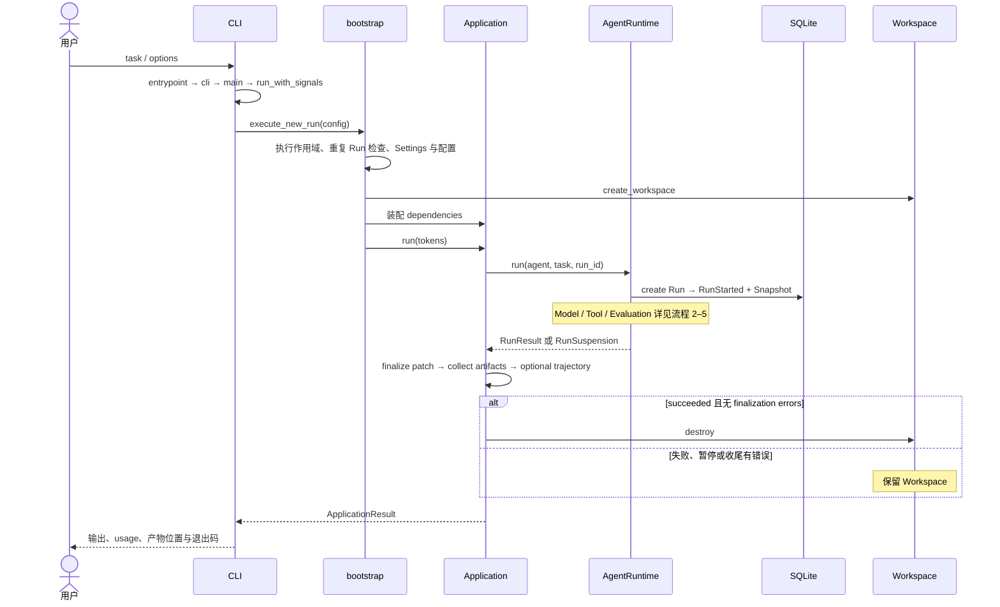
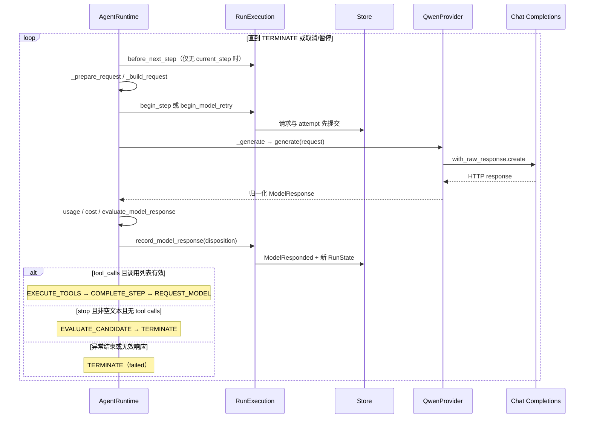
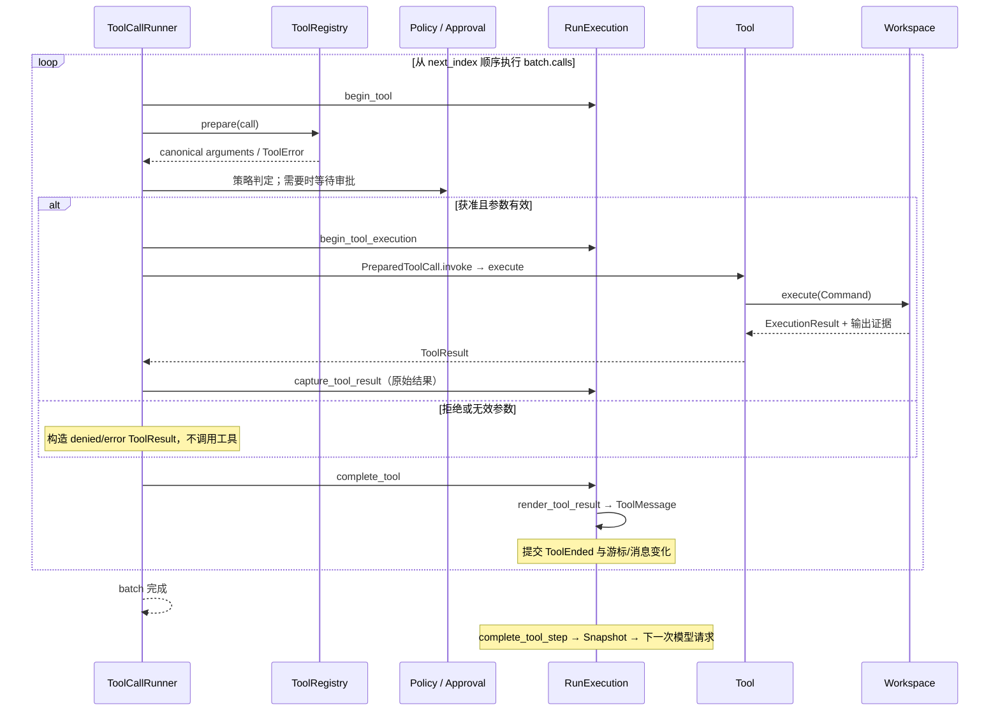
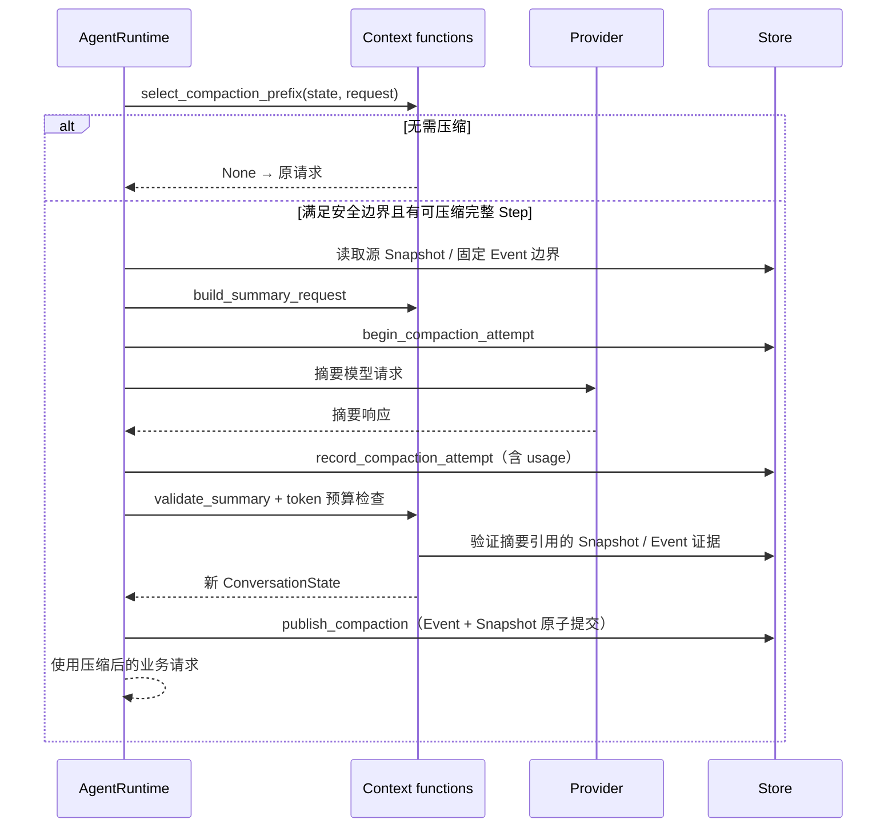
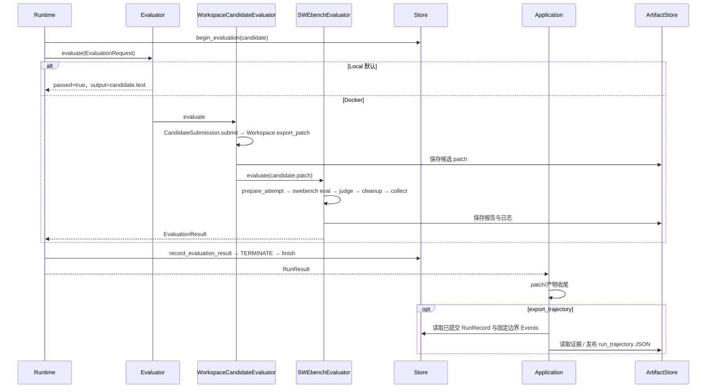

# 执行流程：从任务到结果

[架构总览](overview.md) · [数据与状态](data-flows.md)

范围与证据约定同总览：基于 2026-10-23 工作树静态核对。以下五条路径是当前主路径的不同层次；Mermaid 中 Store 表示 Journal/Recorder 后面的 SQLite 提交，省略纯转换函数和日志。源码引用才是具体调用点。

## 1. 用户任务启动 → 最终交付（核心外层路径）

**触发**：`miniagent <task>` 或 `miniagent run <task>`。脚本入口注册于 [pyproject.toml:40](../../pyproject.toml#L40)。

| 顺序 | 真实调用与数据 | 证据 |
| --- | --- | --- |
| 1 | `entrypoint → cli → asyncio.run(main)`；main 解析配置，再通过 `run_with_signals` 调 `execute_new_run` | [main.py:266](../../src/miniagent/cli/main.py#L266)、[main.py:169](../../src/miniagent/cli/main.py#L169)、[main.py:98](../../src/miniagent/cli/main.py#L98) |
| 2 | `execute_new_run` 建立 application execution scope、检查 run_id 冲突，调用 `bootstrap` | [bootstrap.py:464](../../src/miniagent/cli/bootstrap.py#L464) |
| 3 | `bootstrap` 读取配置、创建 Workspace、Store、工具和 Evaluator；冻结 application/recovery 定义 | [bootstrap.py:248](../../src/miniagent/cli/bootstrap.py#L248)、[bootstrap.py:395](../../src/miniagent/cli/bootstrap.py#L395) |
| 4 | `Application.run → _execute → _execute_run → AgentRuntime.run`；创建 system/task 前缀和 RunState，调用 `RunExecution.start → _start` | [application.py:99](../../src/miniagent/cli/application.py#L99)、[loop.py:214](../../src/miniagent/runtime/loop.py#L214)、[execution.py:449](../../src/miniagent/runtime/execution.py#L449) |
| 5 | Runtime 返回后 `_finalize_patch`，再 `_export_trajectory`，然后按结果清理；若尚无候选提交，收尾使用 `finalize_diagnostic` 导出诊断 patch | [application.py:200](../../src/miniagent/cli/application.py#L200)、[application.py:306](../../src/miniagent/cli/application.py#L306) |
| 6 | `print_application_result → print_run_result` 输出结果；成功 Run 若收尾失败，CLI 仍返回失败退出码 | [main.py:138](../../src/miniagent/cli/main.py#L138)、[rendering.py:82](../../src/miniagent/cli/rendering.py#L82) |

**分支与异常**：Docker 必须具有 SWE-bench 任务上下文；预检失败发生在 Run 执行前。CLI 对准备、存储、执行状态未确认、Run 占用和配置错误有对应退出分支。Application 对 RunPersistenceError、ManagedExecutionError、InterruptionRequested 直接传播；其他 Runtime 异常先尝试 patch 收尾再重抛；外层异常路径仍尝试导出 trajectory。并非所有错误都会被包装成 RunResult。证据：[bootstrap.py:194](../../src/miniagent/cli/bootstrap.py#L194)、[main.py:106](../../src/miniagent/cli/main.py#L106)、[application.py:135](../../src/miniagent/cli/application.py#L135)、[application.py:190](../../src/miniagent/cli/application.py#L190)。

## 2. Agent Loop → Model Provider → 下一阶段（核心内层路径）

**触发**：新 Run 启动或恢复完成后进入 `AgentRuntime._drive`。循环读取 `state.execution.phase`，不是每次无条件调用模型。

调用顺序与控制点：

1. `_drive` 在 PREPARE/REQUEST_MODEL 且无 current_step 时检查连续失败与 max_steps；分别转为 `CONSECUTIVE_FAILURE_LIMIT` 或 `MAX_STEPS_REACHED`。默认阈值为 3 和 250。[loop.py:381](../../src/miniagent/runtime/loop.py#L381)、[execution.py:464](../../src/miniagent/runtime/execution.py#L464)、[config.py:28](../../src/miniagent/runtime/config.py#L28)。
2. `_request_model → _prepare_request`（流程 4）→ `begin_step`：递增 Step，创建 current_step、model attempt，持久化完整 ModelRequest 后才调用 Provider。已有 current_step 时进入重试路径，不新开 Step。[loop.py:899](../../src/miniagent/runtime/loop.py#L899)、[execution.py:681](../../src/miniagent/runtime/execution.py#L681)。
3. `QwenProvider.generate` 将内部 Message 和 ToolDefinition 转为 SDK 请求；返回首个 choice，解析工具参数、finish reason 与 usage。HTTP/连接错误转换为 Provider 错误；上下文超限单独分类。[qwen.py:70](../../src/miniagent/providers/qwen.py#L70)、[qwen.py:137](../../src/miniagent/providers/qwen.py#L137)、[qwen.py:198](../../src/miniagent/providers/qwen.py#L198)。
4. Runtime 计算价格并用 `evaluate_model_response` 判定：合法 tool_calls 继续；STOP + 无工具 + 非空文本进入评估；重复 call ID、缺少调用、length/content_filter/unknown 等转失败。[loop.py:1053](../../src/miniagent/runtime/loop.py#L1053)、[termination.py:22](../../src/miniagent/runtime/termination.py#L22)。
5. `record_model_response → accept_model_response` 追加 assistant 消息、累计有效 usage、保存 disposition 与下一 phase；提交后才替换 execution.state。[execution.py:889](../../src/miniagent/runtime/execution.py#L889)、[transitions.py:126](../../src/miniagent/runtime/transitions.py#L126)。

**重试与终止**：可重试 Provider/timeout 错误走 `_wait_model_retry`；未配置重试或永久错误转 failed。Provider 上下文拒绝最多走一次业务 Context 重试，要求强制压缩确实发布新版本。响应归一化失败保留 evidence 后终止。CancellationRequested 返回 CANCELLED；InterruptionRequested 在剩余期限内保存 SUSPENDED 并返回 RunSuspension，期限耗尽则传播。证据：[loop.py:954](../../src/miniagent/runtime/loop.py#L954)、[loop.py:980](../../src/miniagent/runtime/loop.py#L980)、[loop.py:996](../../src/miniagent/runtime/loop.py#L996)、[loop.py:452](../../src/miniagent/runtime/loop.py#L452)。

## 3. Tool Calling → Workspace → 模型观察（核心内层路径）

**触发**：合法工具响应已提交，phase 为 EXECUTE_TOOLS，`ToolBatch.next_index` 指向未完成调用。

| 阶段 | 调用、分支与结果 | 证据 |
| --- | --- | --- |
| 选择/校验 | Runner 遍历 batch；先查 Agent allowed_tools，再 `ToolRegistry.prepare`；参数按 Pydantic strict=True 校验，形成 canonical_arguments | [tool_runner.py:89](../../src/miniagent/runtime/tool_runner.py#L89)、[registry.py:36](../../src/miniagent/tools/registry.py#L36) |
| 授权 | `_decide_policy` 构造 PolicyRequest 并持久化决定；deny 生成拒绝结果，approval 调 `ApprovalCoordinator.authorize`，allow 执行 | [tool_runner.py:144](../../src/miniagent/runtime/tool_runner.py#L144)、[tool_runner.py:194](../../src/miniagent/runtime/tool_runner.py#L194) |
| 执行 | `_execute_prepared → begin_tool_execution → prepared.invoke → tool.execute`；Shell 转 `/bin/sh -lc`，read_file 通过 Workspace 中的 Python 读取，检查路径与编码 | [tool_runner.py:222](../../src/miniagent/runtime/tool_runner.py#L222)、[shell.py:45](../../src/miniagent/tools/shell.py#L45)、[read_file.py:42](../../src/miniagent/tools/read_file.py#L42) |
| Workspace | Local/Docker 的 execute 打开 OutputCapture，再执行命令，返回 ExecutionResult；工具层转换执行状态、stdout/stderr 与 artifact 引用 | [local.py:693](../../src/miniagent/environments/local.py#L693)、[docker.py:834](../../src/miniagent/environments/docker.py#L834)、[shell.py:59](../../src/miniagent/tools/shell.py#L59) |
| 原始值与观察 | 原始 ToolResult 先捕获，再校验 call_id/错误码；`complete_tool` 将有效结果按限制渲染成 JSON ToolMessage，提交 ToolEnded、raw_result、observation，推进 next_index | [tool_runner.py:279](../../src/miniagent/runtime/tool_runner.py#L279)、[execution.py:1338](../../src/miniagent/runtime/execution.py#L1338)、[execution.py:1386](../../src/miniagent/runtime/execution.py#L1386) |
| 完成 Step | 从 Store 读取该 Step 工具结果验证批次一致性，再记录 StepCompleted 与 Snapshot；全部工具非成功才算失败 Step，任一成功会重置连续失败计数 | [execution.py:990](../../src/miniagent/runtime/execution.py#L990)、[termination.py:83](../../src/miniagent/runtime/termination.py#L83)、[transitions.py:207](../../src/miniagent/runtime/transitions.py#L207) |

**异常边界**：普通工具异常变为 `TOOL_EXECUTION_EXCEPTION` 观察；非法返回类型或关联 ID 变为无效结果。取消、中断、持久化和 ManagedExecutionError 传播，不伪装为普通工具失败。观察无法渲染时终止为 `TOOL_OBSERVATION_UNAVAILABLE`。一次普通工具错误不必立即终止整个 Run。[tool_runner.py:248](../../src/miniagent/runtime/tool_runner.py#L248)、[execution.py:1411](../../src/miniagent/runtime/execution.py#L1411)。

## 4. Message 更新 → Context 压缩 → 新请求（条件触发的辅助路径）

**常规更新**：每轮 assistant 响应与每个 ToolMessage 追加到 conversation；下一请求由 `_build_request` 深拷贝 conversation、工具定义和 generation，校验固定前缀与持久化工具契约一致。[transitions.py:136](../../src/miniagent/runtime/transitions.py#L136)、[transitions.py:177](../../src/miniagent/runtime/transitions.py#L177)、[loop.py:1169](../../src/miniagent/runtime/loop.py#L1169)。

调用顺序：`_prepare_request → select_compaction_prefix → build_summary_request → should_compact → begin_compaction_attempt / _generate / record_compaction_attempt → validate_summary → publish_compaction`。证据：[loop.py:484](../../src/miniagent/runtime/loop.py#L484)、[loop.py:559](../../src/miniagent/runtime/loop.py#L559)、[loop.py:737](../../src/miniagent/runtime/loop.py#L737)、[loop.py:778](../../src/miniagent/runtime/loop.py#L778)。

- 输入预算 `B = C - O - S`，S 为 `max(1024, ceil(0.05*C))`。超过软阈值还需收益判断；超过 B 或强制压缩为 hard trigger。[context.py:63](../../src/miniagent/runtime/context.py#L63)、[context.py:189](../../src/miniagent/runtime/context.py#L189)。
- 只在 RUNNING/request-model、无活跃工具批次和 pending approval 时选择完整旧 Step；保留最近配置数量的 Step，校验 assistant/tool 成组对应。[context.py:97](../../src/miniagent/runtime/context.py#L97)。
- 摘要必须是无工具调用的 STOP JSON，符合 CompactionSummary，并验证 verified_evidence 的来源；新 conversation 为 system、task、摘要 AssistantMessage、保留尾部，重算 StepRange。[context.py:456](../../src/miniagent/runtime/context.py#L456)。
- 发布增加 context.current_version；CompactionCompleted 关联源/新 Snapshot，提交 Snapshot 与 Event 同一事务。[journal.py:123](../../src/miniagent/runtime/journal.py#L123)、[journal.py:207](../../src/miniagent/runtime/journal.py#L207)、[sqlite.py:607](../../src/miniagent/storage/sqlite.py#L607)。

**失败/退出**：摘要请求按 compaction_max_retries 有界重试；无可压缩完整旧 Step、固定前缀/保留内容超限可触发 ContextCapacityError。摘要失败或校验失败时，软压缩回到原请求，硬压缩终止；取消继续传播。压缩不会删除已持久化历史 Events。[loop.py:526](../../src/miniagent/runtime/loop.py#L526)、[loop.py:572](../../src/miniagent/runtime/loop.py#L572)、[loop.py:769](../../src/miniagent/runtime/loop.py#L769)、[context.py:122](../../src/miniagent/runtime/context.py#L122)。

## 5. Candidate → Evaluation → Trajectory（核心评估 + 可选导出）

**触发**：模型有效 STOP 文本进入 EVALUATE_CANDIDATE。评估是终态前的业务步骤；trajectory 是 Application 收尾阶段的可选投影。

1. `_evaluate → begin_evaluation → evaluator.evaluate`，传入 run_id、task、CandidateOutput；通过 observer scope 收集评估进度与执行事实。[loop.py:1123](../../src/miniagent/runtime/loop.py#L1123)。
2. Local 的 PassThrough 原样接受候选，不跑测试。Docker 包装器先提交 patch，只有 submitted 才交给 SWEbenchEvaluator；提交失败返回 failed EvaluationResult。[passthrough.py:4](../../src/miniagent/evaluation/passthrough.py#L4)、[candidate_submission.py:379](../../src/miniagent/cli/candidate_submission.py#L379)。
3. `SWEbenchEvaluator.evaluate → prepare_attempt → _evaluate_attempt`；运行 `swebench eval task.json --predictions predictions.jsonl ...`，随后 `_judge` 检查退出码、报告、patch/prediction 一致性和 resolved；再 cleanup、collect。评估结果包含 artifact 引用。[swebench.py:490](../../src/miniagent/evaluation/swebench.py#L490)、[swebench.py:547](../../src/miniagent/evaluation/swebench.py#L547)、[swebench.py:265](../../src/miniagent/evaluation/swebench.py#L265)、[swebench.py:659](../../src/miniagent/evaluation/swebench.py#L659)。
4. `record_evaluation_result` 保存结果与 TerminateDisposition：通过为 TASK_VERIFIED，未通过为 EVALUATION_FAILED；final output 优先 evaluator.output，否则候选文本。当前路径评估不通过后终止，不把失败报告再投入 Agent 修复循环。[execution.py:1191](../../src/miniagent/runtime/execution.py#L1191)、[loop.py:424](../../src/miniagent/runtime/loop.py#L424)。
5. Application `_export_trajectory → try_export_trajectory → encode_trajectory → ArtifactStore.put`。编码使用冻结定义及 `last_event_sequence`，读取 Events 每页最多 16 条；JSON 上限 64 MiB，受 deadline 限制。[application.py:278](../../src/miniagent/cli/application.py#L278)、[cli/trajectory.py:105](../../src/miniagent/cli/trajectory.py#L105)、[trajectory/export.py:28](../../src/miniagent/trajectory/export.py#L28)、[history.py:8](../../src/miniagent/runtime/history.py#L8)。

**异常/终止**：普通 Evaluator 异常成为 EVALUATOR_EXCEPTION；取消、中断、RunPersistenceError、ManagedExecutionError 传播。SWE-bench 有进程超时、清理和产物收集分支；实际报告是否通过待真实运行验证。Trajectory 读取不到安全提交边界返回 skipped，编码/发布失败返回 failed，均不替换 Run 结果。[loop.py:1146](../../src/miniagent/runtime/loop.py#L1146)、[swebench.py:645](../../src/miniagent/evaluation/swebench.py#L645)、[cli/trajectory.py:129](../../src/miniagent/cli/trajectory.py#L129)。

## 辅助入口：恢复与观察

恢复不是重新创建 Run：`resume_cli → _resume_main → resume_application → _inspect / plan_resume`，dry-run 在写恢复事件前返回；正常路径 attach 原 Workspace、完成恢复提交，再 `Application.resume → AgentRuntime.resume → _drive`。Runtime 要求最新事件为有效的 ResumeCompleted，且没有未关闭 operation/recovery session。结果未知的工具只有声明 `retry_read_only` 才允许重试；否则拒绝自动继续。证据：[main.py:233](../../src/miniagent/cli/main.py#L233)、[cli/resume.py:475](../../src/miniagent/cli/resume.py#L475)、[cli/resume.py:579](../../src/miniagent/cli/resume.py#L579)、[cli/resume.py:775](../../src/miniagent/cli/resume.py#L775)、[loop.py:266](../../src/miniagent/runtime/loop.py#L266)、[runtime/resume.py:373](../../src/miniagent/runtime/resume.py#L373)。

Dashboard 是独立观察入口，不在上述业务调度链中；其页面依赖现有数据库查询和 ArtifactReader。[dashboard/app.py:18](../../src/miniagent/dashboard/app.py#L18)。
