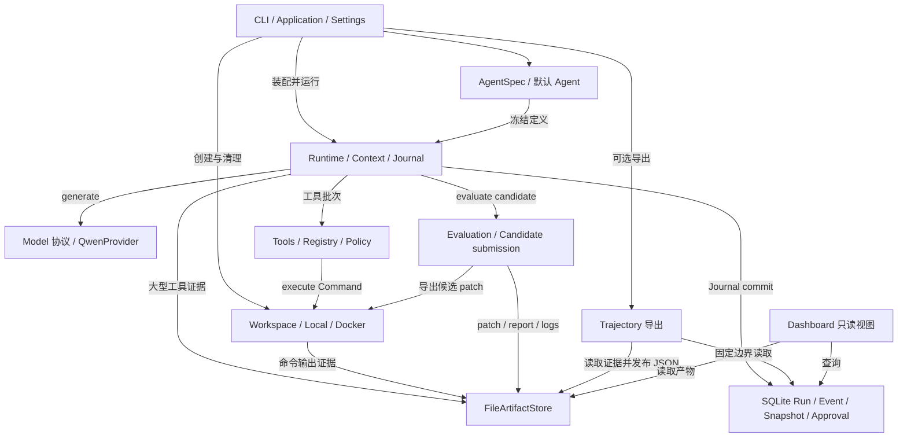

# miniAgent 架构总览

阅读顺序：本页 → [执行流程](execution-flows.md) → [数据与状态](data-flows.md)。

## 1. 范围与证据

本文基于 **2026-10-23 工作树，HEAD `6acaff0`** 的静态分析。先使用现有 graphify 图定位符号，再核对实际源码；图查询的截断结果仅用于导航，不作为完整调用关系证明。源码链接显示 `file:line`，行号对应本次工作树。未运行模型服务、Docker 或 SWE-bench，不将外部服务的实际可用性视作已验证。

- **事实**：以下未额外标注的行为，均由邻近源码引用直接确认。
- **归纳**：架构图按职责合并文件，箭头表示主要调用、注入或读取关系，不代表每两个模块之间都存在唯一调用点。
- **待验证**：真实 API 返回、进程/容器行为和基准测试结果需要实际运行；文末列出范围。

miniAgent 的核心单位是一次 **Run**：CLI 装配 Agent、Provider、工具和 Workspace；Runtime 驱动有界 Step、维护状态与运行证据；模型的最终文本先作为候选交给 Evaluator；Application 再收集产物并决定是否清理 Workspace。证据：[cli/application.py:155](../../src/miniagent/cli/application.py#L155)、[runtime/loop.py:356](../../src/miniagent/runtime/loop.py#L356)。

## 2. 高层模块图

图中装配边来自 [bootstrap.py:281](../../src/miniagent/cli/bootstrap.py#L281)；模型、工具、评估调度来自 [loop.py:381](../../src/miniagent/runtime/loop.py#L381)；存储提交来自 [journal.py:236](../../src/miniagent/runtime/journal.py#L236)；产物及导出来自 [execution.py:1338](../../src/miniagent/runtime/execution.py#L1338)、[cli/trajectory.py:105](../../src/miniagent/cli/trajectory.py#L105)。Dashboard 依赖组见 [dashboard/app.py:18](../../src/miniagent/dashboard/app.py#L18)。

## 3. 模块边界与定位

| 模块 | 职责、主要接口与调用方向 | 源码入口 |
| --- | --- | --- |
| CLI / Application | `entrypoint` 选择命令；`bootstrap` 创建依赖；`Application.run/resume` 调 Runtime，再做 patch/产物交付和 Workspace 清理 | [main.py:266](../../src/miniagent/cli/main.py#L266)、[bootstrap.py:181](../../src/miniagent/cli/bootstrap.py#L181)、[application.py:99](../../src/miniagent/cli/application.py#L99) |
| Agent 定义 | `AgentSpec` 提供名称、system prompt、模型目标、generation 和允许工具；本身不驱动循环 | [agents/spec.py:10](../../src/miniagent/agents/spec.py#L10) |
| Runtime | `AgentRuntime.run/resume` 是控制入口；`_drive` 按持久化 phase 调度；`RunExecution` 组织状态变化和 Event；`RunJournal` 决定提交与 Snapshot 边界 | [loop.py:196](../../src/miniagent/runtime/loop.py#L196)、[loop.py:266](../../src/miniagent/runtime/loop.py#L266)、[execution.py:202](../../src/miniagent/runtime/execution.py#L202)、[journal.py:207](../../src/miniagent/runtime/journal.py#L207) |
| Model / Provider | `ModelProvider.generate(ModelRequest) -> ModelResponse` 隔离外部协议；`QwenProvider` 转换消息、工具 JSON 和 usage，调用 OpenAI-compatible Chat Completions | [models/protocol.py:102](../../src/miniagent/models/protocol.py#L102)、[providers/qwen.py:137](../../src/miniagent/providers/qwen.py#L137) |
| Tools / Policy | Registry 负责定义和严格参数验证；Runner 处理允许列表、策略、审批和结果回填；工具把操作转成 Workspace Command。策略合并优先级为 deny > approval > allow | [tools/registry.py:36](../../src/miniagent/tools/registry.py#L36)、[runtime/tool_runner.py:80](../../src/miniagent/runtime/tool_runner.py#L80)、[policy/engine.py:37](../../src/miniagent/policy/engine.py#L37) |
| Workspace | `WorkspaceBackend.create/attach/recover` 管实例；`Workspace.execute/export_patch/destroy` 管执行与资源。Local 创建独立源文件副本和 baseline；Docker 用容器实例 | [environments/contracts.py:84](../../src/miniagent/environments/contracts.py#L84)、[environments/local.py:93](../../src/miniagent/environments/local.py#L93)、[environments/docker.py:319](../../src/miniagent/environments/docker.py#L319) |
| Evaluation | `Evaluator.evaluate` 判定候选；Local 为 PassThrough；Docker 由 `WorkspaceCandidateEvaluator` 先提交 patch，再调用独立 SWE-bench harness | [evaluation/contracts.py:67](../../src/miniagent/evaluation/contracts.py#L67)、[bootstrap.py:289](../../src/miniagent/cli/bootstrap.py#L289)、[candidate_submission.py:379](../../src/miniagent/cli/candidate_submission.py#L379) |
| Storage / Artifacts | `RuntimeStore` 的 SQLite 实现保存最新 Run、Events、Snapshots、Approvals；`ArtifactStore` 保存字节内容和 manifest，调用方持有 `ArtifactRef` | [storage/sqlite.py:107](../../src/miniagent/storage/sqlite.py#L107)、[storage/sqlite.py:607](../../src/miniagent/storage/sqlite.py#L607)、[artifacts/contracts.py:71](../../src/miniagent/artifacts/contracts.py#L71)、[artifacts/file.py:24](../../src/miniagent/artifacts/file.py#L24) |
| Trajectory | 从已提交 Run 边界编码运行定义、汇总、Event 和证据关联，发布 `run_trajectory` JSON；不驱动 Agent 执行 | [trajectory/export.py:115](../../src/miniagent/trajectory/export.py#L115)、[cli/trajectory.py:149](../../src/miniagent/cli/trajectory.py#L149) |
| Dashboard | 独立 FastAPI 应用，组合查询、页面和 ArtifactReader；读取现有运行信息 | [dashboard/app.py:11](../../src/miniagent/dashboard/app.py#L11)、[pyproject.toml:40](../../pyproject.toml#L40) |

### 核心抽象与当前实现

| 抽象 | 当前主路径实现 | 装配证据 |
| --- | --- | --- |
| `ModelProvider` | `QwenProvider`；provider 标识只接受 `qwen`，模型名称另行配置 | [bootstrap.py:109](../../src/miniagent/cli/bootstrap.py#L109) |
| `Tool` / `ToolRegistry` | `ReadFileTool`、`ShellTool` | [bootstrap.py:118](../../src/miniagent/cli/bootstrap.py#L118) |
| `WorkspaceBackend` / `Workspace` | Local 与 Docker 的 backend、实例 | [bootstrap.py:132](../../src/miniagent/cli/bootstrap.py#L132) |
| `Evaluator` | `PassThroughEvaluator` 或 `WorkspaceCandidateEvaluator(SWEbenchEvaluator)` | [bootstrap.py:289](../../src/miniagent/cli/bootstrap.py#L289) |
| `RuntimeStore` / `ArtifactStore` | `SQLiteRunStore` / `FileArtifactStore`，Runtime 的构造注入两者 | [bootstrap.py:282](../../src/miniagent/cli/bootstrap.py#L282)、[bootstrap.py:310](../../src/miniagent/cli/bootstrap.py#L310)、[application.py:164](../../src/miniagent/cli/application.py#L164) |

## 4. 配置如何改变执行

| 输入 | 影响与边界 | 证据 |
| --- | --- | --- |
| CLI task、`--model`、`--workspace`、`--docker-image` | 生成 `BootstrapConfig`；源目录为当前目录；默认 Agent 为 qwen / qwen3.8-flash，允许 read_file 与 shell | [main.py:67](../../src/miniagent/cli/main.py#L67)、[main.py:148](../../src/miniagent/cli/main.py#L148)、[default_agent.py:13](../../src/miniagent/agents/default_agent.py#L13) |
| `.env` / Settings | API key/base URL、Workspace backend、数据库和产物路径、SWE-bench 数据与超时 | [settings.py:8](../../src/miniagent/cli/settings.py#L8)、[settings.py:21](../../src/miniagent/cli/settings.py#L21) |
| 模型 limits TOML | 按 provider/model 读取 context window 与输出上限；bootstrap 用 limits 覆盖 Agent 的 max_output_tokens | [bootstrap.py:248](../../src/miniagent/cli/bootstrap.py#L248) |
| pricing TOML | 读取所选模型价格并冻结为本次运行的 PriceConfig；响应 usage 用于计费 | [bootstrap.py:313](../../src/miniagent/cli/bootstrap.py#L313)、[loop.py:1091](../../src/miniagent/runtime/loop.py#L1091) |
| RuntimeConfig | 默认最多 250 Steps、3 个连续失败工具 Step；Context 软触发比例 0.70、目标 0.50、保留最近 3 Steps；工具观察默认 content 16 KiB、message 32 KiB | [runtime/config.py:23](../../src/miniagent/runtime/config.py#L23)、[tools/contracts.py:78](../../src/miniagent/tools/contracts.py#L78) |
| ModelRetryConfig | CLI 显式启用 Runtime 模型重试；默认连续失败上限 5、时间窗 900 秒；Provider SDK 自带重试设为 0。直接构造 RuntimeConfig 时 model_retry 默认 None | [bootstrap.py:253](../../src/miniagent/cli/bootstrap.py#L253)、[runtime/config.py:11](../../src/miniagent/runtime/config.py#L11)、[qwen.py:64](../../src/miniagent/providers/qwen.py#L64) |
| `--trajectory/--no-trajectory` | 优先于 Settings.export_trajectory，后者默认 false；选择冻结到 application definition，恢复沿用 | [bootstrap.py:183](../../src/miniagent/cli/bootstrap.py#L183)、[bootstrap.py:361](../../src/miniagent/cli/bootstrap.py#L361)、[cli/resume.py:831](../../src/miniagent/cli/resume.py#L831) |
| Docker / SWE-bench | Docker 分支必须提供内部 `swebench_task`；预检数据、harness、Docker 连接、镜像。单独给普通 CLI 一个 Docker image 不满足任务上下文要求 | [bootstrap.py:194](../../src/miniagent/cli/bootstrap.py#L194) |

依赖角色：Python 要求 `>=3.13`；Typer 是 CLI；Pydantic/Settings 定义与校验结构数据；OpenAI SDK 是 Provider 客户端；orjson 编码协议数据；Jinja 渲染压缩摘要。Dashboard 的 FastAPI/Uvicorn 是 optional extra。证据：[pyproject.toml:9](../../pyproject.toml#L9)、[qwen.py:8](../../src/miniagent/providers/qwen.py#L8)、[context.py:493](../../src/miniagent/runtime/context.py#L493)。

## 5. 核心路径与辅助能力

**核心路径**是启动 → Model / Tool Step 循环 → Evaluator → Run 终态 → Application 交付。SQLite 与 ArtifactStore 是这条路径的基础设施，不依赖 trajectory 导出开关。详见[五条执行流程](execution-flows.md)。

**辅助能力**包括跨进程 resume、策略审批、Context 压缩、可选 trajectory 和 Dashboard：它们分别在恢复、命中审批规则、达到 Context 条件、启用导出或启动 Dashboard 时参与。恢复入口是 `resume_application`，它先检查并生成计划，`--dry-run` 返回计划；正常恢复最终调用 `Application.resume`。证据：[cli/resume.py:475](../../src/miniagent/cli/resume.py#L475)、[cli/resume.py:846](../../src/miniagent/cli/resume.py#L846)。

**不要把契约当作已接入的主路径**：`RecoveryController.decide` 在这里是 Protocol；当前跨进程恢复使用 resume 模块。`RunTrace` 是 span 聚合数据契约，当前 trajectory 导出直接消费 RunRecord 和 Events，没有经过 RunTrace。依据为 [recovery.py:172](../../src/miniagent/runtime/recovery.py#L172)、[tracing.py:118](../../src/miniagent/runtime/tracing.py#L118)、[trajectory/export.py:115](../../src/miniagent/trajectory/export.py#L115)。这描述已核对调用链，不推断所有契约都已有执行策略。

### 静态分析的验证边界

待验证事项为：当前环境的 API 凭证与 endpoint 是否有效、模型是否按约定返回 usage/tool calls、Docker daemon 与镜像是否可用、SWE-bench 实际是否通过，以及真实信号/进程退出时序。本文确认的是处理这些情况的源码分支，不是一次真实运行的结论。尤其 Local 的 PassThrough 只是接受候选文本，不执行独立正确性测试：[passthrough.py:4](../../src/miniagent/evaluation/passthrough.py#L4)。
