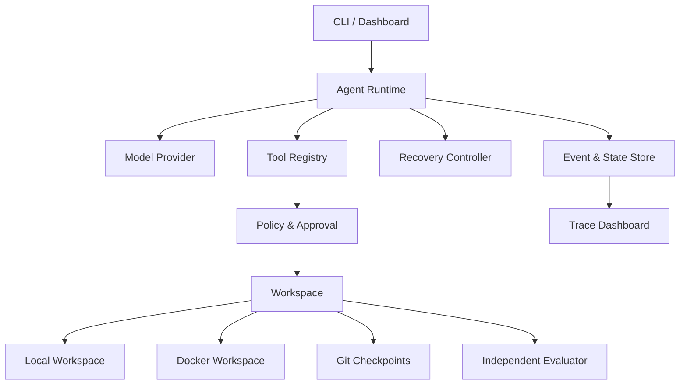

# Recoverable Coding Agent 项目设计与学习路线

> 面向拥有 8 年测试开发与质量保障经验、准备转向 Agent 应用开发和可靠性工程的求职项目。

## 1. 项目定位

项目名称暂定：**Recoverable Coding Agent（RCA）**。

RCA 接收真实 GitHub Issue，在隔离的代码工作区内自主完成代码搜索、问题诊断、补丁修改和测试验证。与普通 Coding Agent 不同，RCA 将可恢复执行作为核心能力：它能够识别 API、工具和 Agent 行为异常，保存状态、回滚无效修改、压缩上下文，并在进程重启后继续任务。

项目不是 mini-swe-agent 的 Fork。开发方式是先分析其最小 Agent Loop，再建立独立代码仓库，自行设计 Runtime、Workspace、工具协议、恢复控制器与评测系统。

### 1.1 职业价值

项目需要同时证明四件事：

1. 能独立开发 Agent，而不只是调用现成框架。
2. 能把 LLM 决策转化为受控、可观测的真实执行。
3. 能设计状态、恢复、安全、审批和隔离机制。
4. 能通过固定任务集和客观测试证明工程改进有效。

推荐在简历中定位为：

> 独立设计并开发可恢复的软件工程 Agent Runtime，在 Docker 隔离环境中完成真实 GitHub Issue 的自主诊断、代码修改与测试验证；通过事件溯源、检查点、停滞检测、回滚和上下文压缩提高任务可靠性，并在固定 SWE-bench 任务集上进行可复现实验。

## 2. V1 目标与非目标

### 2.1 V1 目标

- 单 Agent 能在 Local Workspace 或 Docker Workspace 中完成 Issue → Patch → Test 闭环。
- Agent 使用结构化工具，受限 Shell 作为兜底。
- Runtime 不依赖 OpenAI Agents SDK、LangGraph 等 Agent 框架。
- 支持 Provider/API、Tool、Agent 行为和 Workspace 修改异常的分级恢复。
- 使用 SQLite 保存事件、状态快照和审批状态。
- 使用 Git Checkpoint 保存、回滚和重建代码工作区。
- 进程重启后能从最近安全边界继续执行。
- 使用固定 SWE-bench 子集进行 Baseline 与 Recoverable 对照实验。
- 提供 CLI 和只读 Trace Dashboard。
- 公开核心代码、架构决策和脱敏实验结果。

### 2.2 V1 明确排除

- 多 Agent 协作。
- 完整 Web 管理平台。
- Firecracker microVM 后端实现。
- MCP 工具适配器实现。
- Temporal、Kafka 或分布式 Worker。
- 向量数据库和跨任务长期记忆。
- 多语言批量评测。
- 自动 Push 或创建真实 Pull Request。
- 全量 SWE-bench 排名。

## 3. 总体架构



核心原则：

- **模型负责语义决策，Runtime 负责可靠执行。**
- **Agent 的自述不作为成功判定，测试结果才是最终证据。**
- **工作区状态、Runtime 状态和事件审计分别持久化。**
- **所有外部副作用必须跨越明确的策略与审批边界。**

## 4. 一次任务的执行流程

1. CLI 接收 SWE-bench Task ID 或自定义 Issue。
2. Task Loader 解析仓库版本、Issue 描述、测试配置和资源预算。
3. WorkspaceBackend 根据运行配置创建 Run 独占的 LocalWorkspace 目录或 DockerWorkspace 容器，并准备固定版本代码。
4. Runtime 初始化 `RunState`、Working Context 和 Task Memory。
5. Model Provider 返回文本响应或结构化工具调用。
6. Tool Registry 校验工具名称和输入 Schema。
7. Policy Engine 判断允许、拒绝或进入 `WAITING_APPROVAL`。
8. Tool Executor 在 Workspace 中执行，并输出结构化结果。
9. Event Store 记录模型、工具、文件、测试、恢复和成本事件。
10. Recovery Controller 检测重试、停滞、预算和上下文条件。
11. Agent 生成候选 Patch 后，Independent Evaluator 执行验证。
12. 保存 Patch、Trace、测试报告、指标和最终状态，销毁工作区。

## 5. 模块设计

### 5.1 Agent Runtime

Runtime 是项目核心，不应与具体模型、工具或 Docker SDK 耦合。

主要职责：

- Agent Loop 和状态机。
- Working Context 构建。
- 模型调用与工具调用分发。
- 轮数、时间、Token 和费用预算。
- Recovery Controller 调度。
- Checkpoint、审批、中断和恢复。
- 终止条件与最终结果组装。

建议状态：

```text
CREATED
  → PREPARING
  → RUNNING
  → WAITING_APPROVAL
  → RECOVERING
  → EVALUATING
  → SUCCEEDED | FAILED | CANCELLED
```

终止条件必须由 Runtime 判定：

- 独立验证通过。
- Agent 调用 `finish` 且验证完成。
- 达到最大轮数、总时长、Token 或费用预算。
- 恢复阶梯耗尽。
- 用户取消或审批拒绝。

### 5.2 Model Provider

首版实现一个 OpenAI-compatible Provider，但 Runtime 只依赖统一接口。

```python
class ModelProvider(Protocol):
    async def generate(self, request: ModelRequest) -> ModelResponse: ...
```

统一响应至少包含：

- Assistant message。
- Tool calls。
- Finish reason。
- Token usage。
- Provider request ID。
- 延迟和错误类型。

Provider 层负责协议差异、超时、限流识别和基础网络重试；不负责 Agent 行为重试。

### 5.3 Tool Registry

当前只有 `read_file` 和 `shell` 接入执行链。Tool Registry、执行前 Schema 校验、
Workspace 输出采集截断、模型消息截断和结构化错误 JSON 已接入 Runtime。

四项能力的数据结构、职责、消息大小上限和迁移方案见
[Tool 契约设计](tool-contract-design.md)。以下工具列表为路线图，
不表示已经全部注册。

目标工具控制在 8 个左右：

| 工具 | 作用 |
|---|---|
| `list_files` | 浏览目录和文件元数据 |
| `search_code` | 使用 ripgrep 搜索代码 |
| `read_file` | 按行或窗口读取文件 |
| `apply_patch` | 受控修改文件 |
| `run_tests` | 按 ProjectProfile 执行测试 |
| `git_diff` | 查看当前修改 |
| `shell_exec` | 受限命令兜底 |
| `finish` | 提交候选结果并触发验证 |

统一工具接口使用参数模型生成 Schema 并执行严格校验：

```python
class Tool(ABC):
    arguments_model: type[ToolArguments]

    @property
    @abstractmethod
    def definition(self) -> ToolDefinition: ...

    @abstractmethod
    async def execute(
        self,
        arguments: dict[str, Any],
        *,
        tool_call_id: str,
    ) -> ToolResult: ...
```

`ToolResult` 不只返回字符串，应包含：

- `status`：success/error/timeout/denied。
- `content`：适合放入模型上下文的结果文本，发送前执行大小限制。
- `data`：工具特定的结构化数据。
- `artifacts`：已实际保存的输出引用；不保证被采集层丢弃的内容可恢复。
- `metrics`：耗时、退出码、输出大小。
- `workspace_delta`：修改文件和 Git 状态。
- `error`：结构化错误类型和是否可重试。
- `output`：采集截断标志和模型消息裁剪信息。

Registry 负责注册和参数校验；Runtime 保留执行与取消职责，将结果投影为有界 JSON
工具消息。执行状态和输出完整性独立表达，详细约束以上述 Tool 契约设计为准。

### 5.4 WorkspaceBackend

Workspace 是 Run 独占的代码状态边界。每个 Run 同一时间最多有一个活动 Workspace；恢复时可以创建替代 Workspace，但新旧 Workspace 不得同时接受命令。不同 Backend 的隔离强度不同：LocalWorkspace 只隔离文件状态，DockerWorkspace 额外提供容器安全和资源边界。

```python
class Workspace(Protocol):
    @property
    def workspace_id(self) -> str: ...

    @property
    def run_id(self) -> UUID: ...

    async def execute(self, command: Command) -> ExecutionResult: ...
    async def checkpoint(self) -> WorkspaceCheckpoint: ...
    async def restore(self, checkpoint: WorkspaceCheckpoint) -> None: ...
    async def export_patch(self) -> Patch: ...
    async def destroy(self) -> None: ...


class WorkspaceBackend[SpecT](Protocol):
    async def create(self, spec: SpecT) -> Workspace: ...

    async def recover(
        self,
        spec: SpecT,
        checkpoint: WorkspaceCheckpoint,
    ) -> Workspace: ...
```

V1 实现 `LocalWorkspace` 和 `DockerWorkspace`。CLI 默认使用 LocalWorkspace，正式 SWE-bench 评测和不受信任代码执行必须显式使用 DockerWorkspace。V2 可实现 `FirecrackerWorkspace`。Wasm 不作为完整代码工作区，可以在以后作为受限 Tool Plugin Runtime。

#### 5.4.1 Workspace 选择与公共数据结构

外部配置使用带判别字段的 Pydantic 模型。Backend 的运行时对象使用 dataclass，并实现统一的 Workspace 协议。

```python
class WorkspaceKind(StrEnum):
    LOCAL = "local"
    DOCKER = "docker"


class LocalWorkspaceSpec(BaseModel):
    model_config = ConfigDict(frozen=True)

    kind: Literal[WorkspaceKind.LOCAL] = WorkspaceKind.LOCAL
    run_id: UUID
    source_dir: Path
    environment: dict[str, str] = Field(default_factory=dict)


class DockerWorkspaceSpec(BaseModel):
    model_config = ConfigDict(frozen=True)

    kind: Literal[WorkspaceKind.DOCKER] = WorkspaceKind.DOCKER
    run_id: UUID
    image: str
    workdir: str = "/testbed"
    user_policy: ContainerUserPolicy = ContainerUserPolicy.INHERIT
    environment: dict[str, str] = Field(default_factory=dict)
    network_enabled: bool = False
    limits: ResourceLimits = Field(default_factory=ResourceLimits)


type WorkspaceSpec = Annotated[
    LocalWorkspaceSpec | DockerWorkspaceSpec,
    Field(discriminator="kind"),
]


class WorkspaceSettings(BaseSettings):
    workspace_backend: WorkspaceKind = WorkspaceKind.LOCAL
    local_workspace_root: Path = Path.home() / ".miniagent" / "workspaces"
```

`run_id` 必须先于 Workspace 创建。CLI bootstrap 根据运行参数构造 `WorkspaceConfig`，由异步 context manager 选择 Backend、管理 Workspace 生命周期，再把创建完成的 Workspace 注入 Tool Executor：

```python
@dataclass(frozen=True, slots=True)
class WorkspaceConfig:
    kind: WorkspaceKind
    run_id: UUID
    source_dir: Path
    settings: Settings
    docker_image: str | None = None


@asynccontextmanager
async def workspace(config: WorkspaceConfig) -> AsyncIterator[Workspace]:
    instance = await create_workspace(config)
    try:
        yield instance
    finally:
        await instance.destroy()
```

工具只依赖 Workspace 协议，不直接接收宿主机路径或 Docker 容器 ID。CLI 提供 `--workspace local|docker`，默认值为 `local`；Docker 所需镜像来自 Task 配置，而不是 LocalWorkspace 配置。

#### 5.4.2 LocalWorkspace

LocalWorkspace 用于可信代码的低成本开发和调试。它不是当前工作目录的别名，也不直接修改源仓库。Backend 在受管理根目录下为每次创建生成独立目录：

```text
<local_workspace_root>/<run_id>/<workspace_id>/repo
```

建议的内部状态：

```python
class LocalWorkspaceState(StrEnum):
    ACTIVE = "active"
    BROKEN = "broken"
    DESTROYED = "destroyed"


@dataclass(slots=True)
class LocalWorkspace:
    backend: LocalWorkspaceBackend
    spec: LocalWorkspaceSpec
    _workspace_id: str
    root: Path
    base_revision: str
    state: LocalWorkspaceState = LocalWorkspaceState.ACTIVE
    _operation_lock: asyncio.Lock = field(default_factory=asyncio.Lock)
```

生命周期与约束：

- `create` 要求 `source_dir` 是 Git 工作树根目录；复制当前 tracked 和未忽略的 untracked 文件，并在副本中创建合成 Git 基线。源工作树可以包含未提交修改，这些修改属于初始快照，不应出现在 Agent 导出的 Patch 中。
- `source_dir` 和 `local_workspace_root` 必须解析为绝对路径，且两者不能互相包含，避免复制递归和清理源仓库。
- `execute` 只接受参数数组；工作目录解析后必须位于 `root` 内。需要 Shell 语义时，由受策略控制的 Tool 显式执行 `/bin/sh -lc`。
- 命令超时后终止整个进程组并把 Workspace 标记为 `BROKEN`，避免遗留子进程继续修改文件。
- `checkpoint` 将工作区快照写入 Artifact Store；`recover` 在新的独占目录中恢复快照，并校验 `run_id`、revision 和内容摘要。
- `export_patch` 始终相对 `base_revision` 生成 Git binary patch；源仓库保持不变，只有 Patch 能跨越 Workspace 边界。
- `destroy` 只能删除 `local_workspace_root` 下且身份标记与 `run_id`、`workspace_id` 匹配的目录；路径校验失败时必须拒绝删除。
- 子进程环境使用最小宿主机环境加 `spec.environment`。这只能减少意外凭证暴露，不能构成安全隔离。

LocalWorkspace 不实现 capability、PID、CPU、内存或网络限制。它运行的进程仍能访问宿主机权限允许的路径和网络，因此只适用于可信仓库。若调用方为 LocalWorkspace 配置 Docker 专属限制，配置层必须明确拒绝，不能静默降级。

#### 5.4.3 DockerWorkspace

Docker 安全基线：

- 每次创建使用独立容器 writable layer；V1 不要求额外创建独立 Volume。
- 默认继承任务镜像用户；需要时可通过 `REQUIRE_NON_ROOT` 策略拒绝 root 镜像。
- `cap-drop=ALL` 和 `no-new-privileges`。
- CPU、内存、PID 和命令超时限制。
- 运行阶段默认关闭网络。
- 不挂载 Docker Socket、宿主机代码、SSH 配置或凭证。
- 依赖尽量预构建到任务镜像。
- 任务结束只导出 Patch、Trace 和测试 Artifact。

Rootless Docker 或 user namespace 是推荐的部署加固手段，不是 DockerWorkspace 创建成功的前置条件。DockerWorkspace 不提供磁盘配额；需要强多租户边界或磁盘硬限制时，应使用受管 Docker 部署或后续 FirecrackerWorkspace。

#### 5.4.4 Runtime 接入顺序

1. 先把 `run_id` 的生成移到 Workspace 创建之前，并把 Workspace 的创建失败映射为 `PREPARATION_FAILED`。
2. 实现 LocalWorkspace 的 create、execute、checkpoint、recover、export_patch 和 destroy，再以 Workspace 协议重写文件与 Shell 工具适配层。
3. CLI bootstrap 使用 `workspace(config)` 异步 context manager 管理 Workspace；退出 Run 时统一销毁，销毁失败必须显式上抛，避免静默泄漏工作区。
4. 增加 CLI backend 选择和配置校验，Local 为默认，Docker 为显式选择。
5. 使用同一组 Workspace 契约测试验证 Local 与 Docker；另外为 Local 增加源仓库不变、跨 Run 文件不可见、超时无遗留进程、越界目录拒绝和安全销毁测试。

### 5.5 ProjectProfile

首版只验证 Python 仓库，但配置保持语言无关：

```yaml
project:
  language: python
  setup_commands:
    - python -m pip install -e .
  test_commands:
    - pytest -q
  test_timeout_seconds: 600
  source_roots:
    - src
    - tests
```

以后增加 NodeProfile、GoProfile 时，不应修改 Agent Loop 和恢复逻辑。

### 5.6 Policy 与 Human-in-the-loop

沙箱内的读写、测试、Git Checkpoint 和回滚自动执行。下列行为需要审批：

- 开启网络。
- 安装未预置依赖。
- 访问额外宿主机路径。
- 提高资源或模型预算。
- 执行高风险 Shell 命令。
- Push、创建 PR 或调用其他有外部副作用的工具。

Policy 决策必须记录：规则 ID、风险级别、工具输入摘要、审批人、决定和时间。

### 5.7 Event Store、State Store 与 Run Trace

V1 使用 SQLite。完整大输出写入 Artifact 文件，数据库只保存引用和摘要。

四类信息的边界如下：

| 概念 | 权威内容 | 用途 |
|---|---|---|
| Run Event | 按 Run 严格排序的单条不可变事实 | 审计、解释和后续回放 |
| Run Snapshot | 已知 Event sequence 上的完整 Run State 副本 | 避免从头回放并加速恢复 |
| Artifact | 不适合放入数据库的大型不可变字节内容 | 保存 Patch、完整输出、报告、Checkpoint 和 Trace 导出 |
| Run Trace | 关联 Event 与 Trace Span 得到的可观测性视图 | 因果分析、耗时诊断、查询和展示 |

Run Trace 不是第四套事实存储。Event Store 是审计事实的权威来源；Run
Trace 是其结合 Span 关联信息形成的查询投影。Trace Artifact 是 Run Trace
的导出副本，不能替代 Event Store，也不能作为恢复 Run State 的依据。

事件至少包括：

```text
run_started
step_started
model_requested
model_responded
tool_start
tool_execution_start
tool_execution_end
tool_end
step_completed
file_changed
test_completed
retry_scheduled
stall_detected
checkpoint_created
rollback_completed
context_compacted
approval_requested
approval_resolved
run_finished
```

每条 Event 建议包含：

- `event_id`、`run_id`、`sequence`、`timestamp`。
- `event_type` 和可选的 `step_number`；`step_started` 到对应
  `step_completed` 之间的全部事件都携带该 Step 编号。
- 脱敏后的 payload。
- Artifact 引用。
- `span_id` 和 `parent_span_id`。

Trace 关联规则：

- Run Trace 与 Run 使用同一个 128-bit 身份；对外 Trace ID 是 `run_id` 的
  32 位小写十六进制表示，不在 Event 中重复保存 `trace_id`，也不增加
  `external_trace_id`。
- 模型请求、Tool Call、Workspace 命令和 Evaluation 等有耗时的操作各自形成
  Trace Span；相关 Event 携带 `span_id`，父子关系使用 `parent_span_id`。
- Event 不使用通用 `parent_event_id`。Tool Call、Approval、Checkpoint、Snapshot
  等领域关系由各自有语义的 ID 表达；Span 层级只表达逻辑归属关系，不要求父
  Span 的时间范围包含子 Span。
- Event sequence 是 Run 内事实顺序的权威来源；时间戳和 Span 关系只用于观察，
  不参与状态恢复或副作用幂等判断。
- 父子 Span 出现时间交叠、子 Span 超出父 Span 等异常时仍输出 Trace；异常用于
  线上诊断，不能阻塞 Run 主线或导致整个 Trace 丢失。
- 原始模型内容、完整工具输出和其他大型 Span 数据写入 Artifact Store，Event
  和 Span 只保存脱敏摘要与 ArtifactRef。
- Trace 导出可在 Run 结束后或按需从 Event Store 生成 JSON/JSONL Artifact；
  导出失败不得改变已经持久化的 Run 结果。

`SpanCategory` 描述 Span 在 miniAgent 中的领域角色，不能与 OpenTelemetry 的
`SpanKind` 混用。V1 层级为：

```text
RUN
├── WORKSPACE create/recover/destroy
├── STEP N
│   ├── MODEL
│   └── TOOL call_index=N
│       ├── APPROVAL_WAIT
│       └── TOOL_EXECUTION
├── CHECKPOINT create
├── RECOVERY
│   └── CHECKPOINT restore
└── EVALUATION
```

STEP Span 从模型请求开始，覆盖该响应产生的全部 Tool Call，并携带明确的
`step_number`；MODEL 与 TOOL 是其子 Span，APPROVAL_WAIT 和 TOOL_EXECUTION
是 TOOL 的子 Span。Checkpoint 不是 Tool：在安全边界
创建时直属 RUN，在恢复或回滚时直属 RECOVERY。只有未来由显式 Tool 发起时，
CHECKPOINT 才能成为 TOOL 的子 Span，但其 Category 仍是 CHECKPOINT。

状态快照保存：

- 当前 Run 状态和下一步骤。
- 当前轮次与预算。
- Working Context 引用。
- Task Memory。
- 最近安全 Checkpoint。
- 已完成 Tool Call 的幂等键。
- 待审批操作。

### 5.8 Context Manager

上下文分为三层：

1. **Working Context**：近期模型轮次和工具摘要。
2. **Task Memory**：确认事实、假设、失败策略、修改文件和测试状态。
3. **Run Trace**：由完整原始 Event 和 Trace Span 形成的可观测性视图，供审计、查询和诊断。

压缩触发条件：

- Working Context 达到窗口约 70%。
- 工具输出累计过大。
- 发生回滚或停滞。
- 准备进入更高恢复层级。

压缩规则：

- 测试日志只保留错误摘要和 Artifact 引用。
- 文件内容按需重新读取，不长期占用 Context。
- 失败策略写入 `rejected_hypotheses`。
- 摘要保留来源 Event ID。
- 原始 Event 永不因上下文压缩而删除。

Context 压缩只改变提供给模型的 Working Context，不删除 Run Trace 的来源
Event，也不把 Trace Artifact 提升为恢复状态。

### 5.9 Recovery Controller

恢复采用确定性检测与分级控制，LLM 只负责语义上的重新规划。

恢复阶梯：

| 等级 | 触发 | 动作 |
|---|---|---|
| L0 | 普通工具错误 | 将结构化错误返回 Agent |
| L1 | 临时 API/工具异常 | 有界重试和指数退避 |
| L2 | 无进展或重复行为 | 注入失败摘要，要求采用不同策略 |
| L3 | 修改导致明显退化 | 回滚最近 Checkpoint，压缩上下文 |
| L4 | 剩余预算不足或连续失败 | 切换备用模型或请求人工介入 |
| L5 | 恢复耗尽 | 终止并输出失败诊断 |

首版停滞检测信号：

- 相同工具和参数重复调用。
- 连续若干轮没有文件变化。
- 测试失败集合连续不变。
- 修改与回滚在相同文件间振荡。
- Agent 多次提出已被否定的假设。

每次恢复必须记录：触发证据、恢复等级、执行动作、结果和额外成本。

### 5.10 Independent Evaluator

Evaluator 与 Agent Runtime 分离，Agent 不能修改评价命令和隐藏验证数据。

最终成功条件：

- Patch 可以干净应用。
- Issue 对应测试通过。
- 既有回归测试没有出现不允许的新增失败。
- Evaluator 正常结束且结果可复现。

LLM-as-Judge 只能用于轨迹错误分类、失败归因或报告质量，不用于判定 Issue 是否解决。

## 6. 推荐技术栈

| 领域 | 建议 |
|---|---|
| 语言 | Python 3.12 |
| 项目管理 | uv |
| 类型与配置 | Pydantic v2 |
| 异步 | asyncio |
| HTTP/Provider | 官方 SDK 或 httpx，封装在 Provider 内 |
| CLI | Typer |
| 数据库 | SQLite + SQLAlchemy 2.0/aiosqlite |
| Workspace | 本地进程与文件系统；Docker Engine CLI/API |
| Dashboard | FastAPI + Jinja/HTMX，保持只读 |
| 测试 | pytest + pytest-asyncio |
| 代码质量 | Ruff + ty |
| 日志 | 标准 logging，结构化字段写入 Event Store |

首版避免引入 Redis、Celery、Kafka、Kubernetes、React 前端和向量数据库。

## 7. 建议仓库结构

```text
recoverable-coding-agent/
├── pyproject.toml
├── README.md
├── LICENSE
├── .env.example
├── configs/
│   ├── models.example.yaml
│   ├── policies.yaml
│   ├── dev_tasks.yaml
│   └── eval_tasks.yaml
├── src/rca/
│   ├── cli/
│   │   ├── bootstrap.py
│   │   └── main.py
│   ├── runtime/
│   │   ├── loop.py
│   │   ├── state.py
│   │   ├── budget.py
│   │   └── termination.py
│   ├── models/
│   │   ├── base.py
│   │   └── openai_compatible.py
│   ├── tools/
│   │   ├── base.py
│   │   ├── registry.py
│   │   ├── files.py
│   │   ├── tests.py
│   │   ├── git.py
│   │   └── shell.py
│   ├── workspace/
│   │   ├── base.py
│   │   ├── local.py
│   │   └── docker.py
│   ├── recovery/
│   │   ├── controller.py
│   │   ├── detectors.py
│   │   └── policies.py
│   ├── context/
│   │   ├── working.py
│   │   ├── memory.py
│   │   └── compactor.py
│   ├── persistence/
│   │   ├── events.py
│   │   ├── snapshots.py
│   │   └── artifacts.py
│   ├── policy/
│   │   ├── engine.py
│   │   └── approvals.py
│   ├── evaluator/
│   │   ├── swebench.py
│   │   └── metrics.py
│   ├── projects/
│   │   ├── profiles.py
│   │   └── python.py
│   └── dashboard/
├── tests/
│   ├── unit/
│   ├── integration/
│   ├── recovery/
│   └── e2e/
├── examples/
│   └── traces/
├── docs/
│   ├── architecture.md
│   ├── evaluation.md
│   ├── security.md
│   └── adr/
└── artifacts/              # gitignore，仅保留脱敏示例
```

## 8. 评测设计

### 8.1 数据集

- 开发集：5 个任务，允许反复调试。
- 评测集：20 个冻结任务，任务 ID 随仓库提交。
- 不向 Agent 暴露 Gold Patch。
- 不因运行失败临时替换评测任务。
- Baseline 与 Recoverable 使用完全相同的模型、Prompt、任务、镜像和预算。

建议分层：

| 类型 | 数量 |
|---|---:|
| 单点逻辑错误 | 6 |
| 多文件或调用链 | 5 |
| 边界条件和测试相关 | 4 |
| 依赖理解与兼容性 | 3 |
| 长轨迹或容易停滞 | 2 |

### 8.2 对照组

**Baseline**：

- 单 Agent + 相同工具。
- 只保留 Provider 临时错误的基本重试。
- 不启用停滞检测、重新规划、Git 回滚和上下文压缩。

**Recoverable**：

- 启用完整恢复阶梯。
- 其余模型、Prompt、工具和预算保持一致。

### 8.3 指标

主指标：

```text
Resolved Rate = 验证通过任务数 / 总任务数
```

辅助指标：

- Patch apply rate。
- 回归测试新增失败率。
- 平均模型轮数和工具调用次数。
- 平均 Token、费用和耗时。
- API/工具异常恢复率。
- 进程中断续跑成功率。
- 停滞检测准确率和恢复后成功率。
- 回滚触发次数与回滚后成功率。
- 重复工具调用率。
- 策略越权拦截率。

结果报告必须同时展示提升和代价，例如：成功率是否提高、成本是否上升、平均耗时是否增加。

### 8.4 推荐实验顺序

1. Baseline。
2. Baseline + Provider/Tool Retry。
3. 加入停滞检测和重新规划。
4. 加入 Git Checkpoint 和回滚。
5. 加入 Context Compaction。
6. 完整 Recoverable 版本。

不要一次打开全部能力，否则无法判断哪项机制产生了效果。

## 9. 测试策略

### 9.1 单元测试

- 状态机合法与非法迁移。
- Tool Schema 校验。
- Policy 决策与审批状态。
- Budget 计算。
- 重试退避和最大次数。
- 停滞检测规则。
- Context 压缩与来源引用。
- Event 顺序和幂等键。

### 9.2 集成测试

- Provider Fake → Runtime → Fake Tool 完整循环。
- LocalWorkspace 创建、执行、Checkpoint、Patch 导出和安全销毁。
- DockerWorkspace 创建、执行、导出和销毁。
- Git Checkpoint 与回滚。
- SQLite Snapshot 恢复。
- 审批中断与继续。
- 工具超时和输出截断。

### 9.3 故障注入测试

- Provider 第一次 429，第二次成功。
- Tool 执行超时。
- Runtime 在 Tool 完成后、Event 落库前退出。
- 容器意外停止。
- 相同工具调用循环。
- 无效 Patch 导致测试退化。
- Context 接近上限。

### 9.4 E2E 测试

- 一个简单 Issue 成功修复。
- 一个任务触发重试后成功。
- 一个任务触发停滞与重新规划。
- 一个任务回滚后成功。
- 一个任务预算耗尽并生成完整失败诊断。

## 10. 一周完整 V1 冲刺路线

实施周期：**2026-09-14（周一）至 2026-09-20（周日）**。

本轮以完整 V1 Goals 和 Definition of Done 为交付边界，不将目标降级为只展示核心概念的 MVP。实施方式从原先按模块串行推进，调整为：

> 先建立可恢复纵向闭环，再冻结评测接口；功能开发、故障注入和正式评测并行推进，最后完成质量与公开交付。

### 10.1 一周完成标准

周日结束前必须同时满足：

- 默认 Local Workspace 和显式 Docker Workspace 均能完成 Issue → Patch → Test 闭环。
- 实现 8 个结构化工具和受限 Shell。
- Runtime 统一负责状态机、预算、终止、取消和最终结果。
- SQLite 持久化 Event、Snapshot 和 Approval。
- Artifact Store 与 Git Checkpoint 支持重建、回滚和 Patch 导出。
- 提供 `run`、`inspect`、`resume`、审批、评测、对比和 Dashboard CLI。
- 进程中断后能够从最近安全边界续跑。
- 支持 Provider/Tool 重试、停滞检测、重新规划、回滚和恢复耗尽诊断。
- 实现 Working Context、Task Memory 和 Context Compaction。
- 实现 Policy、`WAITING_APPROVAL`、approve/reject/resume。
- Independent Evaluator 独立判定任务成功。
- 固定 5 个开发任务和 20 个冻结评测任务。
- 输出 Baseline 与 Recoverable 对照结果。
- 至少通过 5 个故障注入 E2E 场景。
- 核心模块测试覆盖率不低于 80%。
- 提供只读 Trace Dashboard。
- README、Architecture、Security、Evaluation、ADR 和演示材料完整。
- 仓库不包含凭证、敏感轨迹或未经授权的数据。

### 10.2 实施原则

- 模型返回最终文本或调用 `finish` 只表示提交候选结果；只有 Independent Evaluator 验证通过，Run 才能进入 `SUCCEEDED`。
- 每项能力按照“接口与验收测试 → 最小实现 → 集成测试 → 故障注入 → 文档与示例”的顺序完成。
- 每天 13:00 和 21:00 设置集成点；核心纵向链路、测试和类型检查不得留到周末集中处理。
- 5 个开发任务允许反复调试；20 个正式任务冻结后不得因任务失败而替换。
- Baseline 和 Recoverable 必须使用相同模型、Prompt、任务、镜像和预算。
- 基础设施失败允许重跑；Agent 未解决任务必须保留为失败结果。
- 优先使用标准库和现有依赖；只在明显降低一周交付风险时引入新依赖。
- 不开发 V1 非目标中的多 Agent、完整管理平台、Firecracker、MCP、分布式 Worker、长期记忆、自动 PR 等能力。

### 10.3 关键路径

```text
Docker 可用
  → Workspace
  → Tool
  → Event/Snapshot
  → Checkpoint/Resume
  → Recovery
  → Evaluator
  → 正式评测
  → 报告与演示
```

以下节点不可延期：

- 周一中午前完成 Docker 和目标容器架构验证。
- 周三结束前完成进程中断续跑。
- 周四结束前完成恢复控制器和关键故障注入。
- 周五晚前启动全部 Baseline/Recoverable 正式评测。
- 周六结束前通过质量门和 5 个故障注入 E2E。
- 周日完成评测报告、干净环境验证和演示。

### 10.4 外部前置条件

编码可以借助 Codex 快速推进，但以下外部耗时不能通过代码生成消除：

- Docker daemon 必须可用；ARM64 开发机必须验证 `linux/amd64` 任务镜像的兼容性和性能，必要时使用 x86_64 Linux 执行正式评测。
- 20 个任务的 Baseline 和 Recoverable 至少产生 40 个正式 Run，需要预留镜像拉取、构建、模型调用和测试时间。
- 在周一冻结模型 API 的调用预算、并发限制、费用上限和备用模型策略。
- 提前确认磁盘容量、任务镜像和依赖缓存足以支持完整评测。

## 11. 每日行动清单

### 周一，9 月 14 日：冻结架构与打通基础设施

上午：

- 将蓝图纳入版本控制，冻结 V1 DoD、模块边界和依赖方向。
- 统一 `RunStatus`、`RunState`、`TerminationReason`、`run_id` 和状态迁移。
- 修正“模型停止即完成”的语义，补充状态机合法与非法迁移测试。
- 补充测试、类型检查、覆盖率和 CI 配置。
- 验证 Docker daemon、`linux/amd64` 容器、资源和网络条件。

下午：

- 定义 Workspace、Event Store、Snapshot Store、Artifact Store、Recovery Controller 和 Evaluator 协议。
- 实现 FakeProvider、FakeWorkspace、FakeTool 和确定性测试夹具。
- 创建并冻结 5 个开发任务和 20 个评测任务清单。
- 提前拉取或构建评测所需镜像。

验收门槛：

- FakeProvider 能连续驱动两个 Tool Call 并正常结束。
- 非法状态迁移被拒绝。
- Docker 能运行目标架构容器。
- 开发集、评测集和统一实验配置进入版本控制。
- 全部已有测试继续通过。

### 周二，9 月 15 日：Local/Docker Workspace、工具和策略边界

实现：

- `WorkspaceBackend`、默认 `LocalWorkspace`、`DockerWorkspace` 和 Python `ProjectProfile`。
- 每个 Run 使用独立工作区；DockerWorkspace 应用 capability、PID、CPU、内存和网络限制，非 root 校验按策略启用。
- Tool Registry、输入 Schema 校验、输出截断和结构化错误。
- `list_files`、`search_code`、`read_file`、`apply_patch`。
- `run_tests`、`git_diff`、受限 `shell_exec`、`finish`。
- Policy Engine 的 allow、deny 和 approval 决策。

验收门槛：

- Agent 能在固定测试仓库定位问题、修改代码并执行测试。
- 路径逃逸、未授权工具和高风险命令被拒绝或进入审批。
- 容器不能读取宿主机敏感路径。
- 容器销毁后 Patch、Trace 和测试 Artifact 仍然保留。
- `finish` 只触发评估，不直接宣告成功。

### 周三，9 月 16 日：事件溯源、Checkpoint 和续跑

实现：

- SQLite Run、Event、Snapshot、Approval 存储和单 Run 严格递增事件序列。
- 文件型 Artifact Store。
- Model、Tool、文件、测试、恢复和审批事件。
- Run Snapshot、最近安全边界和 Tool Call 幂等键。
- Git Checkpoint、restore 和 Patch 导出。
- `run`、`inspect`、`resume` CLI。
- Snapshot 恢复后按原 Backend 重建 Workspace。

安全边界顺序：

1. 记录调用意图。
2. 执行外部操作。
3. 保存结果事件。
4. 创建安全 Snapshot。
5. 进入下一 Step。

验收门槛：

- 在安全 Snapshot 后强制终止 Runtime。
- 使用同一 `run_id` 重建 Workspace 并恢复执行。
- 消息、预算、Checkpoint 和下一执行位置正确恢复。
- 已完成的幂等 Tool Call 不重复执行。
- 中断续跑与不中断运行导出等价 Patch。

### 周四，9 月 17 日：恢复控制器、上下文和审批

实现：

- L0 结构化工具错误。
- L1 Provider/Tool 有界重试和指数退避。
- L2 重复调用、无文件变化、测试失败集合不变和振荡检测。
- L2 结构化失败摘要与不同策略重新规划。
- L3 测试退化后的 Git 回滚和上下文压缩。
- L4 备用模型或人工介入。
- L5 恢复耗尽和结构化失败诊断。
- Working Context、Task Memory、`rejected_hypotheses` 和 Context Compactor。
- 摘要来源 Event ID。
- `WAITING_APPROVAL`、`approvals list`、approve、reject 和 resume。

验收门槛：

- Provider 临时错误重试后成功。
- 相同工具调用循环和无进展能够被检测。
- 停滞后注入证据并要求采用不同策略。
- 无效修改能够回滚后继续。
- 高风险工具调用不能绕过审批。
- 上下文压缩后保留关键事实、失败策略和来源 Event ID。

### 周五，9 月 18 日：Evaluator 与评测流水线

实现：

- SWE-bench/Python Task Adapter。
- Independent Evaluator。
- Patch clean-apply、目标测试、回归测试和测试超时判定。
- Baseline/Recoverable 配置开关。
- Token、费用、耗时、重试、停滞、回滚和恢复指标。
- `eval`、`compare` CLI 和限并发评测执行器。

执行顺序：

1. 跑完 5 个开发任务并修复框架问题。
2. 冻结 Prompt、任务列表、镜像、预算和实验配置。
3. 运行 20 个 Baseline。
4. 运行 20 个 Recoverable。
5. 只重跑基础设施失败，不替换任务或人工修改任务结果。

验收门槛：

- 同一任务可以用两种模式运行并输出统一指标。
- 两种模式使用相同模型、Prompt、任务、镜像和预算。
- Agent 无法读取 Gold Patch 和隐藏验证数据。
- 最迟周五晚启动全部正式评测 Run。

### 周六，9 月 19 日：Dashboard、质量和故障注入

实现只读 Dashboard：

- Run 列表和 Run 详情。
- Event 时间线。
- Git Diff、Checkpoint、测试和恢复事件。
- Task Memory、预算和成本。
- Baseline/Recoverable Compare 页面。

完成至少 5 个故障注入 E2E：

1. Provider 第一次 429、第二次成功。
2. Tool 执行超时。
3. Runtime 在安全边界后退出并续跑。
4. 相同工具调用循环后重新规划。
5. 无效 Patch 导致测试退化并回滚。
6. 有余量时补充容器意外停止和 Context 超限。

质量收口：

- 补齐单元、集成、恢复和 E2E 测试。
- 核心模块覆盖率达到 80%。
- Ruff、类型检查和 CI 全部通过。
- 验证 Event 顺序、Tool 幂等性和敏感字段脱敏。
- 完成 Architecture、Security、Evaluation 和 ADR 文档。

验收门槛：

- 5 个要求内的故障注入场景全部通过。
- Dashboard 可以从 SQLite 和 Artifact 中还原完整轨迹。
- 正式评测继续运行。
- 无已知高优先级测试或安全边界失败。

### 周日，9 月 20 日：评测收口和正式交付

上午：

- 完成剩余正式评测。
- 只重跑基础设施失败。
- 生成 Baseline/Recoverable 对比报告。
- 核对 Resolved Rate、成本、耗时、重复调用率和恢复成功率。

下午：

- 完成 README 快速开始、架构、演示、结果、限制和安全边界。
- 保存脱敏 Trace 示例。
- 执行全新环境安装、启动和演示验证。
- 执行凭证、敏感数据和未跟踪文件检查。
- 准备 10 分钟面试演示和 3～5 分钟录屏。

最终演示必须包含：

1. 普通 Issue 成功修复。
2. Provider 错误后恢复。
3. 停滞后重新规划。
4. 无效修改回滚后成功。
5. 进程中断后续跑。
6. 越权调用进入审批。
7. 恢复耗尽并输出结构化失败诊断。
8. 展示完整 Trace 和 Baseline/Recoverable 对比结果。

## 12. CLI 设计

```bash
# 执行任务
rca run --task django__django-xxxxx --mode recoverable

# 查看状态和事件
rca inspect --run-id run_xxx

# 恢复中断任务
rca resume --run-id run_xxx

# 审批
rca approvals list
rca approvals approve approval_xxx
rca approvals reject approval_xxx

# 运行评测
rca eval --dataset configs/eval_tasks.yaml --mode baseline
rca eval --dataset configs/eval_tasks.yaml --mode recoverable

# 对比结果
rca compare --left baseline_run --right recoverable_run

# 启动只读 Dashboard
rca dashboard --port 8080
```

## 13. Dashboard 页面

首版只需要四个页面：

1. Run 列表：状态、模型、任务、耗时、成本和最终结果。
2. Run 详情：Event 时间线、当前 Task Memory 和预算。
3. Workspace：修改文件、Git Diff、Checkpoint 和测试结果。
4. Compare：Baseline 与 Recoverable 的成功率、成本和恢复指标。

Dashboard 不负责创建任务、管理用户或远程调度。

## 14. 架构决策记录（ADR）建议

- ADR-001：自研 Runtime 而不是首版使用 Agent 框架。
- ADR-002：单 Agent + 确定性控制器。
- ADR-003：结构化工具 + 受限 Shell。
- ADR-004：可信开发默认 Local、受控评测使用 Docker、Firecracker V2。
- ADR-005：Event Log + Snapshot + Git Checkpoint。
- ADR-006：客观测试作为最终判定。
- ADR-007：内部 Tool Registry，MCP Adapter 后置。
- ADR-008：Working Context、Task Memory 与 Trace 分层。

## 15. 主要风险与控制

| 风险 | 控制措施 |
|---|---|
| 范围膨胀 | V1 非目标写入 README；每周只允许一个核心主题 |
| 模型费用失控 | 单 Run 预算；开发集与评测集分离；缓存静态环境 |
| Workspace 安全被高估 | Local 仅隔离代码状态；Docker 使用 capability、资源、网络和敏感挂载限制；Rootless 作为部署加固 |
| 评测样本过少 | 明确不声称排行榜结果；冻结任务 ID 和实验配置 |
| 为任务过拟合 Prompt | 开发集与评测集隔离；不按评测失败修改任务列表 |
| 恢复导致成本上升 | 同时报告成功率、Token、耗时和恢复成本 |
| Dashboard 占用时间 | 只读、服务端渲染；核心完成后再开发 |
| Provider 差异 | 首版只实现一个 Provider；统一错误模型和协议 |
| 容器恢复不稳定 | Runtime Snapshot + Git Patch 重建，不依赖容器进程快照 |

## 16. Definition of Done

项目 V1 完成必须同时满足：

- 独立代码仓库，不是 mini-swe-agent Fork。
- Runtime、Provider、Tool、Workspace、Recovery、Evaluator 边界清晰。
- CLI 默认通过 Run 独占的 LocalWorkspace 执行，并能显式切换 DockerWorkspace；不得把宿主机当前目录直接当作 Workspace。
- 至少 80% 核心模块具有单元或集成测试覆盖；覆盖率不是唯一质量标准。
- 通过至少 5 个故障注入 E2E 场景。
- 能完成一次进程中断后的任务续跑。
- 能展示一次停滞检测和重新规划。
- 能展示一次回滚后继续执行。
- 能阻止一个越权工具调用并进入审批。
- 在冻结任务集上输出 Baseline 与 Recoverable 对比。
- README 包含快速开始、架构、演示、结果、限制和安全边界。
- 仓库不包含凭证、原始敏感轨迹或未经授权的数据。

## 17. 面试演示脚本

建议控制在 10 分钟：

1. 1 分钟：说明问题——Agent 会调用工具，但真实失败、停滞和中断如何处理？
2. 2 分钟：展示架构，重点区分模型决策与 Runtime 控制。
3. 3 分钟：运行一个触发测试失败、重新规划并修复的任务。
4. 2 分钟：展示 Trace、Checkpoint、回滚和成本。
5. 1 分钟：展示 Baseline/Recoverable 对照结果。
6. 1 分钟：说明 Local 与 Docker 的安全边界、V2 Firecracker/MCP 扩展路径。

面试中应主动说明限制：20 个冻结任务不能代表 SWE-bench 全榜；Docker 不能等价于强多租户安全；恢复可能以更多 Token 和耗时换取成功率。

## 18. 推荐学习顺序

1. Agent Loop：消息、工具调用、观察与终止。
2. Tool Schema：输入验证、错误模型与幂等性。
3. Runtime 状态机：中断、审批、恢复和预算。
4. Workspace：隔离、资源控制、Artifact 与 Git Checkpoint。
5. Context：工作窗口、结构化记忆和压缩。
6. Evaluation：独立验证、对照实验和失败分类。
7. Observability：Event、Trace、指标和回放。
8. 扩展机制：Provider、Workspace 和 MCP Adapter。

这个顺序刻意把多 Agent 放到最后。只有单 Agent 在固定任务上出现可重复、可归因的能力瓶颈时，才有理由增加 Planner、Reviewer 或 Recovery Agent。

## 19. 官方参考项目

- [mini-swe-agent](https://github.com/swe-agent/mini-swe-agent)：理解最小 Coding Agent Loop。
- [SWE-bench](https://github.com/swe-bench/SWE-bench)：真实 GitHub Issue、Docker 评测环境和客观验证。
- [SWE-bench Evaluation Guide](https://github.com/SWE-bench/SWE-bench/blob/main/docs/guides/evaluation.md)：补丁应用和测试判定流程。
- [Inspect AI](https://github.com/UKGovernmentBEIS/inspect_ai)：后期参考 Agent 评测、工具和沙箱抽象。
- [OpenHands Software Agent SDK](https://github.com/OpenHands/software-agent-sdk)：后期参考生产级软件 Agent Runtime。
- [Docker Engine Security](https://docs.docker.com/engine/security/)：容器隔离和安全边界。
- [Firecracker](https://github.com/firecracker-microvm/firecracker)：V2 microVM Workspace 参考。
- [WASI](https://wasi.dev/releases)：理解 Wasm 能力模型及其与完整 Linux Workspace 的差异。
