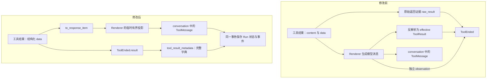
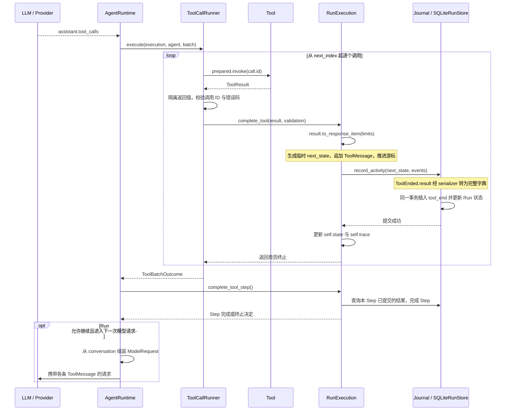

# ToolResult 变更设计解读

> 本文比较 `HEAD 62fdbbc` 与当前工作区，仅分析 `src/miniagent/`、`tests/` 的未提交代码，包括新增但尚未跟踪的 `tests/ut/tools/test_result_projection.py`。未使用开发计划或 skill 文件作为行为依据。未修改源代码或测试，也未为本次文档编写重跑测试。
>
> 证据标记：**事实**表示代码直接实现的行为；**推断**表示由调用关系得到的结论；**推测**表示无法仅凭实现确认的设计动机。下文未特别标为推断或推测的实现说明均为事实。链接指向当前工作区，标签给出 `file:line`；旧实现使用明确的 Git 基线位置。

## 1. Change Overview

本次变更将工具执行结果统一放入 `ToolResult.data`，删除并列的 `content`；通过两个接口生成模型消息与持久化字典。`tool_end.result` 改为保存执行结果本体，取消独立 observation 和模型正文反解析。影响工具生产者、Runtime 完成流程、事件契约、trajectory 及相关测试；多工具仍串行执行、逐条提交。

## 2. Architecture Before / After

### 2.1 原有结构与职责迁移

旧结构中，shell 同时构造格式化 `content` 与结构化 `data`。Runtime 保存原始返回，再把 renderer 输出的 JSON 反解析为 `effective`；`ToolEnded` 同时记录 `raw_result`、`result=effective`、`observation=ToolMessage`。因此，事件中的 `result` 表示模型看见的有界结果，并不一定等于工具原始返回。

旧实现证据：`62fdbbc:src/miniagent/tools/contracts.py:89`、`62fdbbc:src/miniagent/tools/shell.py:72`、`62fdbbc:src/miniagent/runtime/execution.py:1412`、同文件 `:1464`。可用 `git show 62fdbbc:src/miniagent/runtime/execution.py` 对照。

新实现没有新增生产模块或新的 provider 协议，职责在原有模块间重新分配：

| 关注点 | 修改前 | 修改后 | 当前源码 |
| --- | --- | --- | --- |
| 执行结果正文 | `content` 与 `data` 并列，shell 输出重复 | 只保存结构化 `data`；文本结果使用 `data.text` | [contracts.py:92](../../../src/miniagent/tools/contracts.py#L92)、[read_file.py:136](../../../src/miniagent/tools/read_file.py#L136) |
| 生成模型消息 | Runtime 直接调用 renderer、构造 ToolMessage | `ToolResult.to_response_item()` 封装这两步 | [contracts.py:105](../../../src/miniagent/tools/contracts.py#L105) |
| 生成完整记录 | 原始结果序列化与模型结果反解析分散在 Runtime | `tool_result_metadata()` 生成完整字典，事件 serializer 使用它 | [contracts.py:114](../../../src/miniagent/tools/contracts.py#L114)、[events.py:230](../../../src/miniagent/runtime/events.py#L230) |
| 正常返回的事件正文 | 原始证据与模型可见结果分别保存 | 完整结果位于 `ToolEnded.result`，`raw_result=None` | [tool_runner.py:309](../../../src/miniagent/runtime/tool_runner.py#L309)、[events.py:255](../../../src/miniagent/runtime/events.py#L255) |
| 模型消息的位置 | conversation 与独立 observation 同时记录 | 保留 conversation；删除独立 observation | [execution.py:1425](../../../src/miniagent/runtime/execution.py#L1425)、[events.py:218](../../../src/miniagent/runtime/events.py#L218) |
| 批次内的返回值集合 | ToolBatchOutcome 累积结果列表 | 只返回是否终止，不再累积结果正文 | [tool_runner.py:49](../../../src/miniagent/runtime/tool_runner.py#L49) |



图中的新路径描述 accepted 返回。拒绝接受的返回值仍可能保留额外原始证据，见 3.3。

### 2.2 “只保留一份”的准确边界

减少的是**执行结果的重复表示和重复事件字段**，不是让整个系统只存在一个 Python 对象或一份磁盘数据。Runner 仍对工具返回做一次深拷贝；renderer 创建临时字典；conversation 持有序列化模型消息；SQLite 提交入口还会冻结 RunCommit。它们分别承担返回值隔离、消息生成、对话历史和提交隔离。证据：[tool_runner.py:283](../../../src/miniagent/runtime/tool_runner.py#L283)、[rendering.py:10](../../../src/miniagent/tools/rendering.py#L10)、[sqlite.py:150](../../../src/miniagent/storage/sqlite.py#L150)。

**推断：**重复格式化正文、accepted 原始证据副本和 observation 被移除，因此这些路径的重复内存与序列化负担减少；实现本身不能证明固定的内存下降比例，也不构成零拷贝设计。

## 3. Core Execution Flows

### 3.1 正常返回、多工具执行与逐条落库

模型的一条 assistant 消息可以包含多个 tool_calls。既有状态转换把它们保存为 ToolBatch；Runner 从 `next_index` 开始按顺序调用，每次完成都等待 `complete_tool()` 提交，之后才处理下一项。[transitions.py:148](../../../src/miniagent/runtime/transitions.py#L148)、[tool_runner.py:86](../../../src/miniagent/runtime/tool_runner.py#L86)、[tool_runner.py:174](../../../src/miniagent/runtime/tool_runner.py#L174)。



关键转换如下：

1. `to_response_item()` 返回项目既有的 `ToolMessage`，其 `content` 是序列化后的整个结果投影；不是返回一个 Responses API 的 `function_call_output` 对象。[contracts.py:105](../../../src/miniagent/tools/contracts.py#L105)
2. `append_tool_result` 所调用的状态转换追加消息，将批次游标加一，并清除 active_operation；末项完成才把 phase 切到 `COMPLETE_STEP`。此时先生成候选状态，尚未替换运行中的状态。[transitions.py:177](../../../src/miniagent/runtime/transitions.py#L177)
3. 结果正文跟随 **`type="tool_end"`**，保存在 `run_events.payload_json.result`。相邻的 `tool_execution_end` 是执行结束摘要，不是完整结果的保存位置。[execution.py:1434](../../../src/miniagent/runtime/execution.py#L1434)、[execution.py:1448](../../../src/miniagent/runtime/execution.py#L1448)、[queries/events.py:32](../../../src/miniagent/storage/queries/events.py#L32)
4. `record_activity → recorder.commit → store.commit` 同时携带 next_state 和事件；SQLite 在同一事务中插入事件并更新 Run。只有 await 成功后，Runtime 才更新 `self.state`、`self.trace`。**原子边界是每个调用，不是整批调用。** [journal.py:236](../../../src/miniagent/runtime/journal.py#L236)、[recording.py:98](../../../src/miniagent/runtime/recording.py#L98)、[sqlite.py:607](../../../src/miniagent/storage/sqlite.py#L607)、[execution.py:1467](../../../src/miniagent/runtime/execution.py#L1467)
5. 批次结束后，`complete_tool_step()` 从已提交结果检查数量、调用 ID 和失败状态；不是依靠已删除的 ToolBatchOutcome.results。下一次请求从 conversation 复制消息，provider 原样传递消息 content。[execution.py:989](../../../src/miniagent/runtime/execution.py#L989)、[loop.py:1169](../../../src/miniagent/runtime/loop.py#L1169)、[qwen.py:78](../../../src/miniagent/providers/qwen.py#L78)

**推断：**若 A、B 已提交，C 执行中断，前两条提交不会被 C 回滚。模型是否继续收到结果还受 Run 终止条件控制；“已落库”不等于“一定发生下一次模型请求”。既有批次测试明确包含完成后因 Step 上限不再请求模型的情况：[test_tool_batch_resume.py:66](../../../tests/it/runtime/test_tool_batch_resume.py#L66)。

### 3.2 完整执行结果如何变成有界模型正文

renderer 的输入是完整结果，修改对象是 `tool_result_metadata()` 创建的字典；没有把裁剪结果写回 ToolResult。[rendering.py:9](../../../src/miniagent/tools/rendering.py#L9)。

- **第一层预算：**递归遍历 `data` 的字典与列表，找到字符串值，对每个字符串应用 `max_content_bytes`。这个旧配置名仍存在，但其语义已由“单个顶层 content 上限”变为“data 中每个字符串值的上限”。[contracts.py:81](../../../src/miniagent/tools/contracts.py#L81)、[rendering.py:13](../../../src/miniagent/tools/rendering.py#L13)、[rendering.py:76](../../../src/miniagent/tools/rendering.py#L76)
- **第二层预算：**若完整 JSON 仍超限，先依次省略非空的 metrics、workspace_delta、artifacts，再进入 `_fit_payload()`。[rendering.py:21](../../../src/miniagent/tools/rendering.py#L21)
- **总消息填充：**在临时字典中清空候选字符串，计算结构本身的基线大小；结构仍超限则省略整个 data。能容纳结构时，先填 error.message，再按字符串字符长度从小到大填 data 文本，使用 JSON 编码后的字节数计算剩余容量。error.issues 在进入该流程时可被省略。[rendering.py:37](../../../src/miniagent/tools/rendering.py#L37)、[rendering.py:108](../../../src/miniagent/tools/rendering.py#L108)
- **结果标识：**data 文本被裁剪时设置 content_truncated；键名为 stdout/stderr 时还设置对应标志。省略字段记录到 omitted_fields，并避免重复标记。原有标志不会被重置。[rendering.py:90](../../../src/miniagent/tools/rendering.py#L90)

这里没有按工具名称选择 renderer，也没有给 stderr 设置独立保留规则；小文本先填充是通用排序产生的行为。数字数组等非字符串结构的兜底是整体省略 data，而非生成摘要。模型正文因此可能比落库记录少内容，但落库结果保持原样。对应断言见 [test_result_projection.py:50](../../../tests/ut/tools/test_result_projection.py#L50)、[:68](../../../tests/ut/tools/test_result_projection.py#L68)、[:82](../../../tests/ut/tools/test_result_projection.py#L82)。

### 3.3 执行失败、返回值拒绝与无法生成模型消息

应分别理解“工具执行失败”和“Runtime 不接受工具返回值”。前者可以是合法的 error/timeout 结果；后者需要产生替代错误结果。

| 情况 | ToolEnded.result | raw_result / validation | 控制流证据 |
| --- | --- | --- | --- |
| 合法返回 success、error 或 timeout | 保留该 ToolResult，不经过模型正文反解析 | accepted；raw_result=None | [tool_runner.py:309](../../../src/miniagent/runtime/tool_runner.py#L309) |
| 调用 ID 不匹配，或错误码不满足约束 | 当前调用对应的 INVALID_TOOL_RESULT | rejected；保存原始 ToolResult 证据 | [tool_runner.py:285](../../../src/miniagent/runtime/tool_runner.py#L285) |
| 返回类型不是 ToolResult | INVALID_TOOL_RESULT | rejected / unsupported_result_type；不保存任意对象表示 | [tool_runner.py:273](../../../src/miniagent/runtime/tool_runner.py#L273) |
| 工具抛出普通异常 | Runtime 构造 TOOL_EXECUTION_EXCEPTION 结果 | not_returned；无原始返回证据 | [tool_runner.py:250](../../../src/miniagent/runtime/tool_runner.py#L250) |
| 工具未执行，例如权限拒绝或参数无效 | Runtime 构造的 denied/error 结果 | not_returned / tool_not_executed | [tool_runner.py:98](../../../src/miniagent/runtime/tool_runner.py#L98)、[:174](../../../src/miniagent/runtime/tool_runner.py#L174) |
| 模型消息生成抛出 TypeError / ValueError | 仍保存输入 complete_tool 的完整结果 | response_error=render_failed | [execution.py:1407](../../../src/miniagent/runtime/execution.py#L1407) |

对被拒绝的 ToolResult，`capture_tool_result()` 将完整字典经 `json.dumps(..., ensure_ascii=False)` 编码，至多 65,536 字节时使用 inline evidence；更大时写入 tool_result artifact，事件保存引用。此路径只在 Runner 的 ID/错误码拒绝分支调用；正常 accepted 结果不再经过这层大小分流。[execution.py:1337](../../../src/miniagent/runtime/execution.py#L1337)、[tool_runner.py:285](../../../src/miniagent/runtime/tool_runner.py#L285)。

无法生成模型消息时，Runtime 不追加 ToolMessage，而是提交完整结果、response_error 和终止决定。工具执行摘要的 status/error_code 仍来自原始执行结果，因此“工具 success”可以和“Run 因模型消息不可用而失败”同时成立，它们描述两个层次。[execution.py:1411](../../../src/miniagent/runtime/execution.py#L1411)、[:1432](../../../src/miniagent/runtime/execution.py#L1432)。

取消、持久化及托管执行异常在 Runner 中直接传播。写库失败由 recorder 转换为 RunPersistenceError；该次提交未成功时，不执行 complete_tool 末尾的内存状态替换。Run 终止过程中另有 result 可为空的 ToolEnded，response_error 保存终止原因，不代表工具返回了完整结果。[tool_runner.py:242](../../../src/miniagent/runtime/tool_runner.py#L242)、[recording.py:109](../../../src/miniagent/runtime/recording.py#L109)、[execution.py:1695](../../../src/miniagent/runtime/execution.py#L1695)。

## 4. Module Design

### 4.1 tools：结果契约、生产者与投影

`ToolResult` 仍是 Pydantic BaseModel，不是新的接口继承体系。data 默认空字典、不再允许 None，顶层未知字段被禁止；status/error 的一致性校验继续保留。两个新方法不缓存投影：[contracts.py:92](../../../src/miniagent/tools/contracts.py#L92)。

```python
# 对外接口形状，省略实现
result.to_response_item(limits=None)  # -> ToolMessage
result.tool_result_metadata()        # -> dict[str, JsonValue]
```

`tool_result_metadata()` 返回的是包含 data、status、error、duration、artifacts 等字段的完整 JSON 兼容字典，不是仅返回 data，也不负责实际 I/O。`to_response_item()` 调用既有 renderer，并把输出字符串放入 ToolMessage.content；Runtime 现在依赖这个入口，而非直接依赖 renderer。[contracts.py:105](../../../src/miniagent/tools/contracts.py#L105)。

生产者同步改为填写 data：shell 的正常与超时分支都携带 command/stdout/stderr/exit_code；read_file 把文件文本和说明放入 data.text。**超时分支补入已捕获输出是行为变化，不只是字段搬家。** [shell.py:59](../../../src/miniagent/tools/shell.py#L59)、[shell.py:77](../../../src/miniagent/tools/shell.py#L77)、[read_file.py:124](../../../src/miniagent/tools/read_file.py#L124)。

`tool_result_from_execution()` 负责保留 Workspace 产生的 duration、workspace_delta、流截断标志和 artifact 引用，并不重新执行命令或生成正文。[execution_result.py:12](../../../src/miniagent/tools/execution_result.py#L12)。

### 4.2 runtime：可信返回边界与完成协调

Runner 负责调用、返回类型检查、返回值隔离、ID/错误码检查与异常转换；CapturedToolReturn 暂时组合原始拒绝证据、有效结果和 validation。ToolBatchOutcome 只承载终止信息。[tool_runner.py:49](../../../src/miniagent/runtime/tool_runner.py#L49)、[:273](../../../src/miniagent/runtime/tool_runner.py#L273)。

RunExecution 负责把结果投影成模型消息、生成下一状态与 ToolEnded、等待原子提交。它不再深拷贝一次结果，也不再从模型 JSON 反解析 effective；`complete_tool_step()` 则依靠持久化事实完成批次判断。[execution.py:1385](../../../src/miniagent/runtime/execution.py#L1385)、[:989](../../../src/miniagent/runtime/execution.py#L989)。

### 4.3 events / storage：事件形状与持久化边界

ToolEnded 的核心约束是：accepted 必须有 result 且不能再有 raw_result；rejected 通常需要原始证据，unsupported_result_type 例外；not_returned 不能带 raw_result。只要 result 存在，其调用 ID、status 和错误码必须匹配事件摘要。[events.py:253](../../../src/miniagent/runtime/events.py#L253)。

事件 serializer 默认调用完整 metadata 接口，但在 include/exclude、exclude_unset/defaults/none 等读取投影模式下尊重对应选项。这一点关系到 dashboard 能否区分“原始记录没有这个字段”和“记录了默认值”，不是另一份结果缓存。[events.py:230](../../../src/miniagent/runtime/events.py#L230)、[dashboard/queries/events.py:72](../../../src/miniagent/dashboard/queries/events.py#L72)。

Storage 的 SQL/事务实现不在本次 Diff 中。它仍把事件写入 run_events，并更新 Run 状态；`list_tool_results` 的既有 SQL 仍投影 `$.result`。**迁移的是该字段的内容语义，而不是新增工具结果表。** [queries/events.py:45](../../../src/miniagent/storage/queries/events.py#L45)、[sqlite.py:624](../../../src/miniagent/storage/sqlite.py#L624)。

### 4.4 trajectory 与既有消费者

trajectory 的 tool_end 字段白名单删除 observation、observation_missing_reason，加入 response_error；非空且不等于 interrupted 的 response_error 仍产生名为 OBSERVATION_MISSING 的 coverage issue。旧 issue 名称保留，不意味着独立 observation 字段仍存在。[trajectory/export.py:363](../../../src/miniagent/trajectory/export.py#L363)、[:711](../../../src/miniagent/trajectory/export.py#L711)。

应按问题选取证据来源：

| 要查看什么 | 当前来源 | 证据 |
| --- | --- | --- |
| 工具合法返回的完整结构化结果 | tool_end.result | [execution.py:1457](../../../src/miniagent/runtime/execution.py#L1457) |
| 为什么原始返回被拒绝 | raw_result 与 return_validation；有效结果在 result | [tool_runner.py:285](../../../src/miniagent/runtime/tool_runner.py#L285) |
| 模型准备接收的工具消息 | 已提交的 conversation | [transitions.py:190](../../../src/miniagent/runtime/transitions.py#L190) |
| 某次模型调用实际构造的请求 | model_requested.request，包含当次 messages | [execution.py:731](../../../src/miniagent/runtime/execution.py#L731)、[trajectory/export.py:68](../../../src/miniagent/trajectory/export.py#L68) |
| 捕获到的原始命令输出字节及完整性 | command_stdout/stderr artifacts 与流证据 | [output_capture.py:45](../../../src/miniagent/environments/output_capture.py#L45)、[:62](../../../src/miniagent/environments/output_capture.py#L62) |

这里的“完整 ToolResult”是**完整保留工具返回的数据**，不是承诺 Workspace 返回的字符串没有经过已有上限处理，也不是保证进程中断时捕获到了所有字节；字节流证据另有 complete/partial 状态。

Dashboard 生产代码未修改，继续从 result.data 读取 exit_code、从 result.output 读取完整性。**推断：**其结果面板现在反映执行结果本体的标志，而非必然反映模型消息额外发生的裁剪；要还原模型输入，应查看当次请求。[dashboard/projections/events.py:133](../../../src/miniagent/dashboard/projections/events.py#L133)、[rendering.py:10](../../../src/miniagent/tools/rendering.py#L10)。

## 5. Design Decisions

| 可观察的技术选择 | 直接后果 | 证据 |
| --- | --- | --- |
| 执行结果与模型消息分开表示 | 执行判断、落库和模型裁剪不再依靠同一份有界 JSON 的反解析 | [execution.py:1407](../../../src/miniagent/runtime/execution.py#L1407)、[:1457](../../../src/miniagent/runtime/execution.py#L1457) |
| accepted 禁止重复 raw_result，rejected 允许原始/替代结果并存 | 正常路径去重；异常路径仍能解释被拒绝内容与有效错误之间的差异 | [events.py:255](../../../src/miniagent/runtime/events.py#L255) |
| 模型投影修改临时 metadata 字典 | 裁剪和字段省略不改变后续落库的结果本体 | [rendering.py:9](../../../src/miniagent/tools/rendering.py#L9)、[test_result_projection.py:50](../../../tests/ut/tools/test_result_projection.py#L50) |
| 先计算空文本结构，再按剩余容量填充单个字符串 | 不再在每次缩短字符串时反复序列化整个 payload；前缀查找针对单个字符串进行 | [rendering.py:50](../../../src/miniagent/tools/rendering.py#L50)、[:108](../../../src/miniagent/tools/rendering.py#L108) |
| 每个调用完成后提交状态与事件 | 多工具结果可以逐条持久化；批次进度与已追加消息共同提交 | [tool_runner.py:174](../../../src/miniagent/runtime/tool_runner.py#L174)、[sqlite.py:607](../../../src/miniagent/storage/sqlite.py#L607) |
| 请求历史继续保留 ToolMessage | 删除独立 observation 没有删除模型上下文，也没有要求从原始结果重建当次模型输入 | [loop.py:1169](../../../src/miniagent/runtime/loop.py#L1169)、[execution.py:731](../../../src/miniagent/runtime/execution.py#L731) |

**推测：**把两个出口放到 ToolResult 上，是为了让调用者通过结果对象访问模型视图与记录视图，减少 Runtime 对序列化细节的了解。代码能确认依赖入口改变，不能仅凭方法命名认定引入了 Codex SDK 或其完整协议。

## 6. Impact & Compatibility

### 6.1 契约及功能影响

- **Python 结果接口：**`ToolResult(content=...)` 与 `.content` 被移除，data 不再接受 None，默认空字典；未知顶层字段禁止。所有自定义工具和读取结果正文的调用者都需要使用新结构。[contracts.py:92](../../../src/miniagent/tools/contracts.py#L92)
- **消息协议：**ToolMessage.content 仍为字符串，外层 role/tool_call_id 结构未变；变化在字符串内的 JSON：删除 content，正文集中在 data。Provider 适配未修改。[contracts.py:109](../../../src/miniagent/tools/contracts.py#L109)、[qwen.py:99](../../../src/miniagent/providers/qwen.py#L99)
- **存储内容：**tool_end 事件类型未变，result 从有界模型结果改为完整执行结果；accepted 的 raw_result 变为 None。原来的大结果转 artifact 分流现在只出现在拒绝返回路径，正常大结果直接保存在 result。[events.py:224](../../../src/miniagent/runtime/events.py#L224)、[tool_runner.py:285](../../../src/miniagent/runtime/tool_runner.py#L285)、[:309](../../../src/miniagent/runtime/tool_runner.py#L309)
- **兼容处理：**本次没有新增迁移或兼容读取分支，现有 storage 版本常量未改。**推断：**包含旧 ToolResult.content、ToolEnded.observation 的历史记录不能视为兼容新契约，因为相关模型禁止未知字段。这是格式变化的边界说明，不是迁移方案。[storage/codecs.py:42](../../../src/miniagent/storage/codecs.py#L42)、[contracts.py:93](../../../src/miniagent/tools/contracts.py#L93)、[events.py:103](../../../src/miniagent/runtime/events.py#L103)
- **执行与恢复：**Runner 串行顺序和 next_index 机制未改；每个 Step 的结束判断继续查询已持久化结果，只是查询到的 result 现在是完整执行结果。[tool_runner.py:86](../../../src/miniagent/runtime/tool_runner.py#L86)、[execution.py:989](../../../src/miniagent/runtime/execution.py#L989)

### 6.2 测试与机械性修改

下表解释测试所表达的契约，不以本次文档编写期间的测试运行结果作为证据。

| 类别 | 变更与断言所表达的行为 | 阅读入口 |
| --- | --- | --- |
| 新增核心接口测试 | shell 成功、非零退出、超时结果只含一份输出；模型裁剪不修改 metadata；大结构和 JSON 转义受消息预算约束 | [test_result_projection.py:10](../../../tests/ut/tools/test_result_projection.py#L10)、[:50](../../../tests/ut/tools/test_result_projection.py#L50)、[:68](../../../tests/ut/tools/test_result_projection.py#L68) |
| 改写结果持久化测试 | 完整结果只保存一次；模型消息有界；accepted 不再有 raw_result 或 observation | [test_tool_evidence.py:86](../../../tests/it/runtime/test_tool_evidence.py#L86) |
| 新增提交顺序测试 | 第二次 provider 调用时，数据库中已经存在完整结果和同一条 conversation 工具消息 | [test_tool_evidence.py:377](../../../tests/it/runtime/test_tool_evidence.py#L377) |
| 异常与原子性测试 | 被拒绝的原始返回仍可恢复；模型消息失败时结果保留；artifact/事件提交失败时不出现已完成工具消息 | [test_tool_evidence.py:121](../../../tests/it/runtime/test_tool_evidence.py#L121)、[:215](../../../tests/it/runtime/test_tool_evidence.py#L215)、[:231](../../../tests/it/runtime/test_tool_evidence.py#L231) |
| 查询与导出配套断言 | 查询从 result.data 读正文；trajectory 缺失消息的判断改用 response_error；恢复导出含正常结果而无重复 raw/observation | [test_tool_result_projection.py:19](../../../tests/it/storage/test_tool_result_projection.py#L19)、[test_export.py:269](../../../tests/it/trajectory/test_export.py#L269)、[test_trajectory.py:53](../../../tests/sit/resume/test_trajectory.py#L53) |
| 机械性适配 | 测试工具/夹具从 content 搬到 data.text，读取断言同步；ToolEnded 夹具移除 observation 字段并填写 response_error | [tests/support/runtime/runtime.py:83](../../../tests/support/runtime/runtime.py#L83)、[tests/support/dashboard/events.py:20](../../../tests/support/dashboard/events.py#L20) |

并非所有相关测试都是新增测试。未修改的 dashboard 缺失字段测试，解释了事件 serializer 为什么必须保留 exclude_unset 语义；未修改的批次恢复测试则说明原有多调用机制如何继续消费结果。[test_final_review.py:54](../../../tests/it/dashboard/test_final_review.py#L54)、[test_tool_batch_resume.py:40](../../../tests/it/runtime/test_tool_batch_resume.py#L40)。

## 7. Human Reading Guide

建议按以下顺序阅读，先建立结果语义，再跟踪状态与事件边界：

1. **[tools/contracts.py:92](../../../src/miniagent/tools/contracts.py#L92)**：先看删除后的数据形状与两个出口，确认 ToolResult、metadata 字典、ToolMessage 是三种不同角色。
2. **[tools/rendering.py:9](../../../src/miniagent/tools/rendering.py#L9)**：看临时字典如何生成有界消息，再读 `_fit_payload`；理解为什么数据库结果与模型正文可以不同。
3. **[runtime/tool_runner.py:273](../../../src/miniagent/runtime/tool_runner.py#L273)**：区分合法的执行失败与返回值被拒绝，确认什么时候保留 raw_result、什么时候只保留 result。
4. **[runtime/execution.py:1385](../../../src/miniagent/runtime/execution.py#L1385)**：沿生成消息、生成 next_state、构造事件、await 提交、替换内存状态的顺序阅读；这是连接 LLM 与数据库的核心协调点。
5. **[runtime/events.py:218](../../../src/miniagent/runtime/events.py#L218)**：最后看持久化后的数据契约、accepted/rejected 约束和序列化选项，理解其他读取模块依赖的稳定形状。
