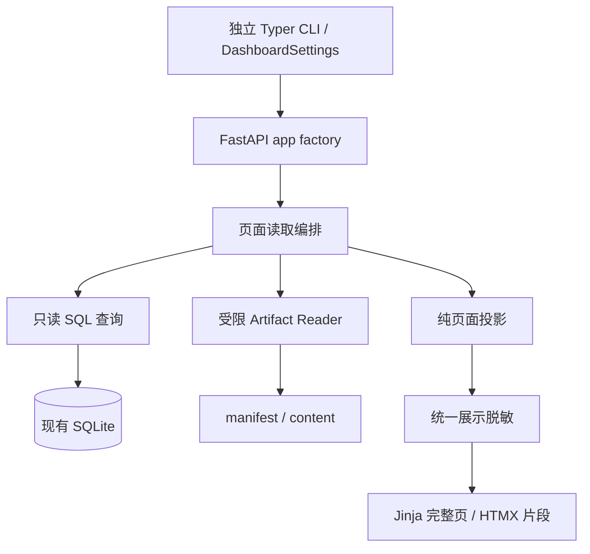

# 只读 Trace Dashboard：架构设计

日期：2026-10-14

最终 review：2026-10-19

状态：用户已确认首版采用本文推荐方案，设计已定稿；实施计划及代码执行另行安排。
需求依据：[Dashboard 详细功能设计](2026-10-14-dashboard-design.md)。
代码核对基线：`e228f70`；以实现和测试为当前行为依据。

## 1. 意图、约束与确认记录

为项目开发者和面试演示者提供本机只读 Dashboard，从 SQLite 和已登记 Artifact 解释 Run 的执行顺序、结束原因、工具结果、压缩来源、补丁、评测和费用。交付 Run 列表、Run 详情、Workspace 三页面；活动 Workspace 销毁后，持久化证据仍可查看。

主导质量属性是事实可信、读取一致、内容安全与有界资源使用。缺失、损坏、未加载和相互矛盾的证据分别显示；不能把缺失转换为零值、失败或成功。页面不证明进程存活，不改变 Runtime 的终态，也不执行验证来补造历史。

沿用功能稿中已确认的 FastAPI + Jinja + HTMX、本地资源、中文界面、单用户 loopback 访问、独立 `miniagent-dashboard` 入口和 optional extra。Compare、Checkpoint、Recoverable、恢复工作区、审批操作、任务执行、公开托管和完整请求级模型记录均不在范围内。

本轮确认记录：

- 用户已确认采用独立 Dashboard 查询与投影，并确认模块边界。
- 用户已确认请求内一致读取、事件分页冻结上界及签名游标契约。
- 用户在集中 review 后确认：首版按本文推荐方案处理，A5–A11 及功能稿澄清均采用本文所列语义。
- Phoenix/Langfuse 作为替代方案已讨论，首版继续采用 FastAPI + Jinja + HTMX 和现有持久化数据的直接只读查询，不增加外部观测平台、历史导入器或同步链路。

本稿补充内部模块、读取与投影契约，不重复设计页面布局。第 15 节记录已确认选择及同步至功能稿的澄清，两份文档共同作为后续实施计划的依据。

## 2. 方案选择与当前接入点

| 方案 | 取舍 | 选择 |
| --- | --- | --- |
| 独立 Dashboard 查询与投影 | 复用数据契约与 codecs，单独管理只读连接、分页和异常隔离；Runtime 不需接入 Web 服务 | 已确认 |
| 扩展 `SQLiteRunStore` | 可复用部分查询，但 Dashboard 会依赖同时具有初始化、迁移和提交能力的对象 | 不采用 |
| 独立读模型数据库 | 查询便利，但引入同步、迁移和另一份持久化事实 | 首版不采用 |

| 现有代码 | 可复用内容 | 架构限制 |
| --- | --- | --- |
| `storage/migrations/001_initial.sql` | 表结构、索引、时间编码与版本基线 | 只读检查，不执行 migration |
| `storage/codecs.py` | `decode_run`、`decode_event`、`decode_snapshot`、`encode_datetime` | 解码错误逐项隔离；异常文本可能含原始值，不能直接展示 |
| `runtime/state.py`、`store_contracts.py` | Run 状态、RunRecord、终态定义 | 不重新定义生命周期，不写 Run |
| `runtime/events.py`、`tracing.py` | Event 类型、scope、Span 父类别约束 | 页面可表达异常历史；不放宽 RunTrace 契约 |
| `runtime/context.py` | `CompactionSummary`、EventSource、SnapshotSource | 不直接调用依赖 RuntimeStore、全历史读取的校验流程 |
| `artifacts/contracts.py` | ArtifactRecord、ArtifactRef | 不使用会批量校验全部内容的 `FileArtifactStore.list_for_run()` |
| `evaluation/swebench_report.py` | InstanceReport 结构与报告判定约束 | 不用报告自身的测试集合代替缺失的目标清单 |
| `cli/settings.py` | 路径字段的默认值 | Settings 必填 Provider 凭证并读取 `.env`；Dashboard 不能实例化它 |

当前数据库 `PRAGMA user_version=2`；Run/Event/Snapshot schema 为 2，Artifact manifest 为 1。Dashboard 首版不读取审批表来执行动作；审批历史从 Event 读取。

## 3. 模块和依赖方向



建议目录，按职责实现，不预建空模块或通用基类：

```text
src/miniagent/dashboard/
  cli.py                 独立入口、依赖缺失提示、Uvicorn 启动
  config.py              DashboardSettings 和读取限制
  app.py                 app factory、生命周期、同源与错误处理
  routes.py              GET/HEAD 参数和页面/片段选择
  pages.py               页面读取编排、合并读取结果
  queries.py             只读连接、SQL、行解码与精确定位
  cursors.py              游标模型、签名和校验
  views.py               内部页面 dataclass 和问题标记
  projections/
    run.py               Run 身份、预算、usage 与费用
    events.py            摘要、Tool 关联、Span 和 Step 分组
    compaction.py        摘要与来源证据的页面校验
    evaluation.py        attempt 分组与证据链
    workspace.py         Patch 选择、diff 与登记信息对照
  artifacts.py           manifest 枚举与安全内容读取
  redaction.py           所有展示内容的脱敏
  templates/             Jinja 模板和片段
  static/                本地 HTMX、CSS 和少量交互脚本
```

`pages.py` 提供页面函数，不增加 service/repository/use-case 基类。SQL 与文件操作分别位于查询和 Reader；纯投影只接收已读取的值，不访问路径、连接或模型。路由不判断评测通过，不配对 Span，不解析 diff。

前端由本项目维护 Jinja/HTML 模板、CSS 和少量交互 JS。Python 服务端将读取结果渲染为完整 HTML 或局部片段，浏览器负责显示，HTMX 负责片段请求和替换；不是预生成静态报告，也不是没有前端实现。首版不增加 React/Vue 应用或 Node 构建链。

外部配置、HTTP 参数、游标和结构化证据使用 Pydantic；内部页面容器使用 frozen dataclass。页面容器不直接引用任意原始 RunState：模板只接收脱敏后的展示值、受控链接和标记。

依赖仅指向已有领域契约和读取 codecs；不导入 bootstrap/application 来装配 Agent，不实例化 Provider、Workspace Backend、Evaluator 或 SQLiteRunStore。不增加另一套 Runtime 或持久化读模型。

## 4. 内部读取契约

以下为职责契约，不要求每项成为类。字段命名可在实施计划中落实，但边界和可观察语义保持。

| 操作 | 输入 | 输出与约束 |
| --- | --- | --- |
| `list_runs` | 规范化筛选、排序游标、页大小 | 当前页摘要、同事务计数、下一页游标、read_at；不读取 conversation 或 Artifact 内容 |
| `read_run_page` | run_id、首屏筛选 | RunRecord 或行问题、事件上界、Snapshot 上界、首批 Event、读取时间 |
| `read_workspace_page` | run_id | 同事务 Run 与评测 Event 引用，建立该页面的新边界；文件另外读取 |
| `read_events` | run_id、已验证事件游标 | 固定上界内的事件批次、异常占位行、下一页位置 |
| `locate_event` | run_id、event_id、页面上界 | 目标 Event 和最多前后各 20 条，不应用时间线筛选 |
| `read_snapshot` | run_id、version、页面上界、消息范围 | Snapshot 来源视图；只展示请求范围和必要元信息，不把整个 conversation 送往浏览器 |
| `read_scope_facts` | 当前批次 span IDs、页面上界 | 同 scope 的起止事实、计数和父 scope；独立于时间线筛选 |
| `read_compaction_sources` | 已读取摘要的精确来源集合、页面上界 | 按 ID/版本批量读取的不可变来源、缺失/损坏/超限问题 |
| `list_manifests` | run_id、Artifact 游标 | 最多 100 项登记元信息和问题；不校验所有内容 |
| `preview_artifact` | run_id、artifact_id、预览游标 | 已校验且脱敏的文本分段、下一位置、完整性标记 |

页大小先校验再执行 SQL；未知参数、排序列和事件过滤值拒绝，不拼接用户 SQL 或 JSON path。复用 codec 时保留契约；未知类型或不支持版本走独立 envelope 视图，不强行构造 RunEvent。

所有可见问题使用固定 code 和中文说明，如 `payload_unsupported`、`source_missing`、`hash_mismatch`、`scope_duplicate`、`read_limit_exceeded`。只有前述读取契约需要共享的问题数据才放入 views；不引入通用 Result 框架。

## 5. SQLite 生命周期与一致性

### 5.1 只读连接

CLI 先检查路径存在，再以规范化、正确编码的 file URI 加 `mode=ro` 打开，启用 `query_only=ON`，busy timeout 为 1 秒。每个读取单元在同一工作线程内打开、使用和关闭连接；连接不跨线程共享，不设置 `check_same_thread=False`，不采用连接池。

读取事务显式 `BEGIN`，同一单元内获取所有需要一致的行，退出事务并关闭连接后再做页面投影、文件读取和渲染。不调用 initialize，不创建目录或空 DB，不执行 DDL/写入，不设置 journal mode，不用 immutable。SQLite 自身有效 WAL/SHM 协调遵循功能稿的只读口径。

启动检查 user_version、必需表/列及 JSON 查询能力，不全库扫描或校验历史。数据库结构不支持则启动失败；单行 schema 不支持则隔离展示。DB busy 返回 503；物理损坏是页面读取失败，不能当成空列表。

### 5.2 页面边界

首屏同一事务内读取 Run、`as_of_sequence`、`latest_snapshot_version` 和首批事件。附属来源链接携带签名边界令牌；事件条件始终包含 `sequence <= as_of_sequence`。在 Run 详情与 Workspace 主页面之间切换时建立新页面边界，并显示新的读取时间，不宣称两个页面共享一个历史 RunState。

后续事件请求只更新时间线片段，不重新渲染当前 Run 概览。数据库中没有每次提交都保存的完整历史 RunState，不能只靠旧 sequence 在下一请求重建首屏状态。

Workspace 首屏同事务读取当前 Run 和截至其上界的 EvaluationCompleted 引用，再退出事务发现 manifest。后续 metadata 页和预览只更新文件区域，沿用该页面证据边界；整页刷新才更新 Run/评测事实。

独立来源读取可使用新事务：Event/Snapshot 是不可变事实，逐项校验 Run、ID/版本和边界即可与已选页面关联。Snapshot 同时要求 `version <= latest_snapshot_version` 和 `event_sequence <= as_of_sequence`。不重新读取可变 Run 来替换旧页面状态。

手动或自动刷新对详情的数据库区域整体重新读取：身份/结果、预算、当前摘要与时间线切换到同一新边界。记录原有筛选、锚点和展开状态，刷新后恢复；旧游标和旧 pending 响应不并入新页面。原 Event 锚点不在首批时，按 ID 在新边界读取定位窗口并保位，不重新加载过去所有分页；锚点与筛选不匹配时保留筛选并提示可独立定位。Workspace 的文件发现始终有独立 manifest 读取时间，允许终态之后晚发布的文件。

## 6. 查询、游标与分页

### 6.1 Run 列表

顺序固定 `created_at DESC, run_id DESC`；后续页使用严格小于上页最后位置的二元条件。时间参数先转为已有 codec 的 UTC 编码，区间为 `[from, to)`；LIKE 使用绑定参数、显式 escape，将 task 中 `%`、`_`、escape 字符按字面匹配。

模型从 `definition.agent_spec.model.model` 读取；Workspace kind 从 recovery context 的 `workspace_spec.kind` 读取，缺失为 unknown。SQL JSON path 固定，先检查 JSON 合法与字段形状。列表仅提取身份、生命周期、模型、Workspace kind、usage 的必要标量，不全量解码每行 conversation；校验选中身份/状态/时间与外层列的一致性。

任务等自由文本先读取完整的有界字段，脱敏后再截短为摘要，不在脱敏前切断凭证。过大的字段只显示超限提示。计数和当前页使用同一筛选谓词与同一事务；无筛选时损坏行仍可作为异常行浏览，有筛选时无法判定的模型/Workspace 不冒充匹配。

不逐行扫描事件或打开 summary Artifact。当前 RunState 没有持久化列表所需的独立评测结论，列表显示可证明的 Workspace/Runtime 事实，评测结论标为“详情查看证据”。Evaluator 类型没有持久化，不能由 Workspace kind 推断该 Run 的验证类型；可说明“当前默认 Local 装配使用 pass-through”，但该 Run 类型显示“未记录”，不把默认装配当成历史事实。unknown 同样不推断验证类型。

跨请求不冻结整个筛选集合：created_at/run_id 稳定，但状态等字段可能改变。分页保证插入新 Run 不挤乱既有下一页，不保证浏览期间状态筛选成员静止。首版不增加索引或成本排序；JSON 筛选可能扫描现有行，查询耗时受第 12 节限制。

### 6.2 Event 筛选

按 sequence 升序，默认 100，最多 200，查询 `limit + 1` 判断下一页。type、Step、tool_name 和失败条件都在 SQL 中执行。tool_name 从已知 payload 的固定字段读取，不在当前批次解码后再过滤。

“仅失败”固定包含：ModelResponded.error_code 非空；ToolEnded/ToolExecutionEnded.status 为 error/timeout/denied；StepCompleted.failed=true；EvaluationCompleted.passed=false；RunFinished.status=failed；CompactionFailed；ApprovalResolved.outcome 为 rejected/expired/invalidated，以及 ApprovalInvalidated。approved 不包含。denied 标为拒绝，不能暗示命令已执行；PolicyDecided.effect=deny 作为策略事实保留，不单独计入执行失败。未知状态不推断为失败。

过滤无匹配直接结束，不返回扫描重试游标。匹配行解码失败仍显示 ID/sequence/type 的异常行，位置照常推进；未知 payload 未通过“仅失败”的已知谓词，但未筛选时间线仍可查看。来源定位绕过筛选。

### 6.3 游标

版本化 Pydantic 游标包含用途、run_id（适用时）、规范化筛选摘要、完整位置、事件/Snapshot 上界、边界读取时的 Run Status、签发与过期时间。边界状态仅供分页 scope 的终态分类，不承载整个 RunState。payload 使用稳定 JSON，Base64 URL 编码，加 HMAC-SHA256 签名，标准库 constant-time 比较；每个服务进程生成随机密钥，30 分钟有效。

单个编码游标最多 4 KiB；用途错用、签名失败、过期、筛选不匹配、非法范围和超出当前已提交上界返回 422。服务重启后旧游标失效，提示重新加载。游标只承载读取边界，不持有原始 task 搜索词、凭证或宿主路径，也不用于授权。

Artifact 游标额外绑定 artifact_id、hash、脱敏策略版本和脱敏后位置。Run 列表、Event、来源边界和 Artifact 游标用途分别校验，不互相接受。

## 7. Event、Step 与 Span 投影

### 7.1 Event 与工具结果

Event 行保持 sequence 顺序。摘要使用已知类型的固定映射，不把任意 payload 作为 HTML。原始 payload 详情实际是有界的脱敏结构化视图；未知/坏 payload 只保留可校验 envelope 和错误类型。

Tool Call/Result 关联键为 `(run_id, step_number, tool_call_id)`，不跨 Step 关联；call_index、span 和工具名用于冲突检查。缺少开始/结束或重复结果均显示问题，不选择其中一条假定正确。参数或完整模型输入输出未记录时明确提示，不从当前 conversation 补历史。

Tool Result 分开显示执行状态与 observation completeness；成功而输出截断不改成失败。shell exit code 保持命令语义。Step 分组是对当前有界时间线的呈现，标注是否只加载了部分 Step；来源定位可以继续查看前后事件。

### 7.2 Span 配对

| Category | 开始事件 | 结束事件 |
| --- | --- | --- |
| run | run_started | run_finished |
| step | step_started | step_completed |
| model | model_requested | model_responded |
| tool | tool_start | tool_end |
| tool_execution | tool_execution_start | tool_execution_end |
| evaluation | evaluation_start | evaluation_completed |
| approval_wait | approval_requested | approval_resolved |

ApprovalInvalidated 是审批后的失效事实，不作为等待结束；压缩事件作为独立事件组，不新增 SpanCategory。

首屏不装载整段 Event 历史。针对当前批次出现的 span IDs，查询同上界内的起止事实与父 scope；即使配对事件在另一页或被筛掉，也可以找到。按 scope/type 获取计数，重复起止不被 LIMIT 隐藏。父链最多 64 层、每请求最多 1,000 个 scope；超限显示未完成加载，不误标实际历史缺父节点。

配对以 span ID + 事件类型进行，并检查 parent 一致性及 tracing.py 已有父类别约束。只有唯一、合法配对且时间未倒退才计算记录间隔。没有真实结束事实时不使用 Run 结束时间代填。

页面使用 Dashboard 自己的 SpanView，保留 open、incomplete、duplicate、missing_parent、invalid_hierarchy、invalid_time 和 not_loaded 等问题。根 Span 缺失只提供 Event 时间线。首版不构造或导出整 Run 的 RunTrace；不能把当前分页 scope 集合宣称为完整 Trace，也不修改已有 TraceSpan/RunTrace 契约。

终态判断必须来自同页面边界：初次详情用同事务 Run 状态，后续分页用签名边界中保存的状态，不以新 Run 终态改写旧 scope。若该边界内的 RunFinished 与状态矛盾，显示证据冲突。Span 时长不代表 Provider 精确延迟，重叠区间不累计成 Run 时长。

### 7.3 Run、预算与费用

身份、模型、candidate/final output、状态、reason、错误及累计 usage 来自同事务 RunRecord；非终态显示“最后记录状态”与最后提交时间。Workspace kind 只从持久化 recovery context 读取，缺失为 unknown；不将 recovery/checkpoint 字段新增为功能入口。

steps_started/max_steps、consecutive_failed_steps/max_consecutive_failures 来自 execution/config。model_requests、tool_calls、Token 和 active_duration_ms 使用 RunUsage，不从当前事件页估算总数。total_tokens 不再次加 cached_input_tokens 或 reasoning_output_tokens。容量取 config.context_window_tokens，输出预留取 agent_spec.generation.max_output_tokens；压缩前后输入估计使用对应 CompactionCompleted，明确来源时点。

成本直接使用持久化 Decimal 与 cost_usd 分项，格式化到展示精度但不转 float 重算；缓存费用是否单列遵循持久化 priced_separately。当前没有计费完整性字段，统一标注“已记录费用，完整性未证明”，不能凭 succeeded 推断完整计费。

时间、累计 Token 和费用硬上限当前不在 RuntimeConfig 中，显示“未配置”；不从 TerminationReason 枚举反推上限。百分比只用于实际配置的限制，超额保留实际值。wall duration 由同边界 started_at 到 finished_at/read_at 计算；负时间显示不可计算，非终态经过时间不表示存活。

## 8. Task Memory 与压缩来源

当前 Task Memory 对应 `state.context.current_version`，从 `conversation.messages[2]` 的 AssistantMessage 读取。仅接受 template_version=1 的固定前缀和 JSON 后缀，使用 CompactionSummary 校验；不从任意 assistant 文本搜索 JSON，不调用模型补摘要。

定位该版本的 CompactionCompleted，验证 current/previous version、event_sequence、源/新 Snapshot ID 与版本、covered_messages/steps、retained_first_step 和边界。摘要 SHA-256 对完整原始渲染消息的 UTF-8 计算，先校验再脱敏；不是对 JSON 后缀或展示文本计算。历史版本从事件引用的 new Snapshot 读取摘要。

当前消息前缀、保留消息与新 Snapshot 的关系按已有 validate_compaction_record 约束检查。该函数依赖 RuntimeStore 并装载全历史，Dashboard 不直接调用，也不为调用它实现一套写接口。

来源校验分两层：

1. 结构和归属：同 Run、事件 sequence 范围、Snapshot version/消息范围、覆盖 Step 和祖先压缩范围合法。
2. 证据内容：excerpt 必须匹配来源叶子文本且 claim=excerpt；field_path 必须指向实际值，claim 与规范 JSON value 一致，不能只确认链接存在。

按精确 ID/版本批量读取需要的来源，逐步追溯 previous_version 的允许范围，不扫描任意 conversation 或全部工具日志。每请求最多追溯 32 个压缩版本，更多历史可以按版本继续浏览。坏 hash、越界、断链和内容不匹配显示“证据不一致”；来源尚未加载或达到资源上限显示“未完成校验”，不声称一致或不一致。

VerifiedEvidence 显示其 EventSource/SnapshotSource 链接。current_goal、workspace_changes、rejected_attempts 等普通摘要字段没有逐项 source，不能给每个条目伪造链接；这些字段链接到承载摘要的 Snapshot，并标为摘要记录。uncertainties 保留不确定性。无压缩显示“尚未生成持久化 Task Memory”。

压缩事件使用 Run scope，并没有独立压缩 span。以首次 CompactionRequested(attempt=1) 的 sequence 标识一次压缩组，到其 Completed/Failed 结束；attempt>1 属于该组。按 `(run_id, first_requested_sequence, attempt)` 关联 AttemptRecorded 与 Completed/Failed 的尝试列表，不能按共享 Run span + attempt 将多次压缩串在一起。起止缺失或重复则保留未关联记录，不猜组。

摘要尝试 usage/成本优先使用 CompactionAttemptRecorded，结束事件中的同次尝试列表只补缺，不重复计数；冲突显示证据问题。摘要费用仅说明其在 Run usage 中的贡献，不再次累加。

## 9. Artifact 发现、安全读取与预览

### 9.1 manifest 发现

只访问配置根目录下 `manifests/{run_id.hex}/{artifact_id}.json`，用户只提交 UUID，不提交 URI。按 UUID 文件名排序游标分页，每批最多 100；排序表示发现顺序位置，不表示创建时间或“最新”。目录项枚举采用流式有界选择，避免将全部 JSON 内容或全目录排序列表留在内存。

每个 manifest 最多 1 MiB，超过不解析；验证 schema_version=1、文件名 artifact_id、目录 run_id 和 ArtifactRecord 内容一致。坏 manifest 形成该项问题，不中断其余项。未知类型也可显示登记元信息，但不默认预览。

Workspace 首屏只读取一批 metadata；按 Event 引用的 Artifact ID 精确补查所需证据，即使其不在当前 metadata 页。默认 patch 的“唯一”判定需要在完整目录流式发现中确认只有一项合法 workspace_patch；发现多个或未完成扫描则不猜选，提供选择入口。

目录扫描同样受时间预算约束；超限显示部分发现且不能证明唯一。manifest 在读取后发布，可在下一次手动刷新发现，不把首次缺失缓存为永久丢失。

### 9.2 文件打开与身份

内容只允许 manifest 中登记的本地 file URI，拒绝非空 authority、网络 scheme 和越界路径。目标应与现有 `content/{sha256[:2]}/{sha256}` 布局及登记 hash 一致；不接受任意同根路径作为内容。

Artifact 根目录在启动时规范化。Reader 在根目录文件描述符下逐级打开已验证路径，不跟随子目录或末级符号链接；使用标准库 dir_fd/O_NOFOLLOW，在打开的同一描述符上 fstat、hash 和读取，避免“先 resolve 后 open”留下路径替换窗口。必要的低层 os API 仅限此处，普通路径管理仍使用 Path。

根目录和中间节点必须是目录；manifest 与 content 必须是普通文件。目录打开使用目录类型约束，末级打开使用非阻塞标志以避免 FIFO 在 open 阶段等待，再在同一描述符上 fstat 确认普通文件，拒绝 FIFO、socket、设备和目录，不将其作为可读取内容。路径和大小校验不能代替文件类型校验。

拒绝根目录以下的符号链接，即使目前指向根内。大小、hash、Run/Artifact 身份或引用不一致均保留登记问题，单项预览返回 409；不存在的登记记录返回 404。metadata 的 files 仅作为文字，不能成为宿主文件读取路径。

### 9.3 有界内容与脱敏分页

登记大小与 fstat 都不得超过 20 MiB；超限只显示元信息和未校验标记，不读取内容。允许内容按 64 KiB 块读取，累计大小和 SHA-256 与登记值匹配后才可用于证据或预览；每次预览重新检查，不使用跨请求持久化缓存。

允许预览已知文本/JSON/diff 类型；无有效 UTF-8 或包含二进制控制内容时降级为元信息。结构化 JSON 不支持的业务形状不参与证据推断，但可在通用结构化脱敏后预览。JSON 语法错误、重复键或深度超限只显示元信息和问题，不能绕过结构化脱敏直接展示原文。

对完整、受 20 MiB 限制的文本建立统一脱敏视图，再按该视图的 UTF-8 字节位置分页；每次最多 256 KiB 且最多 2,000 行，避免切断 UTF-8 字符。超长单行也可在字符边界分段，标注行内续段。响应提供脱敏后 next offset；不声称它对应原文件偏移。

同一请求只保留必要原始数据和一个脱敏文本，不同时加载所有日志。完整 Run/Snapshot 正文读取与 Artifact 内容读取都属于重内容请求，最多两个并发，其余快速返回 503/重试提示；限制文件读取、JSON 解析、hash 和完整文本脱敏的峰值负担。该限制不保证 Python 字符串内存等于文件字节数。

## 10. Workspace 与评测证据投影

### 10.1 Patch

首选被同边界 EvaluationCompleted.artifacts 及匹配 config/summary 明确关联的候选 patch；只存在一项合法登记 patch 时可选它。多个 attempt 指向不同候选、关联冲突或扫描不完整时要求用户选择，不按 UUID/文件名推断最近提交。

diff 解析是只读结构识别：Git diff header、逐文件 hunk、新增/删除/rename、带空格或引用路径、binary 标记。路径不交给 shell，不运行 Git，不应用 patch；不支持的格式保留原文预览。按行流式解析，完整性受文件与时间预算约束，不能把解析失败当作空 patch。

登记 files 与 diff 推导文件清单分别展示；只有解析完整时才可断言不一致，否则标注解析不完整。安全脱敏可能改变原文展示，页面不保证可复制得到可应用 patch，不提供原始下载。

### 10.2 Evaluation attempt

以 manifest metadata 的 attempt_id 分组，校验 UUID 和同 Run；缺失身份的文件显示未关联证据。summary 的多个 collecting/final 快照不按文件名择新：优先使用对应 EvaluationCompleted 明确引用的 Artifact，其余保留并解释差异。日志是否齐全与 verdict 分开。

独立通过展示要求以下证据同时成立：

- 当前展示边界的 Run 为 succeeded，EvaluationCompleted.passed=true，且事件引用相关证据。
- config/summary 内容与各 manifest metadata 的 Run/attempt/instance 一致；report 通过其 manifest 归属和唯一顶层 instance key 关联，不要求报告具有未生产的 Run/attempt 字段。summary 不处于 collecting/cancelled/failed，明确记录 report_resolved。
- patch ID/hash/submission 与 config、summary、事件引用和已校验 manifest 一致，patch 内容 hash 已验证。
- 支持的报告满足 resolved、存在非空 patch、成功 apply、无 infra_failure；tests_status 存在，组内成功/失败集合无重复且互斥，resolved 没有已记录失败。

有明确矛盾显示“证据冲突”；缺少必要证据显示“证据不完整”；二者均不展示独立验证通过。Run 终态、Evaluation 结果和文件可用性始终独立保留，不通过展示判定去改写其中任何一项。Local 无 SWE-bench 卡片；unknown 不从 task 文本猜 instance。

首版结构适配器只支持当前生产者的 config/summary 形状和 `harness_version=5.0.2` 报告。config/summary 没有 schema_version，不能发明存储版本；使用必要字段形状校验，未知形状或 harness 版本仅保留预览。JSON 重复键拒绝，不能采用最后键覆盖的宽松判定。

当前 Artifact 没有发布 task.json，也没有在 config 中保存 FAIL_TO_PASS/PASS_TO_PASS 目标清单。因此不调用 parse_instance_report 时传入从 report 自身推导的目标集合，不读取宿主机准备数据来补全。页面展示“已记录独立评测通过”，并明确标注“目标测试清单未持久化，无法复核完整覆盖”；测试列表称为“报告记录的测试”。它仍是原 Evaluator 的持久化结论，不表示 Dashboard 重做了评测。

后续若需要 Dashboard 独立复核全部目标覆盖，应另行设计生产者证据契约；首版不修改 Evaluator 或增加 Artifact。

## 11. HTTP、前端与内容安全

### 11.1 HTTP 与配置

保留功能稿路由；`/runs/{run_id}/events` 通过精确 event_id 请求同时提供定位和详情片段，不额外建设 JSON API。Snapshot 与 Artifact 路由输出脱敏 HTML 视图；所有页面有普通 GET 导航可用，HTMX 只优化局部更新。只允许 GET/HEAD，其他方法 405。

CLI 仅有 `--database`、`--artifacts`、`--port` 及标准 help；固定 `127.0.0.1`、单 worker，不默认开浏览器。DashboardSettings 为独立 Pydantic 配置，沿用现有路径字段默认值，不读取 `.env`、Provider credentials、模型 limits/pricing 或 Workspace 设置。首版以显式 CLI 参数覆盖默认值，不复制整个 Settings 环境变量契约。

console script 的入口延迟导入 Web 依赖：未安装 dashboard extra 时给出 `uv sync --extra dashboard` 或对应包安装说明，并非 ImportError 栈。extra 加 FastAPI/Uvicorn；Jinja 使用现有依赖；HTMX/CSS/JS 随包分发，不引入 Node。Web 测试所需 HTTP 客户端和浏览器工具只进入测试依赖。

### 11.2 同源与 HTML

Host 精确允许配置端口的 127.0.0.1/localhost；拒绝任意尾缀匹配。出现 Origin 时必须是当前本地服务 origin；浏览器 Fetch Metadata 明确标记 cross-site 的请求拒绝。无 Origin 的直接 GET 可用，不能要求所有导航都带 Origin。无 CORS。

Jinja 自动转义；所有 task、payload、路径、log、diff 和 summary 作为文本。禁用任意 safe HTML，不用模型 Markdown 渲染器，不把 metadata URI 原样变成链接。链接只由校验后的 ID、相对路由和签名参数生成。

设置 CSP：default-src/self、script-src/self、style-src/self、connect-src/self、object-src/none、frame-ancestors/none、base-uri/none；无内联事件处理或 eval，HTMX 禁用 eval 型属性，交互在本地静态 JS 中注册。增加 nosniff、禁止嵌入和 Referrer-Policy:no-referrer。响应采用 no-store，静态资源只来自固定包目录。

### 11.3 展示脱敏

所有展示内容统一走 redaction：敏感键 authorization/api_key/token/secret/password 等值遮盖；按明确 schema path 白名单保留 usage 的统计 token 计数，不能仅凭值是数字保留 token 键。文本覆盖已知凭证前缀、Bearer/Authorization 行、赋值形式和私钥块。

manifest metadata、结构化 payload、task 和错误同样处理。Artifact.uri、Workspace 宿主路径、连接信息和环境引用值不进入普通页面；展示安全的文件名/仓库相对路径。未知 JSON 键默认照常脱敏，不因它不在已知业务模型而绕过。

哈希和证据比较使用原始值；只在验证后生成展示文本。自由文本先完整脱敏再截断/分页；脱敏不声称识别任意未知秘密。JSON 树遍历受深度限制，太深的数据拒绝结构化展示，而非绕过脱敏。

access log 关闭原始 query string 输出，避免记录 task 搜索词；服务日志只记录路由类别、HTTP 状态、错误 ID 和受控身份。Pydantic 验证错误经过自定义转换，不把 input/ctx 原始内容直接发给浏览器。未知异常服务端保留诊断，诊断中的敏感值同样脱敏，宿主路径不进入响应。

### 11.4 刷新

默认手动，可开启 5 秒轮询；隐藏页暂停，终态停止；失败保留旧内容与读取时间，退避 10/20/30 秒，成功恢复 5 秒。使用页面请求代次和 HTMX 请求同步，防止旧响应覆盖用户改变筛选后的新页面。

列表轮询刷新当前页，必要时回到第一页并提示数据更新；详情整体更新数据库区域，保留原有 Event 锚点及展开 ID，新游标从新边界产生。Workspace 整页刷新/轮询重新读取 Run/评测事实及 manifest 元信息，终态同样停止；文件区域刷新和 metadata 分页沿用原边界。已打开预览保留其读取时间和内容，只有用户重载预览才重新 hash 选中文件。终态后手动刷新仍能发现晚发布 Artifact。

## 12. 资源限制与错误语义

下表为首版固定读取限制，集中定义于 Dashboard 内部配置；首版 CLI 仍只公开 database/artifacts/port，不增加资源上限参数、环境变量或配置文件。以后按实际数据规模另行评估调整，不将本轮讨论过的可配置替代方案视为已采用。

| 资源 | 限制 |
| --- | --- |
| SQLite busy | 1 秒，不无限重试 |
| 单读取单元 SQL/目录扫描 | 5 秒处理预算；SQLite progress handler 按单元截止时间中断，线程不能仅靠外层 async timeout 假装已停止 |
| Run 页大小 / Event 页大小 | 10/25/50/100；默认 100、最大 200 |
| state_json / snapshot_json | 每项 20 MiB，SQL 先检查 UTF-8 字节长度再返回内容 |
| Event payload/artifacts JSON、recovery_context_json | 每项 1 MiB；超限保留 envelope/独立 Run 事实，不取出原始正文或推断缺失的 Workspace 类型 |
| 单请求原始结构化正文 | 合计最多 64 MiB，按需读取；超限项标为未完成读取 |
| 列表自由文本字段 | 每项 128 KiB；其他展示标量最多 4 KiB，超限不截取未脱敏前缀 |
| manifest / Artifact 内容 | 1 MiB / 20 MiB |
| Artifact 预览 | 256 KiB 且 2,000 行；hash/读取块 64 KiB |
| metadata 页 / 来源定位 | 100 条；目标前后各最多 20 条 |
| Span 父链 / scope 数 / 压缩版本链 | 64 层 / 1,000 / 32 |
| JSON 结构深度 | 64；超过则不进行递归结构化展示 |
| 重内容读取并发 / 游标 | 2；4 KiB、30 分钟 |

5 秒是主动检查的处理预算，不能打断内核中任意慢磁盘调用，不声称严格硬实时。文件块循环、目录循环和解析循环检查截止时间；同步 I/O 均放到工作线程。文件总大小、结构深度、批次数和并发共同限制资源，不将“流式 hash”误写成无限内容处理。

页面编排同样将大正文解码、纯投影和完整文本脱敏放到受限工作线程，不只将 open/read 放在线程后把昂贵解析搬回 ASGI event loop。请求取消时不能假定工作线程已停止；并发名额随实际工作任务完成释放，不因 HTTP 协程提前结束而失去限制。

SQL 先读取 envelope/正文长度并分配请求字节预算，再只取允许的正文；不能先 fetchall 大 payload 再检查 64 MiB。JSON 深度在进入递归解码前进行词法检查，尊重字符串转义，不能用字符计数误判字符串内的括号。输入字节上限约束原始数据，不代表解码对象或 HTML 的精确内存上限。

单项 state/snapshot 限制是 Dashboard 阅读限制，不是 Runtime 的写入上限。超限不能视为 schema 损坏、无 Run 或无摘要。对已存在超大正文的行返回 ID/状态列与超限标记，提供其他可读证据；不修改原记录以适配页面。

| 条件 | HTTP / 页面行为 |
| --- | --- |
| DB 不存在或结构不支持 | CLI 启动失败，不创建空文件 |
| 参数/游标无效 | 422，可读说明和重新加载入口 |
| Run/Snapshot/manifest 不存在 | 404，保留上级导航 |
| manifest/内容身份、hash、大小冲突 | 单项 409，其余页面可读 |
| 不可预览类型或超过阅读上限 | 200 元信息/问题视图，不提供内容 |
| DB busy、查询预算或重内容并发耗尽 | 503，可重试提示，不返回空成功 |
| 单行坏 schema、未知 payload、坏 summary | 200 页面中的异常证据项，不伪造可解析数据 |
| Host/Origin/跨站请求非法 | 403 |
| 非预期读取错误、DB 物理损坏 | 500，有界通用错误页和错误 ID |

仅在能转为上述行为的边界捕获异常；不在纯投影中吞掉未知异常，不展示 codec/Pydantic 原始错误文本。HEAD 与 GET 具有相同参数和安全规则，不返回正文。

## 13. 验收与最小证据组合

实现时使用真实临时 SQLite、FileArtifactStore 生产的真实 manifest/content、ASGI 客户端；Dashboard 测试不需要模型、Docker 或 benchmark 执行。损坏/未知数据在持久化边界构造，不 mock 内部方法。浏览器只保留一条跨页面主路径。

| 证据层 | 覆盖行为 | 对应功能验收 |
| --- | --- | --- |
| 纯投影单元 | 跨 Step Tool ID、成功与截断、Span 异常/时间倒退/局部加载、费用 Decimal 与子集、压缩摘要及来源、评测冲突、diff 格式 | D02–D07、D09、D11–D12 |
| SQL + ASGI + 文件集成 | 同事务 Run/Event 上界、冻结分页/来源、LIKE 字面筛选、签名与过期、JSON/读取上限、逐项损坏隔离、晚发布 Artifact | D01、D06、D08、D13、D15 |
| HTTP/内容边界集成 | symlink/URI/跨 Run/真实 FIFO 等非普通文件拒绝、hash 后替换、HTML/JSON/私钥跨分段脱敏、Host/Origin、错误响应不泄露 input/path | D08、D14–D15 |
| 兼容与只读集成 | 未装 Web extra 的原 CLI 可用、Dashboard 无凭证可启动、所有业务数据与 Artifact 字节不变、无 Compare/Checkpoint 入口 | D10、D16 |
| 浏览器主路径 | 列表 → 详情 → 来源 → Workspace → 有界预览；刷新保锚点/展开、失败保旧内容、隐藏页暂停、终态停止、键盘导航 | 三页面交互与 D13–D15 |

并发读取测试用真实第二 SQLite 连接提交事件，通过公开读取边界协调开始/提交时机，不 patch 查询内部函数；比较旧边界分页与新刷新结果。busy 用真实锁竞争，查询预算用可控超限数据/时钟边界，不能只 mock 异常类。

只读验证使用预先初始化的 DB，HTTP 前后比较逻辑表内容与 Artifact 字节；不要求 WAL/SHM 字节不变。测试同时证明无 initialize/migration 路径。完整目标测试覆盖不可复核的状态作为明确验收，不以伪造目标集合让报告校验通过。

本轮只新增文档，不运行运行时测试。实施完成时才执行对应定向 pytest、ASGI 和浏览器验收，以及 changed Python 的 ruff/format 和类型检查。

## 14. 影响与后续实施边界

新产品代码集中在 dashboard 包；`pyproject.toml` 增加独立 console script 与 dashboard extra，锁文件按实际安装更新。已有 CLI 解析、Runtime/Store 协议、DB schema、Artifact 生产格式和 Evaluator 不变。本稿不要求 README 修改。

实施依赖顺序为只读查询/参数契约 → 纯投影/来源证据 → Artifact/Workspace → 页面/服务/浏览器验收。它只是架构依赖，不是已批准实施计划；书面架构 review 后再另行编写 implementation plan。

首版没有持久化缓存、全量 Trace 聚合接口、读模型同步、实验目录、恢复开关或预建扩展层。未来请求级 usage、完整目标测试覆盖、Compare 或恢复操作都需要真实生产者证据与独立设计。

## 15. 最终 review 决议与功能稿澄清

### 15.1 已确认，不再次要求选择

| ID | 内容 |
| --- | --- |
| A1 | 独立 Dashboard 查询与投影，沿用现有契约，Runtime 不装配 Web 服务 |
| A2 | 入口/查询/投影/Artifact/展示模块边界 |
| A3 | 短只读事务、首屏一致读取、事件分页冻结上界、来源精确定位 |
| A4 | 签名游标，30 分钟有效，重启失效；无持久化游标状态 |

### 15.2 集中 review 后已确认的首版选择

用户于 2026-10-19 确认首版按本文推荐处理。下列影响和后续替代用于记录取舍，不是待选择事项。

| ID | 已确认方案 | 首版影响与后续替代 |
| --- | --- | --- |
| A5 | 独立 DashboardSettings，默认值沿用，显式 CLI 参数覆盖，不读取 `.env` | 无 Provider 凭证可启动；若需要环境变量配置，应定义 Dashboard 专属契约 |
| A6 | 页面范围的 SpanView + 按需 scope 补查，Task Memory 按已加载来源校验 | 有界浏览且异常证据可见；完整 RunTrace 聚合/全历史校验另做任务 |
| A7 | 摘要普通字段仅链接承载 Snapshot，只有 VerifiedEvidence 有精确 Event/Snapshot 来源 | 不伪造字段级证据；若需所有事实逐项 source，必须修改摘要生产契约 |
| A8 | 展示持久化独立评测通过，明确无法复核完整目标测试覆盖 | 保持生产者不变；完整覆盖复核需要新 Artifact/目标清单契约 |
| A9 | 根目录以下拒绝全部 symlink；同描述符校验读取；脱敏后位置分页，无跨请求缓存 | 读取安全且无原始下载；Artifact 内容目录不能通过内部 symlink 重排 |
| A10 | 增加第 12 节读取、JSON、链长度、处理时间和并发上限 | 超限保留其他事实，显示未完成读取；上限是 Dashboard 限制，不改变 Runtime |
| A11 | 详情整体切换数据库边界，保留锚点/展开；主页面切换建立新边界；Workspace 元信息刷新不重读日志 | 避免新状态混旧事件和重复 hash；整页刷新才更新 Run/评测事实 |

### 15.3 已确认并同步至功能稿的澄清

- 第 6.2 节“无匹配时扫描游标仍前进”：SQL 筛选无匹配即结束；只有匹配行解码失败时显示占位并推进，不引入无意义空页扫描。
- 第 6.3 节“每个事实的来源”：现有 CompactionSummary 只有 VerifiedEvidence 有逐项 source；其他摘要字段仅有承载 Snapshot 来源。
- 第 7.2 节独立通过：当前生产者足以关联持久化 verdict/report/patch，却未发布完整目标清单。页面必须区分已记录通过与完整覆盖可复核，不能自己补造目标集合。
- 第 10–11 节预览：hash 采用流式读取，但为了先脱敏再分页，单个允许内容仍需构建有界完整文本视图；分页 offset 是脱敏后位置。拒绝所有内部 symlink 是对“拒绝越界 symlink”的更严格落地。
- JSON 语法错误、重复键或深度超限不提供原文预览；未知但合法、可脱敏的 report 形状仍可预览。
- 第 12 节复用 Settings：只沿用路径默认值，不实例化必填凭证的 Settings，也不继承其 `.env` 读取行为。

功能稿相应正文与 D01、D05–D06、D08–D09、D13、D15–D16 验收口径同步采用这些语义；不以补造历史、修改生产者或放宽验证来消除数据缺口。

### 15.4 Phoenix/Langfuse 的首版范围决定

首版保留三页面及其 Task Memory 来源、补丁浏览、评测证据冲突和异常历史解释能力，采用本项目自建只读 Dashboard。Phoenix/Langfuse 的历史导入与通用 Trace UI 不纳入本次依赖、页面、数据契约或验收要求。

后续若调整为以通用 Trace 浏览为主，再独立评估数据适配及专用证据页面；首版不预建导出器、同步状态或外部平台入口。本次定稿结束功能与架构设计修订，尚不包含实施计划或代码实现。

### 15.5 独立复核与修订记录

独立 architecture-critic 复核结论为 PROCEED，无 blocker，报告见 [Dashboard 架构复核](dashboard-architecture-critique.md)。两个 should-fix 已在本轮文档中处理：manifest/content 仅接受普通文件并避免 FIFO 打开阻塞；Local 默认装配说明不作为历史 Run 的 Evaluator 类型证据。读取上限同时明确覆盖单独存储的 recovery_context_json。报告保留复核时的意见快照，不代表产品代码或运行验收已完成。
