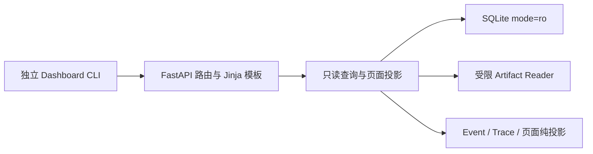

# 只读 Trace Dashboard 详细功能设计

日期：2026-10-14

最终 review：2026-10-19

状态：功能与架构推荐选择已确认，首版设计定稿；实施计划及代码执行另行安排。
依据：`docs/blueprint.md` 第 11 节 Dashboard 清单与第 13 节四页面设计。
配套：[Dashboard 架构设计](2026-10-14-dashboard-architecture-design.md)。

## 1. 意图与交付边界

用户要求完成 Dashboard 的详细功能与架构设计，并已确认：当前不支持 Checkpoint，Recoverable 尚未设计实现，Compare 暂不实现，其余首版选择采用配套架构稿推荐方案。本文以 Dashboard 查看能力为范围依据，不修改冲刺日期，也不包含评测执行器和故障注入系统的实现。

使用者是项目开发者和面试演示者，在本机查看正在进行或已结束的 Run，解释执行顺序、工具结果、压缩来源、补丁、独立验证和成本。首版是单用户本地只读工具，交付 Run 列表、Run 详情、Workspace 三个页面。

成功标准：

- 从 Run 列表进入详情，能回答“执行到了哪里、为何结束、依据是什么、花费多少”。
- Workspace 销毁后，仍可查看已保存的补丁和评测证据。
- 每个展示的结论都有 Run、Event、Snapshot 或 Artifact 来源；缺失的数据不会变成零值或成功结论。
- Dashboard 不改变 Run、审批、Workspace、数据库 schema 或 Artifact。

不提供 Compare、实验清单、Baseline/Recoverable 指标、Checkpoint 展示、恢复执行展示或统计。也不提供创建任务、执行命令、取消、审批操作、resume、恢复工作区、用户管理、远程调度、公开分享、OTel 导出或完整 Web 管理平台。已有审批与上下文压缩事实可以查看；上下文压缩不等同 Recoverable 功能。

## 2. 现有能力与缺口

代码核对基线：`e228f70`。实现与测试优先于蓝图的路线图描述。

| 展示对象 | 当前来源 | 设计约束 |
| --- | --- | --- |
| Run 身份、状态、模型、结果、累计 usage | `RunRecord.state`，`runtime/state.py`、`metering/usage.py` | 状态与验证类型分开显示 |
| 单 Run 事件顺序、Step、Span scope | `runtime/events.py`，SQLite `run_events` | `sequence` 是顺序依据，时间戳用于显示 |
| 历史状态与压缩来源 | `runtime/snapshots.py`、`runtime/context.py` | 压缩摘要保存在 conversation，尚无独立 Task Memory 表 |
| Patch、测试日志、report、evaluation summary | `artifacts/file.py`、`cli/candidate_submission.py`、`evaluation/swebench.py` | 以已登记 manifest 和内容摘要为依据 |
| TraceSpan / RunTrace | `runtime/tracing.py` 已定义契约 | 聚合未接入，Dashboard 需增加只读投影 |
| 每请求模型 usage、成本、完整输入输出 | `ModelResponded` 不包含上述字段 | 当前只承诺累计 usage；旧历史无法补造请求级明细 |
| Token、费用、时间硬预算 | termination reason 有类型，当前 `RuntimeConfig` 未定义这些上限 | 上限缺失显示未配置；不能声称已被 Runtime 强制执行 |
| Local 成功 | 默认 CLI 装配 `PassThroughEvaluator`，历史 Run 未持久化 Evaluator 类型 | 默认装配说明与该 Run 的“验证类型未记录”分开，不由 Local succeeded 推断独立验证通过 |
| 完整目标测试清单 | 当前 evaluation Artifact 未发布 task.json，config 未保存完整目标集合 | 可浏览报告记录的测试及已记录评测结论，不能声称已复核完整覆盖 |

“完整轨迹”指完整查看已持久化的执行事实与可用证据；不承诺恢复所有模型对话、采集阶段丢弃的输出或从未登记的文件。

## 3. 方案比较与推荐

| 方案 | 优点 | 代价与适用性 |
| --- | --- | --- |
| **FastAPI + Jinja + 少量 HTMX（推荐）** | 符合蓝图、复用 Jinja、无需 Node 构建；同一服务负责读取与渲染 | 增加 FastAPI、Uvicorn；局部刷新需保持浏览位置 |
| 静态 HTML 报告 | 易留存、无需长驻服务 | 实时 Run、分页筛选较弱；作为后续导出能力 |
| SPA + JSON API | 适合复杂交互和后续多人产品 | 增加前端工具链与接口维护，超出首版价值 |

采用第一种。HTMX 与 CSS 本地随包分发，不依赖 CDN。FastAPI 用于服务、参数校验和错误转换，Jinja 使用自动转义。首版没有公共 JSON API 和前端状态管理框架。

本项目仍需维护 HTML/Jinja 模板、CSS 和少量交互 JS；Python 服务端返回动态生成的完整 HTML 或片段，浏览器负责显示，HTMX 负责局部替换，不是预生成静态报告。最终 review 后首版继续采用该方案；Phoenix/Langfuse 的导入、同步和通用 Trace UI 留作后续独立备选，不纳入本次交付。

## 4. 信息结构与公共交互

三个主页面：Run 列表、Run 详情、Workspace。Run 详情和 Workspace 共用身份栏及页签；来源跳转和 Artifact 预览是附属只读视图。

公共规则：

- 中文界面，状态、事件类型、模型名保留代码原值以便检索。状态使用文字和颜色双重表达。
- 时间显示浏览器本地时间及明确时区，悬停可见 UTC；无 JavaScript 时显示 UTC。
- 每次读取标注 `read_at`，详情标注 `as_of_sequence` 和 Snapshot 版本。Workspace 另标注 manifest 读取时间，文件发布与数据库提交不是同一事务。
- 所有筛选参数进入 URL，刷新和返回保留筛选。空结果给出清除筛选入口。
- 文本按普通文本展示。JSON 折叠，长文本分段查看，不执行模型生成的 HTML、Markdown 内嵌 HTML 或链接脚本。
- 页面可键盘访问；横向溢出的 Diff 可滚动，移动端表格可横向查看。首版不设计独立移动端交互。
- 手动刷新默认可用；自动刷新默认关闭，可开启 5 秒轮询。隐藏浏览器页停止轮询，终态停止轮询，可手动刷新查看后续发布的 Artifact。
- 轮询失败保留原有内容和读取时间；下一次自动请求退避到 10、20、30 秒，成功后恢复 5 秒。
- 详情刷新将 Run 状态、预算、当前摘要与时间线切换到同一新读取边界，恢复筛选、Event 锚点和展开状态；锚点不在首批时按 ID 读取有界定位窗口，不重新加载全部历史。主页面页签切换建立新边界，附属来源视图沿用原页面边界。
- Workspace 整页刷新/轮询更新 Run、评测事实和 Artifact 元信息；已打开日志保留原内容与读取时间，仅在用户重载预览时重新读取和 hash 校验。

## 5. Run 列表

入口 `/runs`，`/` 重定向至该页。

列：Run ID（短显示、完整 ID 可复制）、任务摘要、模型、Workspace 类型、状态、Termination Reason、验证类型/结论、active duration、累计模型成本、创建时间。任务全文在详情显示；不得从自由文本 task 猜测 benchmark instance ID。

筛选：状态（可多选）、模型、Workspace 类型、创建时间区间、Run UUID 精确匹配、task 文本包含。task 查询最长 200 字符，作为普通文本参数，SQL LIKE 通配符需转义。时间区间采用 `[from, to)`，`from >= to` 拒绝。旧 Run 没有 Workspace 类型时显示未知并可筛选。

排序固定为 `created_at DESC, run_id DESC`。每页默认 25，允许 10/25/50/100；使用带完整排序位置的游标，下一页不会因新 Run 插入而重复已有行。首版不提供跳到任意页或成本排序。

游标不冻结跨请求的整个筛选集合：Runtime 更新状态时，匹配成员和计数可以变化。页面承诺排序位置分页，不宣称浏览期间状态筛选结果静止。

点击 Run 进入详情；失败 Run 显示失败原因摘要。列表不逐行读 Artifact 内容，也不逐行扫描全部事件；验证结论只有已存储的摘要支持时才显示，否则显示“详情查看证据”。

列表顶部只显示当前筛选的 Run 数和各状态数量，不显示 resolved rate，避免把自由任务、pass-through 和 benchmark 混合计算。

## 6. Run 详情

入口 `/runs/{run_id}`。布局由身份栏、概览、Event 时间线、Task Memory/压缩、预算与费用五部分组成。

### 6.1 身份与结果

显示 task 全文、Run ID、配置模型、Workspace 类型、创建/开始/结束时间、Run Status、Termination Reason、错误代码和有界错误消息。候选输出和最终输出分开折叠显示。

展示三项独立事实：Runtime 终态、Evaluation 结论与类型、Artifact 可用性。`succeeded` 不自动翻译成 SWE-bench resolved；evaluation summary 的 `verdict` 是证据快照，不覆盖 Run 终态。当前默认 Local 装配使用 pass-through，但 Run 未持久化 Evaluator 类型，页面分别显示默认装配说明与“该 Run 验证类型未记录，未证明独立验证”，不能把 Workspace 类型当成评测类型证据。Dashboard 无法凭更新时间判断进程仍在运行：非终态统一为“最后记录状态”，标注最后提交时间，不擅自改成 interrupted 或 failed。

### 6.2 Event 时间线

默认按 sequence 升序，每批 100，最多 200。每行显示序列号、时间、Step、事件类型、span ID、状态/错误和一句摘要。事件详情按需加载，有原始结构化 payload 的脱敏视图和 Artifact 链接。

支持事件类型、Step、工具名、仅失败筛选。工具调用的关联键为 `(run_id, step_number, tool_call_id)`，不得假设 call ID 跨 Step 唯一。筛选也在 SQL 层分页，不能只筛当前已取的一批；SQL 无匹配即结束，匹配行无法解码时保留异常占位并推进游标，不重复读取同一坏记录。来源链接按 Event ID 定位并展示前后事件，不依赖当前筛选；已知失败、拒绝和审批失效的筛选口径遵循架构稿第 6.2 节，不将未知状态自动归为失败。

可切换 Step 分组，展开该 Step 的模型/工具/审批/压缩事实。Tool Result 同时展示 execution status 和 output 完整性；“成功但输出截断”保留两个标记。未保存的工具参数和模型输入输出显示未记录，不从当前 conversation 反推历史。

Span 视图是辅助投影，Event 列表始终可用。为已知类别建立开始/结束配对表：Run、Step、Model、Tool、Tool Execution、Evaluation、Approval Wait；压缩独立作为事件组，不强行增加现有 SpanCategory。

- 以 span ID 和事件类型配对，以 `parent_span_id` 表达归属。
- 配对成功且时间合法才计算持续时间；时间倒退显示不可计算，不改写原始时间。
- 有开始无结束：非终态标记 open/存活未知；终态标记 incomplete，不能用 Run 结束时间伪造成功结束。
- 有结束无开始、重复开始/结束、缺父节点或非法层级：保留事件，提示 scope 不完整。
- 首版使用独立页面 SpanView，按需补查当前批次 scope 的起止与父节点；不构造或导出整个 Run 的 RunTrace，不放宽现有契约。根 Span 缺失时只显示 Event 时间线。
- 超过父链/scope 读取限制时标为未完成加载，不能把未加载节点误报为历史缺失；分页与筛选不能导致已有配对事实被误判为缺少起止。
- Span 时长源于提交时间差，标注为记录间隔；不能等同 Provider 精确延迟，也不累加重叠 Span 作为 Run 耗时。

### 6.3 Task Memory 与压缩

展示已提交压缩版本、摘要来源 Snapshot、覆盖 Step、来源 Event sequence、前后 input token 估计、摘要尝试 usage/成本、失败原因。

当前 Task Memory 由 active compaction summary 投影：current_goal、user_constraints、verified_evidence、workspace_changes、rejected_attempts、uncertainties、open_items、next_action。使用既有模板版本的固定前缀解码和 `CompactionSummary` 校验，不用正则从任意 assistant 文本提取 JSON。只有 VerifiedEvidence 按其 EventSource/SnapshotSource 提供精确跳转；其他摘要字段链接承载摘要的 Snapshot，标为摘要记录，不能伪造逐项来源。明确区分观察、被否定尝试和不确定项。

校验完整渲染摘要的哈希、当前版本及已加载来源的范围与内容支持；来源范围不合法、摘要解析失败或内容不匹配显示“证据不一致”及可用的脱敏文本，不执行修复。来源尚未加载或超出读取限制显示“未完成校验”，不能声称证据已通过或已损坏。无压缩时显示“尚未生成持久化 Task Memory”，不调用模型补摘要。历史版本从对应 new Snapshot 查看。Snapshot 来源视图用于解释运行状态和压缩证据，不提供代码状态恢复能力。

每次压缩以首次 CompactionRequested(attempt=1) 的 sequence 标识，尝试在对应 Completed/Failed 结束的事件组内关联；不能以共享的 Run span 和 attempt 编号串联不同压缩。摘要尝试在 AttemptRecorded 与结束事件列表间去重，缺失或冲突保留问题，不重复计费。

### 6.4 预算与成本

展示 Steps started / max_steps、连续失败数 / max_consecutive_failures、模型请求数、Tool Calls、累计输入/输出/总 Token、缓存输入与 reasoning 输出的子集计数、累计模型费用和 active_duration_ms。

缓存 Token 与 reasoning Token 不再次加到 total。费用使用持久化 Decimal，不按当前价格重算旧 Run。首版费用标题为“累计模型成本（USD）”，不包含 Docker/基础设施费用；当前没有计费完整性字段，统一标注“已记录费用，完整性未证明”。摘要请求已包含在 Run usage，单列摘要成本只作说明，不再次计入。

累计 Token 与模型上下文容量是不同概念。容量/输出预留从 Run definition 读取，最近压缩前后 input token 标记为估计值和来源时点，不伪装为当前请求占用率。

未配置的时间、累计 Token、费用硬上限显示“未配置”；无上限不绘制百分比。达到上限允许显示 100%，超过上限显示实际数值与超额标记。时间区分 active duration 和 start→finish 的 wall duration；非终态 wall duration 是截至读取时间的经过时间，不证明进程存活。

## 7. Workspace 页面

入口 `/runs/{run_id}/workspace`。展示已保存的代码与验证证据，不访问活动 Workspace 或执行 Git/Docker 命令。

### 7.1 补丁与文件

选择器列出 `workspace_patch` Artifact，显示 Artifact ID、kind、stage、submission ID、base revision、文件清单、SHA-256 与来源。默认优先选被 Evaluation 证据明确引用的候选补丁；其次选唯一的已登记补丁；多个无关联补丁不按文件名/UUID猜“最新”，要求用户选择。

文本 Diff 提供逐文件、统一 diff 查看，增加/删除行有标记。文件列表以 metadata 为登记信息，diff 解析结果独立展示；二者不一致给出提示。处理新增、删除、重命名、带空格路径、binary patch。无法解析时保留有界原文预览，不丢弃 Artifact，不应用补丁验证。

预览每次最多 256 KiB、2,000 行；显示脱敏后文本的位置，可读取下一段，不声称该位置对应原文件偏移。单个可预览 Artifact 上限 20 MiB，超过只展示元信息和“超出首版读取上限”。先校验内容，再对有界完整文本脱敏后分页；首版无跨请求内容缓存，不提供任意原始 Artifact 下载，也不读取完整仓库文件。

### 7.2 测试与独立评测

按 attempt ID 分组显示 evaluation config、summary、report、stdout/stderr、test output、instance log 和补丁关联；以当前 `evaluation_*` Artifact 类型和 metadata 为来源。

展示报告记录的测试、patch apply、timeout/infra error 等结论，只有对应结构化 report/config 明确支持时才展示。未知 report 形状或 harness 版本只提供脱敏预览，不能靠日志关键词判成功；JSON 语法错误、重复键或深度超限只显示元信息和问题。`shell` 的 exit code 只能称命令退出状态，不等同测试通过。

Run succeeded、`EvaluationCompleted.passed`、匹配 Run/attempt/instance 的 config、最终 summary 与 resolved report、对应 patch ID/hash/submission 是已记录独立评测通过的证据链；存在冲突显示“证据冲突”，必要证据缺失显示“证据不完整”，均不得展示为独立验证通过。日志或 report 缺失按项提示，其他证据仍可查看。Local 不提供 SWE-bench 独立评测卡片。

当前 Artifact 未发布完整目标测试清单，证据链成立时标题为“已记录独立评测通过”，并标注“目标测试清单未持久化，无法复核完整覆盖”。不从 report 的实际测试列表反推应执行的目标集合，不读取宿主机准备数据补全，也不修改 Evaluator 或新增生产者 Artifact。

## 8. 延后能力与范围约束

用户已确认 Recoverable 暂未设计实现，因此首版不实现 Compare 页面及其数据消费契约。Checkpoint 同样不在当前支持范围。

不增加 `/compare` 路由、Compare 导航、实验目录参数、实验清单模型、benchmark provenance 发布要求或恢复指标。不用空卡片占据页面，也不为后续功能预建通用扩展层。

蓝图中的 Compare、Checkpoint 和恢复执行展示保留为后续独立任务；届时需要重新设计生产者证据与验收口径。当前三页面只依赖已有 Run/Event/Snapshot 与 Artifact 数据。

## 9. 组件、读取与接口



建议目录 `src/miniagent/dashboard/`：app/routes 处理 HTTP；queries 处理 SQL 读取；projections 处理事实到页面模型、Span 配对和压缩证据的映射；artifacts 处理单项安全读取；templates/static 提供本地页面资源。按职责拆分，不新增通用 Repository 基类或另一套 Runtime。

外部结构化数据用 Pydantic，简单内部页面容器用 dataclass。SQL 读取复用已有 schema 与 codec，但不复用会 initialize/commit 的写入 store 生命周期。文件与 SQLite 同步 I/O 放在线程中执行，避免阻塞 ASGI event loop。

内部查询需求：分页 Run 摘要、一次一致性读取 Run + 事件批次 + Snapshot 摘要、Event 定位、Snapshot 版本、Artifact 元信息。路由不直连 Provider、ToolExecutor 或 Workspace Backend。

| GET 路由 | 结果 |
| --- | --- |
| `/runs` | Run 列表完整页；HTMX 请求返回同源列表片段 |
| `/runs/{run_id}` | 概览与首批事件 |
| `/runs/{run_id}/events` | 筛选、游标、Event ID 定位后的时间线片段 |
| `/runs/{run_id}/snapshots/{version}` | 有界、脱敏的 Snapshot 来源视图 |
| `/runs/{run_id}/workspace` | 补丁、修改文件和评测证据 |
| `/runs/{run_id}/artifacts/{artifact_id}` | 校验后按偏移提供有界文本预览 |
| `/healthz` | 本地服务状态，不暴露路径或配置 |

只提供 GET/HEAD，不设置改变 Run 的 HTTP 操作。查询中的路径、排序列和 SQL 条件使用固定白名单；参数绑定，校验 UUID、cursor、sequence、偏移及范围。

## 10. 只读一致性、资源与错误

SQLite 使用 `mode=ro` URI 和 `PRAGMA query_only=ON`，不调用 initialize，不 CREATE/UPDATE，不迁移或设置 journal mode。活动 WAL 使用正常 SQLite 一致性视图，不使用 immutable 模式；运行机需有读取有效 WAL 的权限，首版不在 Dashboard 内修改部署的 journal 设置。

每个页面数据库读取在短只读事务中获取同一视图的 Run、`as_of_sequence` 与 Snapshot 上界，后续事件查询限定不超过该 sequence；先退出事务再读文件与渲染。事件分页保留首屏概览，不以新 Run 状态替换旧边界；详情整体刷新才取得新边界，主页面切换重新读取，附属来源查询校验原上界。游标绑定用途、Run、过滤条件、完整位置、读取上界和边界状态，HMAC 签名、30 分钟有效、服务重启失效；无持久化游标状态。过期/不匹配返回参数错误并提供重载入口，不把新事件静默插进已读页。

Artifact manifest 可能晚于 Run 终态发布；首次无文件并非永久丢失，手动刷新可发现。只允许通过 run ID + artifact ID 查已登记 manifest，不接受用户 URI。逐项校验身份、内容根目录、大小与 hash；一个坏文件不阻塞整个 Workspace。

现有 `FileArtifactStore.list_for_run()` 会验证所有内容，一个坏 Artifact 可中断整个列表；Dashboard 需单独按受限 manifest 枚举元信息、逐项捕获可恢复错误，不能直接依赖该批量方法。针对可预览内容采用有界流式 hash 校验和读取，不用其全量 `read_bytes` 路径。超过 20 MiB 不读取内容，明确标为未校验。

首版固定资源限制以架构稿第 12 节为准：SQLite busy timeout 1 秒，单读取单元处理预算 5 秒；事件批次最多 200；state/Snapshot 正文每项 20 MiB，Event payload/artifacts JSON 和 recovery_context_json 每项 1 MiB，单请求结构化正文合计 64 MiB；每次预览 256 KiB/2,000 行；manifest JSON 每个最多 1 MiB；Artifact 元信息每页 100 条；Span 父链 64 层、scope 1,000 个、压缩版本链 32 版、JSON 深度 64、重内容请求并发 2。超限保留可读事实并标为未完成读取，不将阅读限制视为 Runtime 写入限制。首版不增加资源参数、环境变量、配置文件、跨请求内容缓存或物化表；页面不批量加载所有日志内容。

| 条件 | 用户可见行为 |
| --- | --- |
| DB 路径不存在、schema 不支持 | CLI 启动失败并给出原因，不创建空 DB |
| 非法筛选、UUID、游标、过大参数 | HTTP 422，有可读参数说明 |
| Run/Snapshot/未登记 Artifact 不存在 | HTTP 404，可返回上级页面 |
| 已登记内容损坏、hash 冲突 | 证据不可用标记；单项预览 409，保留其他页面内容 |
| DB 暂时忙、查询预算或重内容并发耗尽 | HTTP 503 与可重试提示；不无限重试 |
| 正文超出阅读上限、不可预览或 JSON 不可安全解析 | 保留元信息和问题视图，不输出原始正文，不冒充历史损坏 |
| 某一旧 Run/事件 schema 不支持或损坏 | 隔离显示 ID、sequence、错误类型；不输出未经脱敏的原始 state_json |
| 非预期读取失败 | 有界错误页和服务器错误 ID；服务端保留诊断，不把宿主路径/凭证发给浏览器 |

不吞掉未知异常或返回空成功页面。不支持的 Event 类型可显示 envelope 与“无法解析 payload”，不影响其他可解码事件。数据库物理损坏仍是页面失败，不能伪装成无 Run。

## 11. 内容安全与隐私

默认绑定 `127.0.0.1`，首版不提供非 loopback host 设置、认证系统或公开托管。请求验证 Host 与 Origin；不接收跨域片段请求，不启用 CORS。所有脚本和样式本地提供，配置 CSP、`nosniff` 和禁止 iframe 嵌入，静态资源不提供任意文件目录。

Artifact 预览只允许明确的文本/JSON/diff 类型，未知或二进制内容只展示元信息；拒绝目录逃逸及根目录以下的所有符号链接，即使指向根内。安全打开后在同一文件描述符上验证大小、hash 并读取，避免路径检查后被替换；用户输入不触发网络下载。测试与 Artifact 内容视为不可信数据。

manifest/content 仅接受普通文件，目录节点必须为目录；打开过程避免 FIFO 阻塞，随后在同一描述符上确认文件类型。非普通文件作为单项不可用证据展示，不允许占住读取名额后无限等待。

所有发往浏览器的 task、输出、payload、summary、metadata 和文本片段经过同一展示脱敏：敏感结构化键（authorization、api_key、token、secret、password 等）遮盖值；已知凭证前缀、Bearer/Authorization 行及私钥块遮盖文本。统计 Token 字段通过明确白名单保留。查询匹配在受限本地环境中可使用原始 task，但响应和服务器访问日志不记录原始搜索词。

预览先对有界完整文本建立脱敏视图，再分页，避免凭证被片段边界拆开。无“显示原始凭证”按钮。脱敏不声称识别任意未知秘密；公开示例另走离线数据审查流程，本设计不自动发布原始内容。

## 12. CLI 兼容性

当前 `miniagent TASK [OPTIONS]` 是 Typer 单命令应用。直接加入 `dashboard` 子命令会改变既有入口解析，属于公共契约变化。

增加独立 console script：

```bash
miniagent-dashboard --port 8080 \
  --database ~/.miniagent/runs.sqlite3 \
  --artifacts ~/.miniagent/artifacts
```

省略 database/artifacts 时沿用现有 Settings 的路径默认值，但使用独立 DashboardSettings，不实例化必填 Provider 凭证的 Settings，不读取 `.env` 或继承其环境变量契约。首版仅提供 database/artifacts/port 和标准 help，参数使用 Typer/Pydantic 校验，port 为 1–65535。单进程、单 worker 启动，不默认打开浏览器，不装配 Agent、不读取 Provider credentials。FastAPI/Uvicorn 放 `dashboard` optional extra，现有 CLI 安装与运行不强制安装 Web 服务依赖；缺依赖时给出明确安装说明。

未来统一成 `miniagent run/dashboard/...` 需另做迁移，不在本设计顺带重构主 CLI。蓝图 `rca dashboard` 是规划示意，不代表当前可调用命令。

## 13. 验收与最小证据组合

设计文档本身不执行运行测试；实现后使用真实临时 SQLite 和真实临时 Artifact 文件验证。只有外部 Provider/Docker 需要边界 fake，Dashboard 验收不调用它们。

| ID | 场景与可观察验收 |
| --- | --- |
| D01 | 持续写入新 Run 时分页列表，无重复既有行；筛选包含通配符的 task 文本按字面匹配；状态筛选成员可随提交变化，不宣称跨请求冻结 |
| D02 | 非终态与各终态展示状态、reason、错误；Local 默认 pass-through 说明与历史 Run 验证类型未记录分开，Local succeeded 不显示独立 resolved |
| D03 | sequence 顺序与时间戳不同仍按 sequence 展示；跨 Step 重复 tool call ID 不串结果 |
| D04 | Tool success + 采集截断保留成功与不完整两个标记 |
| D05 | 缺结束/父节点/重复 Span 与未知 payload 保留可读事件；跨页起止可补查、超限节点标未加载，不伪造完整 Trace；筛选无匹配结束，坏行占位并推进 |
| D06 | 压缩当前/历史版本和 VerifiedEvidence 来源可定位，其他摘要字段仅链接承载 Snapshot；无摘要、坏 hash、缺来源与未完成校验分别可见；不同压缩中重复 attempt 不串联 |
| D07 | Patch 文本/重命名/binary/无法解析可查看或说明；Workspace 已销毁不影响读取 |
| D08 | 一份 Artifact 损坏，其余仍可访问；跨 Run ID、路径逃逸、根目录下全部 symlink、FIFO 等非普通文件和路径检查后的替换攻击被拒绝或不影响已打开内容；FIFO 不阻塞读取 |
| D09 | SWE-bench config/summary/report 与 Run/attempt/instance/patch 不匹配时证据冲突，必要证据缺失标不完整；通过时展示已记录结论并标注完整目标覆盖无法复核；shell 成功不能代替验证 |
| D10 | 三页面没有 Compare、Checkpoint、恢复统计入口；CLI 没有 experiments 参数或实验清单读取要求 |
| D11 | 未配置的预算上限不显示百分比；累计 Token 不当作上下文占用，缓存/reasoning 子集不重复相加，摘要成本不重复计费 |
| D12 | 累计费用复用持久化 Decimal，未证明的计费完整性明确标注；非终态经过时间不宣称进程存活 |
| D13 | 请求期间 Runtime 提交新事件，页面 Run/事件上界一致；分页不混新状态，刷新切换边界且保位；主页面独立读取，来源沿用原边界；手动刷新可发现晚发布 Artifact |
| D14 | HTML/script、凭证、私钥跨分页边界不会进入可执行或未脱敏响应；Host/Origin 非法拒绝 |
| D15 | 超出正文/预览/JSON/参数/来源链限制不全量加载；坏 JSON 不提供原文，脱敏后偏移分页；DB busy/查询预算/重内容并发耗尽为 503，轮询失败保留内容 |
| D16 | Dashboard 所有路径只读；无并发写入时 SQLite 逻辑数据与 Artifact 字节未变，无迁移和 Artifact 新写入；SQLite 自身 WAL/SHM 协调不视为业务写入；原有 `miniagent TASK` 解析保持；Dashboard 无 Provider 凭证且无 `.env` 也可启动 |

测试分层：投影单元测试覆盖配对、usage 展示、压缩来源和未知数据；ASGI+SQLite+文件集成覆盖 HTTP、只读、身份校验、分页和竞争读取；浏览器验收覆盖三页导航、展开、来源跳转、刷新保位、文字溢出和键盘可用性。自动浏览器测试只保留跨页面一条证据浏览主路径，不重复所有计算测试。无真实 benchmark 或模型费用要求。

本次 Dashboard DoD：三个页面和 D01–D16 场景通过，能从 SQLite 与 Artifact 查看当前执行链已记录的事实与证据。缺失的已支持数据明确标记；本次验收不依赖 Recoverable、Checkpoint 或实验生产者，也不代表蓝图第 13 节的全部四页面已经完成。

## 14. 实施边界与依赖顺序

后续实现计划按同一只读子系统组织：查询一致性与视图模型 → Run 列表/详情 → Artifact/Workspace → 本地服务与浏览验收。该顺序不是本轮已批准的 implementation plan。

首版不引入实验契约、模式开关、恢复执行数据或 Checkpoint 接口，不预建对应服务、页面和空占位卡片。后续这些能力有独立设计和真实生产者后，再另行扩展 Dashboard。请求级完整模型记录、额外硬预算执行和跨进程 resume 同样不属于本次实现；它们不阻塞现有持久化事实的查看。

## 15. 已确认的设计选择

用户已确认 Compare 暂不实现、当前不支持 Checkpoint，并于 2026-10-19 确认首版按架构稿 A1–A11 推荐方案处理。下表为最终设计依据，不再作为待选择事项；具体读取、投影与限制契约以配套架构稿为准。

| 编号 | 选择 | 已确认方案 |
| --- | --- | --- |
| R1 | 范围依据 | 基于蓝图 Dashboard 范围收敛为 Run 列表、Run 详情、Workspace；评测执行器不纳入 |
| R2 | 主要用途 | 本机开发诊断与面试演示；只读单用户、loopback 访问 |
| R3 | 技术方案 | FastAPI + Jinja，HTMX 局部刷新，资源本地分发 |
| R4 | CLI 与安装 | `miniagent-dashboard` + optional dashboard extra，保留既有 CLI |
| R5 | 更新行为 | 默认手动，可开启 5 秒轮询；终态停止，隐藏页暂停 |
| R6 | 数据缺口 | 已支持数据缺失明确标注，不补造历史；交付不依赖延后能力 |
| R7–R8 | Compare | 延后；不实现实验清单、统计口径、路由或导航 |
| R9 | Artifact 访问 | 仅脱敏有界预览；256 KiB/2,000 行分段，20 MiB 单文件上限 |
| R10 | 视觉与交互 | 简洁表格、页签、统一 diff、文字状态；中文界面 |
| R11 | Checkpoint / Recoverable | 首版不实现展示、操作或指标；已有上下文压缩事实继续展示 |
| R12 | 外部观测平台 | 首版继续自建三页面；Phoenix/Langfuse 及其导入、同步、平台入口暂不纳入 |
| R13 | 来源与评测口径 | 精确来源仅承诺 VerifiedEvidence；已记录独立评测通过不等于 Dashboard 复核完整目标覆盖 |
| R14 | 配置与读取上限 | 独立 DashboardSettings，仅 CLI 路径/port；采用架构稿固定阅读限制，无跨请求内容缓存 |

本轮完成最终 review 决议与两份设计同步；下一阶段另行生成实施计划并选择执行方式，不将设计确认视为代码执行授权。
