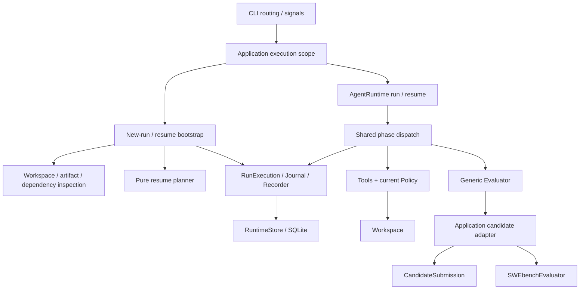

# Resume：架构设计

日期：2026-10-14

状态：架构 review 已确认；2026-10-19 按用户意见取消旧存储格式兼容与迁移，其余采用推荐方案；尚未进入实现计划或实现。

后续评审：[architecture-critique.md](../../../architecture-critique.md) 的三项 should-fix 已落实；评估镜像首次冻结按用户指定采用“镜像不存在即初始化报错，不允许 Resume”的处理。

需求依据：[Resume 需求与详细设计](2026-10-14-resume-design.md)。代码依据：`e228f70`。

## 1. 设计意图与确认范围

为同主机 Local / Docker Run 提供跨进程安全续跑。复用原 Run、Workspace、模型定义、Working Context、工具结果、配置与累计 Usage；不使用 Workspace checkpoint，不重新创建现场，不自动重放未知副作用。

用户已确认采用方案 1：在现有架构上扩展，由 Application 编排恢复，Runtime 通过共用 phase dispatch 推进，Journal 原子提交事实。2026-10-19 集中 review 确认：C08 因产品未上线而取消旧存储格式兼容与迁移，其余 C01–C12 按推荐方案采用。第 18 节记录最终选择及影响。

原文 D1–D10、CLI 契约与 R01–R35 验收保留，并增加 R36–R39 覆盖本轮评审边界。主导质量属性依次为：

1. **副作用安全**：未知 shell 不重放；旧受管理执行未结束时不并发执行。
2. **持久化一致性**：恢复位置、响应处置、工具结果、审批与 Usage 的提交边界明确。
3. **可操作性与可解释性**：dry-run 无业务写入，拒绝有稳定码，Local / Docker 使用同一恢复协议。

SQLite 无法与文件、进程、Docker 或 provider 的副作用组成事务。本设计不承诺 arbitrary shell exactly-once、磁盘回滚、外部服务恢复或脱离受管理进程组的后台写入检测。Workspace 保持 Run 独占是前提。

## 2. 路线与当前实现差距

采用现有组件增量演进；不接入 L0–L5 `RecoveryController`，不改为事件重放驱动，不新增第二套 loop。

| 当前事实 | 架构处理 |
| --- | --- |
| `AgentRuntime.run()` 创建新 State，`RunExecution.start()` 创建新记录 | 新增 attach / resume 入口，与 run 汇合到共用 dispatch |
| `_run_step()` 串行完成请求、工具和 Step 收尾 | 拆为可从持久化 phase 进入的阶段 |
| `ToolCallRunner.execute()` 已从 `batch.next_index` 开始 | 保留此行为；Step 完成时读取整批已提交结果 |
| `RunRecorder.record` 与 Journal 审批版本只在进程内建立 | attach 加载最新记录及所需 StoredApproval.version |
| `RunResult` 只允许终态 | 保持终态契约，新增独立暂停结果类型 |
| Local / Docker `recover()` 从 checkpoint 创建资源 | 新增 retained Workspace attach；不复用 recover |
| Docker backend 使用 `docker exec`，不保存 exec ID | 引入可持久化的 exec 身份与可检查的执行收尾 |
| CandidateSubmission、Evaluation 暂存主要在内存 | 持久化提交阶段、执行 attempt 和完整 EvaluationResult |
| SQLite `user_version=2`，runs.status CHECK 不含 suspended | 直接更新初始 schema；开发数据库重建，reader 仅支持当前格式 |
| Settings 初始化强制要求模型凭据 | 拆开记录定位配置与实际执行凭据 |

## 3. 组件、依赖与文件归属

图中 Evaluator 调用应用层适配器通过依赖注入发生；Runtime 只导入通用协议，不导入 CLI 实现。

| 单元 / 位置 | 责任、公开操作与依赖 |
| --- | --- |
| `cli/main.py` | 显式路由旧调用、run、resume；解析 UUID、信号与退出码；保留 Python `main(...)` 签名 |
| `cli/application.py` | 最外层执行作用域持有 Run 锁；调用 bootstrap / Runtime / finalization；管理暂停结果 |
| 新增 `cli/resume.py` | 恢复用例编排：load → inspect → plan → ResumeStarted → attach → rehydrate → ResumeCompleted |
| `cli/bootstrap.py` | 新 Run 初始化；提供可复用的冻结定义装配函数，不在 resume 重新读取默认任务配置 |
| 新增 `cli/run_definition.py` | 应用装配定义的版本化模型，包括 evaluator 判别联合与恢复所需绝对路径 |
| 新增 `runtime/resume.py` | 通用 ResumePlan / ResumeRejection 与纯判定函数；只接收通用 facts，不访问宿主设施 |
| `runtime/state.py` | execution phase、活动操作、暂停与恢复元数据；集中校验状态组合 |
| `runtime/loop.py` | `run()` / `resume()` 共用 `_drive(execution)`；无 Workspace backend 选择逻辑 |
| `runtime/execution.py`、`transitions.py` | 纯状态转换及其持久化入口；模型处置、attempt、Step、暂停、恢复与终止 |
| `runtime/recording.py`、`journal.py` | attach、CAS、审批版本、State / Event / Approval / Snapshot 同一提交 |
| 新增 `environments/attachment.py` | Local / Docker attachment 的版本化模型；不引用 Runtime |
| `environments/process.py` | 宿主进程身份、收尾观察与既有有界回收；不理解 Step / Policy |
| 新增 `environments/docker_connection.py` | 从现有评估连接模块提取冻结连接及命令参数构造，供两个 Docker 使用方复用 |
| 新增 `environments/managed_execution.py` | 执行身份、observer、完成证据及必要的进程组监督逻辑；不成为通用任务框架 |
| `cli/candidate_submission.py` | candidate / diagnostic 分离；持久化 submission、export attempt 和 patch 绑定 |
| `evaluation/swebench.py` | 冻结输入下的评估 attempt、受管理 harness、资源归属与结果 |
| `storage/sqlite.py`、codecs、queries、初始 schema | 当前格式读写、版本校验和恢复所需查询；不实现升级迁移 |
| 新增 `storage/run_lock.py` | POSIX 同主机非阻塞 advisory lock，不管理业务状态 |

这些是职责归属；不要求每个操作增加类或 Protocol。只在依赖跨领域、需要外部边界替代时使用小型接口。Run 锁不进入 State，也不由 SQLite 连接隐式持有。

## 4. 持久化模型与唯一事实来源

### 4.1 分离运行状态和装配定义

**RunRecord.state** 是执行进度的唯一恢复来源。Snapshot 保持状态校验、审计和 compaction source 用途；不用旧 Snapshot 覆盖更新的 RunRecord.state。

沿用 `RunRecoveryContext` envelope，升级为 v2：保留脱敏 workspace spec，增加 retained attachment 和应用定义 envelope。应用定义 envelope 包含 `kind=cli_application`、schema version、规范 JSON payload 与摘要；Runtime 只校验通用 envelope，不导入 CLI / SWE-bench 类型。CLI 使用严格 Pydantic 联合解析 payload。未知 kind / version 拒绝恢复，禁止 pickle 或动态 import 配置指定的类。

应用定义保存原 pricing entry、provider 非敏感连接身份、凭据引用、模型容量、工具指纹、artifact root、candidate / finalization 超时及 evaluator 定义。`RunDefinition` 已有 Agent、RuntimeConfig 和 tool definitions，不再复制一套作为装配权威；envelope 用摘要绑定这些已有内容。

Local evaluator 为 `pass_through`。Docker evaluator 为 `swebench`，保存原 task context、prepared task 的完整非秘密定义及 digest、manifest / tasks digest、harness version、镜像内容 ID、数据 / work root、两个 Docker 连接身份和全部实际超时配置。凭据、TLS 私钥内容、环境快照不落库；只保存引用和必要非敏感身份。

**评估镜像首次冻结**在 bootstrap 预检阶段、创建 Workspace 和首笔 RunRecord 之前完成。使用冻结的评估 Docker 连接 inspect 原镜像并取得内容 ID；镜像不存在时，无论 `swebench_allow_image_pull` 是否开启，均报 `EVALUATION_IMAGE_UNAVAILABLE`，退出 1。本路径不自动拉取，不推迟到评估阶段冻结，不写不完整恢复描述、不公开恢复命令；没有已创建的 Run 可供 Resume。若其他准备步骤已分配本次临时资源，沿 bootstrap 规则有界清理。

这是对当前“允许拉取时可带缺失镜像继续初始化”行为的显式收窄。`allow_image_pull` 仍作为原评估配置保存，但不能绕过首次冻结或恢复时的镜像内容 ID 校验；Resume 发现原内容不可用仍直接拒绝，不通过重新拉取 tag 代替。用户需先自行准备镜像，再新建 Run。

`RunRecoveryContext` 仅支持当前 v2，不保留 v1 reader。旧格式返回不支持版本错误；当前格式缺少恢复证据返回 `RESUME_METADATA_MISSING`，不通过默认值补造证据。

### 4.2 ExecutionProgress

| 字段 | 结构与语义 |
| --- | --- |
| `phase` | ExecutionPhase 或 None；非终态为 prepare / request_model / execute_tools / complete_step / evaluate_candidate / terminate，终态为 None |
| `steps_started`、`consecutive_failed_steps` | 沿用原值，不因 Resume 重置 |
| `tool_batch` | 沿用 calls / next_index，不复制调用游标 |
| `current_step` | Step number、消息起点、StepStarted sequence；无活动 Step 为 None |
| `request_progress` | 正常准备 / 业务请求 / 强制 compaction 分支、原业务 retry 已用次数及 summary retry 已用次数；重入不刷新预算 |
| `active_operation` | 版本化判别联合：model / summary / tool / patch_export（仅 candidate）/ evaluation；无操作为 None；diagnostic 使用独立 finalization 事件 |
| `response_disposition` | tools / candidate / terminate 的明确判别联合，包含已接受响应的后续处置 |
| `evaluation` | 通用提交引用、活动评估关联及已提交完整 EvaluationResult；不放 SWE-bench 配置类型 |

每个 operation 包含独立 attempt UUID、业务关联、开始 event ID / sequence，以及可选的执行身份。candidate / evaluation 的专属细节使用版本化 payload envelope，由所属组件严格解析；通用状态只保存恢复调度需要的身份。一个业务 operation 内的多个进程句柄逐个记录开始 / 收尾，包括宿主 SDK helper 与远端 exec；SDK helper 控制其关联 exec 的创建和启动，二者属于同一受管理执行链，不按互不相关的后继命令处理。前一独立执行链未确认结束时不分配下一链。

`phase + tool_batch.next_index` 是唯一 dispatch 依据；保留现有 `RunCursor` 枚举及字段，作为**经过强校验的兼容投影**：RUNNING / request_model → REQUEST_MODEL，RUNNING / execute_tools 或 complete_step → EXECUTE_TOOL_CALLS，候选或失败处置尚待切换状态时 → REQUEST_MODEL；其他 RunStatus 为 None。transition 同时更新 phase / cursor，validator 拒绝任何不匹配，不允许它们独立漂移。这样保留现有 Python 构造与读取形状，不额外引入第二份可独立修改的恢复 cursor。

`current_step` 区分“尚未开始下一 Step”和“同一 Step 请求待重试”，因此仅靠 phase=request_model 不增加 Step。整批工具结果来自该 Step 的 `ToolEnded.result`，以 Run / Step / call_index / tool_call_id 严格匹配；不解析渲染后的 ToolMessage，不保留第二份完整结果列表。

### 4.3 RecoveryProgress

保存 `resume_attempts`、可选 suspension 元数据、可选 recovery session。恢复 session 包含 source sequence、原业务 status、开始恢复时的 phase、resume attempt ID；不保存另一份可变业务游标。phase / batch / disposition 留在 ExecutionProgress。

SUSPENDED 和 RECOVERING 只是业务执行外层生命周期。连续恢复 RECOVERING 时继承最初业务恢复点，更新本次 session 的来源 sequence 和 attempt；不能把 RECOVERING 当成下一次的业务目标。若实际 attach 尚未完成就收到信号，保存 SUSPENDED 与未完成 recovery session，下次继续完整预检和 attach。

暂停与恢复的错误放在相应元数据和事件中，不写业务 `lifecycle.error`、`finished_at` 或 `termination_reason`。

### 4.4 核心 invariants

- WAITING_APPROVAL 恰有一个 pending；其他状态没有 pending。
- execute_tools / complete_step 必须有 batch；complete_step 必须 `next_index == len(calls)`。
- 已提交调用下标恰覆盖 `[0, next_index)`，每个业务 Call 仅一个最终 Tool Result。
- tool active operation 只能对应 next_index 当前调用；完成事务同时清除 operation、追加消息并推进下标。
- candidate 处置包含已接受原文；terminate 处置包含明确终止决定，不从 assistant 非空文本推断。
- 已完成 Step 不保留 current_step；request_model 下存在 current_step 表示原 Step 的请求处理。
- SUSPENDED / RECOVERING 保存合法业务来源；终态不含可推进 phase / active operation，历史 attempt 留在事件中。终态后诊断只追加 finalization 事实，不构成此 invariant 的例外。
- 所有已知 Usage 和结果均随其接受事实只累计一次；模型未知计费单独记录。
- State 构造、decode、每个 transition 后均执行完整模型验证，不能依赖未经校验的 `model_copy(update=...)`。

生命周期扩展必须同步 `_ALLOWED_TRANSITIONS`：CREATED / PREPARING / RUNNING / WAITING_APPROVAL / EVALUATING / RECOVERING 均可进入 SUSPENDED；可恢复非终态进入 RECOVERING；RECOVERING 可回 PREPARING / RUNNING / EVALUATING；SUSPENDED 的恢复先进入 RECOVERING。WAITING_APPROVAL 进入暂停 / 恢复必须同事务处理 pending。恢复原 CREATED 对应的未完成准备统一进入 PREPARING；终止 phase 先恢复原合法业务状态再执行 finish。终态没有出边。

## 5. 共用 phase dispatch

`run()` 验证依赖后 create/start 一次；`resume()` 只 attach 已提交记录，不重新写 RunStarted。两者进入 `_drive(execution)`。

| phase | 进入条件与行为 | 下一个持久化边界 |
| --- | --- | --- |
| prepare | 完成已冻结定义下的 Runtime 准备，不 create Workspace | RUNNING + request_model |
| request_model，无 current_step | 先检查原 max_steps；执行 Step 边界 compaction；开始新 Step / request attempt | StepStarted + ModelRequested + operation + Usage |
| request_model，有 current_step | 继续原请求阶段；使用原上下文或已提交强制 compaction 结果 | 同 Step 新 attempt；不写第二次 StepStarted |
| execute_tools | 按 next_index prepare → 当前 Policy → 必要新审批 → 执行 | 每个调用独立结果事务；最后一个同时切 complete_step |
| complete_step | 查询并验证整批结果，计算 failed / consecutive failures | StepCompleted + 清 batch / current_step / 已消费响应处置；转 request_model 或 terminate |
| evaluate_candidate | 持久化候选 StepCompleted / EVALUATING；应用适配器确保候选 patch；调用原 evaluator | submission / attempt / result 的明确事务 |
| terminate | 使用已保存的 termination decision，校验原状态转换合法性 | EvaluationCompleted（若适用）+ RunFinished + 终态 |

响应接受事务将消息、usage、attempt 结束、response_disposition 和下一个 phase 一起写入。候选响应落库后即使尚未提交 EVALUATING，也直接进入 evaluate_candidate，不再请求模型。失败响应同理直接进入 terminate。

模型异常、工具执行之外的 Policy 错误、Step failure limit 等确定终止决定，也先通过同一持久化处置入口记录；避免失败只存在于 Python 局部变量。进程在决定落库前中断时，仅按最后确认事实恢复，不能推断未提交的异常。

`begin_evaluation()` 负责候选 Step 完成；dispatch 重入时检查 current_step 与持久化状态，不重复写 StepCompleted。EvaluationResult 已提交时跳过 evaluator，直接进入 terminate。

Compaction 保持完成 Step 边界与现有 source validation / 原子发布。summary attempt 与业务请求 attempt 区分，若 context-limit retry 已进入强制 compaction，在 request phase 中保存该分支及已耗 retry 预算。已提交 summary usage 保留；未发布的 summary 不进入 Working Context。Estimator 重新创建为保守初始状态，不能依赖旧内存校准恢复安全性。

若业务请求已经开始，Resume 直接从冻结定义与已提交 Context 重建原请求，不再次触发一般 Step 边界 compaction。只有持久化 request_progress 指向强制 compaction 时才重入该分支；未发布的 summary 可重新计算计划，使用原 source version / retry 余额，不能把原请求重试误当新 Step。

## 6. 文件锁与应用执行作用域

Run 锁使用 `fcntl.flock(LOCK_EX | LOCK_NB)`。键绑定规范数据库绝对路径和完整 UUID；文件在数据库相邻固定目录中，长期保留，不在解锁时 unlink。FD 设置 close-on-exec，不传给工具、harness 或其他 subprocess。

新 Run 在创建 Workspace 前由 application 分配 UUID 并取锁，bootstrap 接收该 UUID；首笔记录提交后才输出恢复命令。Resume / dry-run 在读取可变 Run 现场前取同一锁。作用域覆盖到 finalization 完成或有界退出；不能 bootstrap 返回后提前释放。

锁不靠 status / PID / mtime 实现，不杀旧进程。真实副作用前还需校验活动执行。SQLite expected_sequence / snapshot version / approval version CAS 保留为第二层保护。

支持本地主机 POSIX 文件系统（首版目标 macOS / Linux）；不支持 NFS、多主机、数据库硬链接别名和绕过协议的客户端。数据库路径不能在运行期间替换或移动。空库初始化使用 SQLite 事务，不依赖某个 Run 的锁；已有非当前格式数据库直接拒绝，不自动升级或重建。

最外层作用域采用 application 层异步上下文管理函数，统一包住 run / resume 两种用例；不引入长期运行的协调服务。`main(...)` 和 trigger 最终仍进入该作用域。

## 7. Resume 时序与 dry-run

### 7.1 一次真实 Resume

1. 只加载数据库定位配置，解析 UUID，非阻塞取锁，以只读连接校验当前存储格式并读取记录；旧格式直接拒绝。
2. 校验终态、schema、State、attachment、冻结装配摘要与必要历史事实。未知 shell 优先拒绝，不能先启动容器。
3. 收集宿主进程、Docker daemon / container、artifact、任务 / harness 身份事实，包括业务与 diagnostic finalization 的遗留执行。先排除旧 helper / 未决 start，再判断远端收尾；纯 planner 返回计划、延期检查或拒绝。
4. 原子提交 ResumeStarted + RECOVERING + recovery session + attempts 增量 + Snapshot；同事务 resolve pending approval 为 INVALIDATED 并清空 pending。
5. 按冻结连接 attach 原 Workspace；允许启动已验证 exited 的原 Docker 容器，完成延期的只读 live checks。已证明归属旧评估 attempt 的清理仅发生在这里。
6. 装配原 provider / pricing / tools / evaluator。当前 Policy 重新建立；将未消费的旧 APPROVED 授权失效，保留其历史人类 Resolution。
7. 原子提交 ResumeCompleted + 目标业务 status / 原 phase + Snapshot，并清理或关闭可重试旧 operation 的审计状态。使用该提交返回的最新 RunRecord 交给 Runtime.resume。
8. 共用 dispatch 运行，最后执行原 finalization；释放文件锁。

步骤 4 / 7 提交结果不明时立即停止，不继续 attach / 业务执行 / 诊断 patch 导出。新的进程读取数据库确认。步骤 4 后 attach 或装配失败记录 ResumeFailed，保留 RECOVERING 和原现场；失败不是任务 FAILED，不自动循环 retry。

终态、缺恢复证据、明确身份冲突和未知 shell 的预检拒绝无业务状态写入。依赖验证发生在 inspect 与装配两个阶段；纯 planner 不调用 Pydantic Settings、工具 prepare 或任何可能执行用户代码的插件入口。

拒绝顺序固定为：锁冲突 → Run 不存在 / 格式不支持 → 终态 / 缺证据 / State 不一致 → 未确认 shell → Workspace / 旧执行 → 冻结依赖 / candidate / evaluation。未知 shell 即使“准备阶段可能根本没跑”，也不能通过后续 Policy、容器启动或重新请求模型绕过。

### 7.2 ResumePlan

内部纯数据容器使用 frozen dataclass，包含 run_id、source_sequence、目标业务 status、phase、每种允许操作、旧 attempt 的处理方式、应失效授权、待验证事实及展示诊断。外部持久化 payload / State 使用 Pydantic。

计划只在持锁期间、对应 source_sequence 下有效，不导出成以后可执行的授权文件。实际变更前重查来源身份；CAS 失败立即停止。

### 7.3 dry-run

使用同一锁、同一读取 / inspection / planner；SQLite 连接为 `mode=ro`，不 initialize、不切 WAL、不创建 ArtifactStore 根目录。可初始化锁文件；不写 Run / Event / Approval，不调用模型或工具，不 exec、启动容器、创建评估目录、清理资源。

输出区分 `ready`、`requires_live_checks`、`rejected`。stopped Docker 的 workdir / Git 检查，以及无法从 host API 确认的容器内进程组检查列为 live checks；不能把它们显示为通过。前两者表示预检未发现明确阻断，退出 0；明确拒绝退出 1。`requires_live_checks` 不承诺实际 Resume 一定成功。

缺模型 API key 仍可完成记录读取与相应 dry-run；缺 Docker 连接凭据或无法访问检查事实则如实列出阻断。实际装配缺 provider 凭据，在任何模型请求前拒绝。

## 8. Workspace attachment 与执行证据

### 8.1 attachment

通用身份为 Run UUID、Workspace ID、backend、原 base_revision、attachment schema；绝对 Artifact 路径归应用定义。attachment 由创建出的 Workspace 通过公开描述操作提供，bootstrap 不访问 backend 私有字段。

Local 保存 root / workspace_dir / repository_root 规范绝对路径及预期 marker 内容。逐层检查目录与链接，拒绝路径被 symlink 重定向；校验 marker 的 Run / Workspace 身份。base_revision 必须仍可用于原基线导出，不强求 HEAD 不变。attach 不复制、不 reset、不重新初始化 Git。

Docker 保存完整 container ID、镜像内容 ID、managed / run / workspace labels、workdir、冻结 daemon connection。inspect 只接受原 ID 与身份；running 可接回，exited 可在 ResumeStarted 之后启动；paused / restarting / dead / removing 等状态明确拒绝。不得通过同名容器接回、重新 pull/create 或降级 evaluator。

### 8.2 执行观察接口

`Workspace.execute(command)` 的原有基本调用保持有效。增加可选的受管理执行 observer；通过工具绑定的进程内 execution scope 注入，不把 observer 放进工具 JSON 参数或持久化配置。scope 使用 ContextVar，进入/退出由 ToolCallRunner 控制；candidate export 及评估显式建立各自业务 scope，diagnostic export 建立独立 finalization scope（§12.4），禁止按“最后一个当前 Call”全局变量关联。

observer 提供“执行身份已分配”和“执行已结束”的窄回调。业务 scope 由 RunExecution 原子提交，finalization scope 由 Application 使用绑定最新记录的 Recorder 追加事实；二者不并发写同一 Run。Workspace 不导入 RunExecution / Journal，只依赖通用 callback 协议。需要恢复的 CLI 工具必须走此协议；绕过它的第三方工具按未知副作用契约处理。

明确默认工具契约：Tool 基类新增默认 `unknown_outcome=reject`；仅 ReadFileTool 显式声明 `retry_read_only`。ShellTool 始终 reject，不按命令文本或退出码猜测只读。该分类进入现有 contract metadata 指纹，与 Policy 的 ALLOW / APPROVAL 独立。

流程为：ToolExecutionStarted + active attempt **先提交** → Workspace 创建执行句柄 → observer 持久化身份 → 运行 / 等待 → 取得结果且确认组内执行结束 → Tool Result 完成事务。分配身份时提交失败，停止并有界回收本次已知执行，不转成普通 Tool ERROR 后继续。

进程在开始事实提交后、身份落库前消失，shell 仍判未知。read_file / export / evaluation 缺执行身份且无法证明旧执行结束时也拒绝；不能因缺 PID 视为未执行。

### 8.3 Local：宿主进程身份

增加宿主机 `psutil` 依赖，使用新建 Process 实例读取 PID + create_time，关联 host boot identity、PGID / SID、attempt UUID。仍以现有 `start_new_session=True` 创建受管理进程组。探测要验证进程出生身份与组成员，不能只检查 PID 存在或依赖 process_iter 缓存；身份不可读、复用歧义、权限不足时返回 unknown / WORKSPACE_BUSY。

命令主进程退出还不够。正常完成、超时和取消的收尾都检查组内残留；组未结束时不提交可信完成证据。对本进程创建且身份可验证的组可按已有预算回收；新 Resume 不粗略 kill 一个碰巧同 PID 的进程。daemon 化或自行 setsid 逃离受管理组的进程仍在保证范围外。

上述身份只降低 PID 复用混淆，不是原子进程枚举或完整内核隔离证明。psutil 官方也说明身份校验依赖出生时间，process_iter 不自动保证跨次迭代 PID 未复用；实现需使用显式新身份检查。[官方进程接口](https://psutil.readthedocs.io/stable/index.html)

### 8.4 Docker：exec 身份与进程组

增加宿主机 `docker` Python SDK，仅用于 Workspace 的受管理 exec；现有镜像、容器 lifecycle 和 SWE-bench CLI 不必整体改写。共享冻结连接显式构造 APIClient，禁止 `from_env()` 重新选择 daemon。SDK 支持 exec_create / exec_start / exec_inspect；Engine 本身把 create 与 start 分开，可在 start 前持久化 exec ID。[SDK 接口](https://docker-py.readthedocs.io/en/stable/api.html)、[Engine exec 协议](https://docs.docker.com/reference/api/engine/version/v1.40/#tag/Exec)

先提交业务开始记录，按下述门控协议登记并放行 helper，再由其调用 exec_create；持久化 exec ID / container ID / daemon ID 和“即将 start”的事实后，才允许调用 exec_start。start 请求结果不明时不重发。恢复读取同一 exec 的 Running / ExitCode；exec 消失或 daemon 换代导致证据丢失时不能猜测完成。

exec 主进程采用小型 Python supervisor，复用 Workspace 现有 Python 前提。supervisor 在容器内以新 session 运行实际命令，向宿主的控制通道报告 PID / PGID / 内核出生标识，在继续业务前完成身份确认。监督代码及控制协议版本进入工具执行指纹；代码通过参数 / stdin 注入，不修改业务仓库、不要求 Agent 安装宿主 SDK。

容器内 group identity 与 exec ID 一起记录。supervisor 等待命令并检查组成员，输出与控制帧分离；后台子进程仍活动时不声称命令收尾。Engine Running=false 本身只证明 exec 主进程结束，不能证明整个组结束；supervisor 异常死亡时实际 Resume 需额外只读检查原组，dry-run 标为 live check。原容器 exited 可证明当时无容器进程，但仍不能把未知 shell 升级为成功。

SDK 是同步边界：每次 RPC 必须设置有限连接 / 读取预算；阻塞调用与流读取放在**一次命令专属的宿主 helper subprocess**。helper 是必须记录、检查和收尾的受管理执行，不能只把身份留在父进程内存。持久化其 PID / create_time、host boot identity、PGID / SID、attempt / exec 关联、放行与收尾事实；业务操作保存到 active operation 及事件，diagnostic 保存到 finalization 事件。helper 仅处理该次 exec 的固定协议，不能演化成服务或重试器。

helper 放行顺序固定为：先提交 operation 开始 → 启动等待门控的 helper（此时禁止发出 Engine RPC）→ 提交 helper 身份和本次放行意图 → 父进程发送绑定 attempt 的许可 → helper 才能创建 exec。取得 exec ID 后提交远端身份和 start 意图，父进程再发 start 许可；没有许可不得执行 exec_start。门控通道不传给其他进程；等待许可时父进程死亡导致 EOF，或门控超时，helper 即退出，不自行补发许可或重试 start。已放行的 RPC 不假设随父进程死亡同步结束，按下述未决 start 协议判断。身份 / 意图提交结果不明时父进程不放行。

恢复时先校验旧 helper 身份和可能发出 start 的权限。未确认 helper 结束，或不能排除旧 start 仍可能发生时，返回 `WORKSPACE_BUSY` / unknown，不把“exec 当前未运行 / 容器内组尚不存在”当作安全证明，不启动原容器或新执行链。只有排除旧 helper 的延迟发令后，才按远端 exec / 进程组事实判定收尾。已放行但 start 结果不明时，仅 helper 已退出和 Running=false 仍不足以证明安全：必须有可验证的已启动后结束证据，或能证明从未获得 start 许可且不可能再启动，否则继续拒绝。未知 shell 的 `UNCERTAIN_TOOL_EXECUTION` 拒绝规则始终优先。

父进程暂停时停止发新许可、关闭通道并有界回收已验证身份的 helper；helper 收尾与远端 exec / group 收尾都确认后才能提交可信完成。此安排同时覆盖普通暂停和父进程被 SIGKILL 的窗口，避免取消 to_thread 后后台线程继续 start、以及默认 executor 关闭无限等待。

observer 提交错误、身份未知、执行残留的错误必须穿过 ToolCallRunner 的通用异常包装，停止推进，不伪装成可继续的普通 Tool ERROR。真实结果与已确认收尾的 ERROR / TIMEOUT 才走正常工具完成契约。

## 9. 原子提交矩阵

| 边界 | 同一 RunCommit 中必须包含 | 提交后才允许 |
| --- | --- | --- |
| 首次创建 | 初始 State、完整 recovery context / application definition | 公开恢复 ID、开始请求 |
| 新 Step 请求 | StepStarted、ModelRequested、当前 Step / attempt、请求计数 | 调用 provider |
| 同 Step 新请求 | ModelRequested、独立 attempt、请求计数、原 retry 分支 | 调用 provider；不增加 steps_started |
| 接受模型响应 | ModelResponded、消息、已知 Usage / cost、处置 / phase、关闭 operation | 执行工具、评估或终止 |
| 工具业务开始 | ToolExecutionStarted、attempt / Call 关联、tool_calls 计数 | 进入真实工具代码 |
| SDK helper 放行 | helper 身份、attempt 关联、放行意图；业务 scope 更新 active operation，diagnostic scope 仅追加 finalization 事件 | 向该 helper 发送创建 exec 的许可 |
| 业务执行句柄 / start | 执行身份事件、active operation 更新；Docker start 前意图 | 发出对应 start / 放行业务 |
| 工具完成 | 完整 ToolEnded.result、ToolMessage、next_index、组结束证据、清 active operation；末调用转 complete_step | 下一 Call 或 Step 收尾 |
| Step 完成 | StepCompleted、整批失败判定、failure count、清 batch / current_step、下一 phase / termination decision | 下一 Step |
| 候选 patch 提交 | submission ID、精确 ArtifactRef / hash / base_revision、candidate 绑定、export attempt 完成 | 启动 evaluator |
| 评估 attempt 开始 | attempt / harness_run_id / 目录与资源归属、patch hash、active operation | 创建 harness 进程 |
| 评估结果 | 完整 EvaluationResult、证据 refs、关闭 attempt、termination decision / phase | 终态提交 |
| 终态 | EvaluationCompleted（适用时）、RunFinished、终态 State / Snapshot | 成功 finalization 后清理 Workspace |
| 暂停 | RunSuspended、暂停元数据、原 phase、pending INVALIDATED 与清 pending、Snapshot | 返回暂停结果 |
| 恢复开始 / 完成 | 对应 Resume 事件、State / recovery 元数据、所需审批变更、Snapshot | attach 变更 / 共用 dispatch |
| diagnostic finalization | 诊断 attempt / 执行身份 / 结果或未确认事实的事件；业务 State 不变，不创建 active_operation | 当前 finalization scope 按门控许可推进；不构成可恢复业务 |

工具、模型、评估 attempt 的细节是事件历史；State 只保留当前操作和继续执行必需结果。未采用完整 event sourcing。批结果与未消费授权查询需通过 RuntimeStore 公开方法，不能从 Runtime 调用 SQLite 私有函数。

新增事件族至少包含 RunSuspended、ResumeStarted / Completed / Failed、OperationExecutionIdentified、OperationInterrupted、CandidateSubmissionStarted / Committed / Failed、EvaluationAttemptStarted / Interrupted、EvaluationResultRecorded，以及 DiagnosticFinalizationStarted / ExecutionIdentified / Completed / Interrupted。执行身份事件区分 host helper / remote exec 等角色，并保存门控许可和收尾证据；名称在实现计划中与既有枚举命名风格统一。已有 ModelRequested、ToolExecutionStarted 等业务事件扩展 attempt 关联时提升对应 payload 版本，不能改写历史事件。EvaluationCompleted 仍只在终态事务写一次；EvaluationResultRecorded 表示结果已持久化，不冒充终态。

不能将一般持久化异常转换为普通业务失败后补发命令。Application 捕获 RunPersistenceError 时跳过会 exec 的 patch 诊断，保留资源，报告最后确认 sequence；若要只读展示，必须明确记录读取并不授权继续执行。

## 10. Recorder / Journal attach 与审批

`RunRecorder.attach(store, record)` 初始化已有记录、recovery context、last sequence / snapshot version；验证 Run ID / schema。`RunJournal.attach(...)` 加载当前 pending 以及尚未消费 APPROVED 授权的版本，后续继续 CAS。`RunExecution.attach(...)` 由最新 State 创建新 Trace scope，不写 create / RunStarted。

最小公开恢复契约如下；这些签名表达设计责任，不要求新增同名类：

| 操作 | 输入 / 输出及副作用 |
| --- | --- |
| `inspect_attachment(attachment)` | 返回版本化身份 / 活动执行 facts；host 只读，不 exec，不启动容器 |
| `plan_resume(record, history_facts, environment_facts)` | 返回 ResumePlan 或 ResumeRejection；纯函数 |
| `backend.attach(spec, attachment)` | 返回同 ID Workspace；调用方已持锁并提交 ResumeStarted；必要时启动原容器并验证 live facts |
| `RunRecorder.attach(store, record)` | 返回绑定原记录的 recorder；不创建或写入 Run |
| `RunJournal.attach(recorder, approvals)` | 返回带持久化版本的 Journal；不将旧批准视为本进程授权 |
| `AgentRuntime.resume(record)` | 依赖已按冻结定义装配，record 是 ResumeCompleted 返回值；只 attach 并进入共用 dispatch |

Runtime.resume 要求 store 中该 Run 的 latest sequence 与传入 record 一致，且恢复状态已完成；Application 负责持锁，Runtime 不反向获取 application 的锁对象。实际业务提交仍由 expected_sequence 保护。

RuntimeStore 补齐已有 SQLite get_approval 的协议声明，并增加按 Run 查询未消费授权 / 按 Step 查询完整工具结果的最小公开查询。已执行调用的识别以 ToolExecutionStarted 和业务 Call 关联为准，不因 active operation 清空而把历史授权当作未消费。

ResumeStarted 同事务处理 pending request 的系统 INVALIDATED 与清 pending；ResumeCompleted 前，尚未进入实际执行的旧 APPROVED 记录追加 authorization invalidation，不改历史人类 Resolution。当前 SQLite RunCommit 限制单次 resolution 为唯一 approval change，因此这两类变更分开提交，不强行把所有授权塞进同一事务。部分失效后再次中断可安全重复：按持久化授权状态继续处理。

恢复后的 Call 总是重新 prepare、重新 Policy；新的 APPROVAL 关联相同 Call 与 Workspace、当前 revision。已完成调用不再授权；未知 shell 不因新批准可重放。无交互 handler 保持原失败语义。

## 11. 暂停、取消与结果接口

### 11.1 两种停止意图

库调用原 CancellationToken 仍表示终态 CANCELLED；新增独立 InterruptionToken，仅由 CLI signal scope 请求 suspend。共享等待辅助函数能区分两者，不能将所有 asyncio.CancelledError 无条件理解为暂停。

首枚信号在 bootstrap / resume / Runtime / finalization 的最外层 scope 注册，停止新工作并取消当前等待，执行有界收尾。首笔 RunRecord 之前按 bootstrap 规则清理；记录之后保存恢复点并保留 Workspace。第二枚信号取消顶层 task，可不完成持久化；下次读取最后确认记录。终态已提交后的信号只终止 finalization，不把终态改成 SUSPENDED。

暂停使用**新增、冻结的 30 秒总预算**，涵盖当前操作收尾、暂停提交和可选诊断；诊断预算最多使用剩余部分。预算超时保留最后事实并以信号码退出，不把超时变为任务 FAILED。数据库提交结果不明仍走停止协议。

CLI 只观察到取消且没有可信 shell 结果时保留 active attempt；RunSuspended 不写虚构 ToolEnded.result 或 StepCompleted。若真实结果和收尾已确认且仍有提交预算，可先完成工具事务，再暂停。

### 11.2 结果模型

保持 `RunResult` 仅表示终态；新增 Pydantic `RunSuspension`，含 run_id、status=SUSPENDED、Usage、started_at、suspended_at、interruption 与恢复命令所需身份，无 termination reason / finished_at。

原 `AgentRuntime.run()` 无 interruption token 的库调用保持 `RunResult`；显式启用 interruption 的重载返回 `RunResult | RunSuspension`，resume 同理。ApplicationResult.run_result 接受该联合，rendering 判别 status。新增公共类型和所有消费者同步更新，不让调用方通过异常猜测暂停是否已提交。

信号退出码固定 130 / 143；普通失败或拒绝 1，参数错误 2，成功 0。暂停诊断出错只作为附加信息，不改变暂停状态。SUCCEEDED 且 artifact finalization 无错误才销毁 Workspace；终态后的 finalization 失败本轮没有恢复命令。

## 12. CandidateSubmission 与评估恢复

### 12.1 应用适配器如何提交持久化事实

保留通用 Evaluator.evaluate(request) 的基本签名。WorkspaceCandidateEvaluator / SWEbenchEvaluator 通过应用装配时注入的窄 execution observer 回报 submission、attempt、执行身份及完成结果。observer 由当前 RunExecution 作用域提供，不能直接持有一份独立陈旧 State 写库。

RunPersistenceError、执行归属不明及收尾不明的控制异常也必须穿过 evaluator / application 的通用异常包装；不能被转成普通 EvaluationResult(passed=False) 并提交终态。已确认的业务评估失败仍沿原 FAILED 路径。

回调按当前 recorder record 提交，避免 evaluator 与 Runtime 各写一份 State；同一进程不并发提交同一 Run。实际 evaluator 的输入配置与 backend 细节放在应用定义和其专属 operation payload 中，通用 Runtime 只理解 attempt / identity / artifact / result。

### 12.2 候选提交状态

区分 candidate submission 与 diagnostic submission，分别拥有身份与结果。候选记录包含 candidate 原文关联、submission ID、not_started / exporting / registered / empty / failed 状态、patch ref / hash / baseline、export operation。

candidate export 前持久化业务 attempt、临时 index 路径与资源身份；临时 index 必须位于原实现的受控位置、每 attempt 唯一。旧 export（包括可能继续发令的 helper）未确认结束时报 WORKSPACE_BUSY。确认结束但尚未提交候选引用时，可新 attempt 重导出相同 candidate；不得从 artifact 列表挑最新 patch。diagnostic export 的记录位置与终态约束见 §12.4。

ArtifactStore.put 的文件系统写入与 SQLite 不原子：文件先写成功，随后引用进入 RunCommit；中断留下的孤立 artifact 不自动认领。registered 后只验证原引用字节 / hash / ownership，不重导出。明确 empty / failed 的可信提交结果沿原评估失败路径终止；不能借 Resume 无限 retry。

暂停、失败时诊断 patch 独立保存，且仅在没有不确定活动执行且预算允许时导出。诊断不能更改 candidate 状态、覆盖其引用或成为下次评估输入。

### 12.3 评估 attempt

准备输入目录前持久化 attempt UUID、deterministic harness_run_id、instance / task、patch hash、attempt directory、资源匹配条件。创建宿主 harness 后保存 PID / create_time / group 身份；需要可重跑但身份落库失败时先有界回收，不能只依赖名字猜测旧 host 进程。

评估恢复先核对原 task / data / harness / image / daemon，再确认旧 host 组结束；按已保存严格 instance / harness_run_id 查找所属容器。可清理已证明归属旧 attempt 的容器，不触及 Agent 容器或其他 Run。任何进程或清理事实不确定则 EVALUATION_ATTEMPT_BUSY。

没有结果的旧 attempt 记录 interrupted，使用原 patch 创建新 attempt；完整 EvaluationResult 已提交则只终止，不重跑。孤立 report 不升级为结果。新 attempt 的资源身份独立，旧审计保留。

优先保持现有独立 evaluator 的结果判定与资源清理规则；变化只在于这些中间事实可持久化、可重建。评估镜像 tag 发生移动时使用冻结内容 ID；无法获得原内容则拒绝，不 pull 一个同名新镜像替代。

### 12.4 Diagnostic finalization

Application 在 Runtime 返回终态或暂停后，可在仍持有 Run 锁、旧业务执行已收尾且预算允许时发起 diagnostic export。它使用独立 finalization attempt ID / observer / scope，**不写 execution.active_operation，不改变 phase、candidate submission、RunStatus、finished_at 或 termination reason**，终态 invariant 不设例外。

导出前追加 DiagnosticFinalizationStarted，记录 kind=diagnostic、临时 index 路径和已知资源；进程 / helper / exec 身份分配和放行分别追加 ExecutionIdentified / 许可事实；完成后追加结果、artifact 引用或 Interrupted / unknown。每笔提交使用最新 Recorder.sequence CAS 和原业务 State；只推进事件序列，不创建新的业务 Snapshot 或可恢复游标。旧调用链中的 diagnostic submission 必须使用这个 observer，不能绕过执行观察。

若开始事实无法提交则不启动导出；身份 / 许可提交不明则不放行，按预算回收已知执行并停止 finalization。诊断失败或被信号中断不改写终态 / SUSPENDED；终态 Resume 始终拒绝，不重开或自动重试 finalization。若暂停 Run 遗留 diagnostic helper / export 未确认结束，下次恢复通过这些事件检查其归属与发令可能性，无法排除旧执行时返回 `WORKSPACE_BUSY`。本节只补足诊断事实记录，不新增终态 repair 命令或第二套执行状态机。

## 13. 模型请求、Usage 与冻结配置

每个业务 / summary 请求在发出前提交 attempt 与 model_requests 增量。恢复遗留未确认响应的请求时，将该 attempt 关闭为 interrupted_unconfirmed，并给累计 `unconfirmed_model_requests` 增量一次；开始新 attempt 再增加请求数。

一次命令只执行已有业务 retry / compaction retry 预算，不因恢复产生无界自动重试。实际调用前崩溃也可能保守计为未确认请求；输出明确它是“可能已发出 / 计费”的上界，不宣称 provider 确实收费。

已提交响应的 tokens / cost 保留，不因重建 pricing 重算；后续请求使用原 pricing 内容。已知 summary usage 和已知失败响应 usage 同样保留。无 Usage 的失败或响应不能伪装成 0 消费。增加 RunUsage 字段时同步 `add_request_usage()` 等重建函数，避免累计值被默认覆盖。

provider endpoint 的非敏感身份变化单独审计；同 provider / model / 协议兼容才允许。Generation、模型容量、工具版本 / schema / execution options 与 supervision 协议均比对冻结指纹。当前模型容量资料缺失 / 不兼容时拒绝，不用新默认值覆盖原值。Policy 是明确例外，使用当前 revision 并重新评估未执行 Call。

原 max_steps 只限制新 Step。恢复未完成 Step 即使上限已用满也完成剩余 batch；failure count 从整批已提交结果计算。暂停时长不计 active_duration；继续累计各进程实际活动区间，不依赖旧 monotonic 时间基准。

## 14. 存储格式与初始化

产品尚未上线，直接采用 SQLite schema v3、Run / Snapshot envelope v3、recovery context v2。变化的事件 payload 明确升级；未变化的 payload / Approval 可保留原版本号，但每种格式仅保留当前 decoder，不维护历史版本分支。版本号用于格式校验，不表示提供向后兼容。

直接更新现有初始 schema 文件 `storage/migrations/001_initial.sql`、状态 CHECK 和配套 codecs，不新增 `002_resume.sql`、迁移框架、旧表复制或旧记录转换。空数据库一次建立当前 schema，已有当前格式数据库正常打开；其他数据库 / envelope 版本在读写前明确拒绝。

现有开发数据库需由开发者另行重建后使用新格式；本轮只修改设计，不删除或重建任何实际数据库。程序不自动清空、覆盖或认领旧数据 / Workspace。旧格式不提供只读兼容、导入或恢复；当前格式缺少 attachment / 执行证据仍按恢复预检拒绝，终态仍不可重开。

RuntimeStore 保留只读打开 / schema inspect、当前格式记录 attach 所需查询。dry-run 不初始化、不写库。不为 Resume 新建独立数据库或 attempt 表；attempt 历史使用事件，当前进度使用 State JSON。记录读取不能触发 `.env` 凭据验证、路径 mkdir 或后台清理。

## 15. CLI、错误与 Trace

CLI 使用显式入口适配器：首参数 run / resume 分流，其余进入兼容旧 task parser；所有实际参数继续由 Typer 处理。保留导入式 main(...)，避免 Typer 从单命令变 command group 后隐式破坏旧调用。以词语 resume 为任务时使用 `miniagent run "resume"`。

Resume 只接受完整 UUID、可选 run_ 前缀、--database、--dry-run；不接受模型 / 任务 / Workspace / 预算覆盖。冻结绝对路径避免 cwd 漂移。首次完整描述持久化后及最终展示打印 Run ID。

结构化 ResumeRejection 含 stable code、run_id、phase、source_sequence、可定位的 Step / Call / Workspace 身份与非敏感原因；复用原需求稳定码集合。依赖 / 连接错误翻译到对应恢复错误并保留具体原因，不打印秘密参数。预检错误、恢复过程错误和业务失败分别展示，不能统一写 FAILED。

新进程创建新 Trace spans，关联 Run / Step / Call / attempt、source sequence、resume attempt。旧未闭合 span 仅记录 interrupted / unknown，不补写成功事件。旧活动 Step 不重复写 StepStarted；新 span 的关联不依赖恢复旧内存对象。本轮不实现 Trace 聚合 / export。

## 16. 验证设计与验收映射

本轮仅设计文档，不运行 runtime tests。实现时覆盖 R01–R39，不以单元测试替代跨进程证据。

| 证据层 | 真实依赖与观察 | 覆盖 |
| --- | --- | --- |
| State / planner | 由需求构造输入事实；验证 phase / attempt / 审批组合及拒绝顺序 | R01–R10、R20、R21、R33 |
| SQLite / Journal | 真实当前格式临时库；初始化、提交前后故障、CAS、审批版本、不可变历史与不支持版本拒绝；不验证迁移 | R03–R12、R21、R32、R33 |
| Local 跨进程 | 真实目录、Git、文件锁和子进程；外部 provider fake；检查实际副作用次数 | R01–R15、R19、R20、R24–R26、R34、R35 |
| Docker attach / exec | 真实 daemon / 原容器；start 请求结果不明、exec ID 落库窗口、后台子进程、helper 门控及父进程被杀 | R05、R06、R11、R16–R19、R22、R24、R36、R37 |
| SWE-bench | 冻结定义下的外部受控 harness，加至少一项就绪 development task 真实恢复；允许拉取但首次无镜像的初始化拒绝 | R08、R27–R32、R35、R39 |
| CLI 契约 | 真实 argv / help / trigger 调用、首枚 / 第二枚信号、缺 API key 的 dry-run | R13、R14、R22、R23、R25、R34 |
| Diagnostic finalization | 终态后真实导出 / 临时 index / artifact、身份与事件提交；暂停诊断残留执行检查 | R34、R35、R38 |

故障屏障设在外部依赖或持久化提交边界；由父测试进程观察提交事实后终止子进程，不依靠任意 sleep 或 patch 私有方法。关键观察含工具真实副作用次数、模型请求次数、Run / Step / Call 身份、消息协议、序列与 Snapshot 单调性、审批失效、Usage 和资源身份。

新增重点：dry-run 对数据库 / artifact tree 的前后摘要不变（允许锁文件）；helper 身份未落库时硬杀父进程不得发出 Engine RPC；已放行 helper 延迟 start 时恢复必须拒绝；SDK helper 退出不等于 exec 结束，Running=false 不消除未决 start；容器 supervisor 被杀但子进程仍活必须拒绝；终态诊断不产生业务 active_operation；psutil PID 复用 / AccessDenied 不误认结束；observer 持久化失败不被包装成普通工具错误；已用业务 retry 预算在多次 Resume 后不刷新；允许拉取但首次镜像缺失时没有模型请求、不创建可恢复 Run。

只有定向测试、类型检查、相关旧接口回归及真实 Docker / development task 证据满足后，才宣称 Local + Docker 的完整支持。实现修改 Python 后按 AGENTS.md 执行定向 ruff check / format 与类型检查。

## 17. 风险、范围控制与自审

- **执行监督是主要实现风险**：SDK exec ID 只解决主进程身份，进程组收尾仍需 supervisor / OS 事实；不能缩减为 PID / ExitCode 判断。
- **协议无原子副作用保证**：响应 / 工具执行与数据库提交之间的未知窗口保留为拒绝或未知计费，不能通过“恢复友好”而补造结果。
- **边界保持通用**：CLI 装配定义和 SWE-bench 配置不进入通用 RunState 类型依赖；observer 不持有第二份 State。
- **开发数据重建**：旧存储格式不兼容，现有开发数据库需另行重建；程序必须明确拒绝，不自动删除、转换或覆盖。
- **跨进程环境漂移**：身份验证无法证明每个文件都没被人改动，沿用 Workspace 独占前提；不可读事实安全拒绝可能降低可用性。
- **不扩展产品范围**：不建设跨主机锁、自动 retry 服务、资源 GC、checkpoint、终态 repair、通用 recovery controller 或 Trace 产品。

自审已对照 D1–D10 与 R01–R39：原 Workspace 身份、未知 shell、stopped Docker / dry-run、业务 retry 预算、pending / APPROVED 区分、完整响应处置、整批结果、patch 绑定、评估结果恢复、helper 发令门控、终态诊断和镜像首次冻结均有明确归属和提交点。本文不包含实现任务拆解，不代替后续 implementation plan。

## 18. 集中 review：已确认选择与影响

2026-10-19 用户确认：C08 取消旧存储格式兼容与迁移，其余按推荐方案采用。以下为已确认选择，不再作为待决项；原文 D1–D10 的安全与 CLI 契约保留，并同步收敛存储范围。

| 编号 | 已确认选择 | 原因与影响 |
| --- | --- | --- |
| C01 | Application 编排 + 共用 Runtime dispatch | **已确认**；不引入 RecoveryController 或事件重放 |
| C02 | phase / next_index 决定 dispatch，保留 RunCursor 字段并强校验投影 | 消除双游标漂移，保持现有 Python 读取 / 构造形状；transition 必须同时更新并验证 |
| C03 | recovery context 保存应用定义 envelope，应用层严格解析 | 避免 Runtime 依赖 CLI / SWE-bench；多一个版本化 envelope，但不重复 RunDefinition |
| C04 | 新增宿主机 `psutil` 与 `docker` SDK 依赖 | 为 macOS / Linux 出生身份与可持久化 exec ID 提供成熟接口；相比手写 OS / HTTP 协议增加两个直接依赖。**这是本稿新增的依赖取舍** |
| C05 | Docker 命令用容器内 Python supervisor + 单命令宿主 SDK helper | 补足 exec 主进程之外的收尾证明和异步取消边界；增加内部控制协议与验收成本，复用容器已有 Python 前提 |
| C06 | observer + 进程内 execution scope 串联工具 / submission / evaluation 与 Journal | 保留基本工具 / Evaluator 调用形式；observer 需被当成持久化安全边界，失败必须停止 |
| C07 | 保留终态 RunResult，新增 RunSuspension 联合 | 不弱化已有终态保证；ApplicationResult、rendering 与显式启用暂停的调用者需支持新类型 |
| C08 | 产品未上线，直接采用新 schema，不做旧格式兼容或迁移 | 更新初始 schema，现有开发数据库另行重建；旧格式直接拒绝，程序不自动重建或删除数据 |
| C09 | dry-run 增加 requires_live_checks，退出 0 且明确未验证项 | 保持无 exec / 无启动；容器内组检查也可能延期，实际恢复仍可拒绝。**这是对原 dry-run 展示契约的细化** |
| C10 | CLI 暂停总预算默认 30 秒并冻结 | 有界收尾、提交与诊断共享预算；预算耗尽时不能保证 SUSPENDED 落库，下次按硬中断处理 |
| C11 | 当前 Step 的工具结果从原事件读取，评估完整结果先持久化再终态 | 不复制整批 Tool Results；增加严格查询与结果事务，避免重复评估 |
| C12 | 第一版以 macOS / Linux POSIX 同主机为支持边界 | 对应 flock 与进程组模型；不增加 Windows / NFS / 多主机支持 |

已确认保留 C04–C05 的宿主机依赖与执行监督、C07 的独立暂停结果、C09 的 dry-run 展示 / 退出码，以及 C10 的冻结 30 秒暂停总预算；不额外引入此前讨论过的替代方案。

### 18.1 后续架构评审落实

依据 [architecture-critique.md](../../../architecture-critique.md) 的三项 should-fix，按用户意见补齐：

| 评审项 | 确定契约 | 落点 / 验收 |
| --- | --- | --- |
| SDK helper 的跨进程归属 | 持久化 helper 身份和许可；落库后门控放行；先排除旧 helper / 未决 start，再判断远端收尾 | §4.2、§8.4、§9；R36、R37 |
| 终态后 diagnostic 与 active_operation 冲突 | 独立 finalization 事件及 observer，业务 State 不变，终态不重开 | §4.4、§8.2、§12.4；R38 |
| 允许拉取但镜像缺失的首次冻结 | 按用户决定直接报 EVALUATION_IMAGE_UNAVAILABLE，不拉取、不创建不完整 Run，不可 Resume | §4.1；R39 |

本轮交付为 review 意见落实后的设计文档。后续进入 writing-plans 时再创建实现计划，审阅计划并选择执行方式；本轮不创建实现计划，不修改运行代码。
