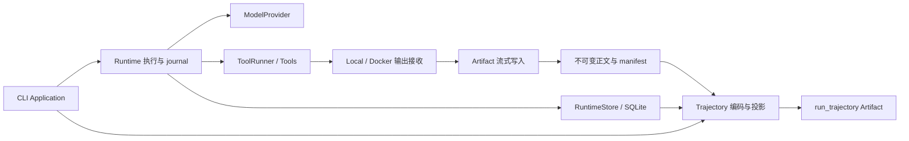

# Trajectory 架构设计

日期：2026-10-20\
状态：基础方案已获用户批准；本轮根据[第二轮评审报告](2026-10-20-trajectory-architecture-critique-round-2.md)的 B1/S1 完善架构，修订待 review。业务响应仍采用一次原子提交；本轮不修改实施计划、不实现、不提交。\
需求依据：[Trajectory 功能需求与设计](2026-10-20-trajectory-design.md)\
代码基线：`02b42a9` 及本次工作区的需求修订。

## 1. 设计简述与约束

目标是让开发者在进程结束、Workspace 销毁后，仍能复盘一次 Run 的真实模型输入、每次最终响应、工具命令与完整输出、模型实际观察、压缩、恢复、终止和验证结果。优先质量属性是证据忠实性、恢复安全性和有界内存。

用户明确要求：

- 完整证据始终保存；trajectory 默认不导出，配置只控制最终 JSON Artifact。
- 不保存模型 reasoning/thinking 正文；reasoning token 计数照常保存。
- 现有 Event/Snapshot schema_version 保持 3，CLIApplicationDefinition 保持 1。不兼容调整前的开发期数据，不迁移、不删除旧数据。
- 本轮优先采用推荐选择，成文后 review，不实现、不提交。

本文采用原需求中的用途假设：主要用于开发调试与复盘，暂不承诺训练格式、重放、实时消费或公开分享。原文件保留为需求输入；其中架构细节与本文冲突时，采用本文的推荐设计，须经本次 review 确认。

“完整”指规范化协议及执行端实际接收到的证据，不含未生成、未收到或强制终止后无法提交的内容。JSON 独立承载交互主线，大型工具正文通过不可变 Artifact 引用提供；单个 JSON 不是完整附件包。

## 2. 现有架构评审与方案选择

### 2.1 已验证的关键事实

| 现状与代码锚点 | 架构影响 |
| --- | --- |
| `runtime/loop.py::_request_model` 在缺 usage 时直接 interrupt；`execution.py::record_model_response` 同时接受响应与改变业务状态 | 不能只给现有成功响应事件加字段；需覆盖响应接收与后续判定之间的窗口 |
| `execution.py::begin_compaction_attempt` 的 OperationRef 有 UUID，但 CompactionRequested 未携带它 | 摘要请求/响应必须使用同一 attempt_id，不以重试次数关联 |
| `environments/process.py::read_stream`、`docker_exec.py::run_docker_exec_output` 丢弃超过上限的字节 | 在 ShellTool 返回后保存无法恢复完整输出；采集必须下沉到输出接收点 |
| `artifacts/contracts.py::ArtifactStore.put` 只接收 bytes | 全量 stdout/stderr 不能靠取消上限后拼接大 bytes 解决 |
| `artifacts/file.py::list_for_run` 和 get_record 会读取内容、校验 hash | 原方案的“不读取附件正文”不能复用这些接口，必须补元数据分页接口 |
| `cli/execution_scope.py` 的 RunLock 包围 application 执行 | 可复用现有锁保持导出边界，不必新增数据库长事务或第二把锁 |
| `application.py::_execute` 有多处提前返回，部分异常直接抛出 | 单在正常 return 前加 exporter 会遗漏 suspension、finalization interruption 和异常路径 |
| `AgentRuntime` 当前允许 run_store=None | “直接调用也始终持久化”需要明确收紧公开构造契约，并更新调用者 |
| `providers/qwen.py::_parse_arguments` 可在构造 ModelResponse 前失败 | 必须区分规范化成功的响应与 provider 已收到但协议无效的响应 |
| `context.py` 的来源校验/恢复校验、`cli/resume.py::_inspect` 及其他执行消费者全量加载 Event | 完整请求进入 Event 后，必须同步改成固定边界分页折叠或定点查询；导出分页不能保护正常执行 |
| `tool_runner.py::_execute_prepared` 对错误调用 ID 或错误码替换返回值 | 原始 ToolResult 必须在替换前捕获，拒绝结论和模型实际观察另存 |

### 2.2 三种方案

| 方案 | 取舍 | 结论 |
| --- | --- | --- |
| Event 作为唯一事实入口，流式持久化工具正文，收尾按固定边界投影 JSON | 需要扩展执行捕获与少量存储接口；复用恢复、序列和事务体系 | **推荐并采用** |
| 独立 evidence 数据表/采集服务，再联结 Event 导出 | 更适合独立检索服务，但引入双写、跨表提交和额外生命周期 | 当前无需求，不采用 |
| 另写实时 JSONL，结束后转换 | 支持实时消费，但必须解决文件与 journal 两套提交边界、resume 拼接和半行问题 | 首版不采用 |

保留原方案的 Event 主时间线、附件引用、默认关闭导出和非致命导出错误。具体采用：完整输出流式落盘；原始响应与判定在语义上区分、业务响应仍一次提交；附件目录只读元数据；导出投影放入独立小模块。完整证据增大 Event 后，现有压缩、恢复与执行检查也必须按需读取；工具原始返回值在业务校验替换前捕获。

## 3. 组件与依赖

| 组件 | 职责与拟定位置 | 不承担的工作 |
| --- | --- | --- |
| 证据契约 | `models` 保有请求/响应协议；`tools` 保有完整结果及观察契约；`runtime/events.py` 承载关联与提交事实 | 不创建另一套模型消息类型或完整 Run 历史 State |
| Runtime | 在调用前提交请求，在返回后提交响应，在工具观察入 conversation 时提交准确观察 | 不读取导出开关、不写 trajectory、不自行创建数据库或 ArtifactStore |
| env 输出采集 | 在 Local pipe、Docker guest data 解码处，将业务字节送入注入的 Artifact writer，同时保留原有有界预览 | 不把控制帧当 stdout，不负责 trajectory schema |
| artifacts | 新增流式正文写入和只读 manifest 分页；原 put/read 行为保留 | 不判断模型业务接受/拒绝，不修改 journal |
| `trajectory/contracts.py`、`trajectory/export.py`（新增小包） | 定义外部 schema，校验已提交来源，按序编码；依赖 runtime 公共契约和 artifact 契约 | 不接触 Dashboard、provider 网络、Workspace 执行，不实现 RunTrace 聚合器 |
| `cli/trajectory.py`（新增） | 在锁内固定边界、控制预算、调用导出、返回 URI/诊断 | 不判定 Run 成败、不补造执行事实 |
| storage / resume / Dashboard | 提供固定边界分页/类型筛选/按 ID 定位，折叠恢复所需事实，保持既有安全校验和正文展示边界 | 不新增历史格式兼容、trajectory 专用 UI |

新增包仅隔离导出格式的变化，不引入插件注册、observer 总线、通用 projector 基类或 repository 抽象。文件命名是推荐落点，不是逐步实施计划。

## 4. 持久化事实与不变量

Event 是证据的索引与顺序来源；Artifact 是大正文的存储来源；Run State 保存当前决策所需状态；Snapshot 保存恢复边界。Artifact 已注册不等于业务事实已提交。

所有操作使用原有 run_id、step_number、span_id、parent_span_id；模型/摘要/工具执行 attempt 使用 UUID，重试与 resume 不复用。一个 Tool Call 可以关联多个实际命令执行 execution_id，不能假定工具与命令一对一。

新增或扩展契约如下，使用 Pydantic 验证外部/持久化数据：

| 事实 | 必须表达的内容 |
| --- | --- |
| ModelRequested / CompactionRequested | attempt_id、用途 business/summary、实际传入 generate 的完整 ModelRequest、provider 标识；摘要附来源 Snapshot/version/covered messages |
| ModelResponded / CompactionAttemptRecorded | attempt_id、完整 ModelResponse 或互斥的 provider 协议失败证据、该阶段接受/拒绝及结构化原因、RequestCost 或缺失原因、结算结果；摘要是否发布由后续 compaction 事实表达 |
| ToolStarted | 完整请求参数；验证成功后，执行开始事件另存实际 canonical arguments |
| 命令执行事实 | attempt_id/execution_id、实际 argv、有效 cwd、执行身份、超时设置、stdout/stderr 正文引用、字节数、capture 状态及退出证据 |
| ToolEnded | 校验替换前的原始 ToolResult（小正文内联，大正文引用）、接受/拒绝结论及原因、模型可见的有界结果、准确 ToolMessage 或未产生原因；外层归属取当前执行 attempt，而非原返回 ID |

重复字段如 tool_call_count、finish_reason 必须由同一响应计算并验证一致。数值缺失不填零；request_cost=None 区分无 pricing、usage 缺失和计算失败。费用只在结算事务累加一次。

完整证据不作为额外历史列表复制进每个后续 Snapshot；State 继续保存业务执行需要的 Working Context 与 disposition。完整请求、被拒绝响应和完整工具输出通过 Event 查询。不新增 pending response 状态或响应恢复协议；第 7.1 节的通用按 ID 查询服务于现有证据来源校验。

## 5. 模型请求、响应和恢复

### 5.1 业务响应：一次原子提交

1. 构造最终 ModelRequest，完成上下文准备；与开始事件及 active operation 同事务提交。提交失败不调用 provider。
2. 调用 generate；开始事件只证明本地调用意图已持久化，不证明远端收到请求。
3. generate 返回后，在内存中完成 usage 检查、费用计算和 finish reason/工具调用一致性判定，得到 disposition。此阶段不执行工具或 Evaluator，不新增异步操作。
4. 将完整响应、判定结果、已确认 usage/cost、conversation/disposition 与 active operation 的清除放入同一个 journal commit。可预期的拒绝（包括缺 usage）也必须走这条提交路径，不能提前丢弃响应。
5. 提交成功后才进入工具执行、Evaluation 或终止处理。

缺 usage 时保留响应、失败原因与未确认计数，费用不填零。提供了 usage 但没有 pricing 时仍记录 usage，并明确费用未计算。判定所需错误属于可预期业务结果时，转换为失败 disposition 后一并提交；意外程序异常仍传播，不增加为了抢救内存响应而绕过状态不变量的备用提交路径。

普通响应的检查是字符串/枚举、工具调用 ID 去重和 Decimal 计费，通常远小于模型请求耗时；本文不设未经测量的性能保证。一次提交避免增加额外 fsync/序列化及 pending 状态、重复计费保护和恢复分支。其代价是从 generate 返回到 commit 完成期间的响应尚未持久化，进程崩溃可能丢失这份内存响应；本设计接受这个窗口，与其他尚未提交的执行事实采用同样语义。

### 5.2 摘要与恢复边界

摘要保留现有专用流程，不为了统一形式新增通用响应接收事务：在 `record_compaction_attempt` 中把完整响应和该次 usage/cost 一起提交；再进行 JSON 契约、历史证据和压缩后预算校验，最后通过现有 compaction commit 发布 Task Memory，或记录失败。响应错误重试也沿用既有 attempt 流程。摘要 attempt 记录与 Task Memory 发布是已有的两个不同业务事实，不新增 ModelResponseObserved 事件。

摘要校验包含异步存储读取，不能套用普通业务响应的耗时估计。校验失败不抹掉已保存的 attempt 响应；尚未发布的摘要不能视为 Working Context。保持现有 resume planner 的摘要重试与来源校验行为，不新增“从已保存响应继续本地判定”的恢复能力，也不重复结算已记录 attempt；若现有规则触发重新请求，则生成新的 attempt 并分别记录费用。

| 已提交位置 | resume 行为 |
| --- | --- |
| 请求已提交，业务响应事务未提交 | 沿用现有未知模型调用处理；旧 attempt 未确认，后续调用使用新 attempt |
| 业务响应及判定事务已提交 | 从现有 disposition 继续，不重复追加消息或收费 |
| 摘要 attempt 已提交，尚未发布 | 沿用既有压缩恢复规则，保留旧响应与费用，不声称摘要已生效 |
| 摘要发布已提交 | 使用已提交 Task Memory/version 继续 |

从持久化与恢复视角，模型等待期间与本地判定期间中断，只要响应事务都未提交，都是“请求有记录、结果未确认”。外部事实可能不同：provider 可能已完成并计费，因此未知不能解释成未执行。中断发生在 journal 写入期间时，必须先按既有 shield/drain 纪律确认事务结果，再依据实际提交边界恢复；不能仅凭调用方收到取消异常推断事务回滚。

### 5.3 provider 规范化失败

模型协议正确时完整保存现有 ModelResponse，不保存 SDK 对象或 HTTP wire payload。Qwen 若已收到响应但 tool arguments/usage 不能规范化，则抛出带白名单 `response_evidence` 的类型化 provider 异常：保存最终 content、tool call id/name、原 arguments 文本、原 finish reason、request ID 与可用的 usage 原始计数字段，附规范化错误。

这份失败证据不能冒充有效 ModelResponse 或进入 ToolRegistry。Runtime 将其作为响应事件的互斥失败分支，与拒绝结论及状态一次提交；未经验证的 usage 不进入账单。无 response 的连接异常只有错误事实。provider 映射必须显式选字段，绝不 dump 完整 SDK response，也不读取 reasoning 字段。错误字符串同样不得夹带完整 SDK/HTTP 对象或凭据。

## 6. 工具完整输出：接收时落盘，观察继续有界

### 6.1 捕获位置和正文形式

Local 在 `read_stream` 收到原始 chunk 时、Docker 在验证并解码 guest 业务 data frame 后，把完整字节写入持久化暂存流；再按原有限额生成 stdout/stderr 预览。分别保存两个 stream，不承诺跨 stdout/stderr 的精确全局交错。

每个实际命令执行均使用两个正文 writer，包括空输出。正文为原始 bytes，hash/size 按 bytes 计算；UTF-8 替换解码只用于模型预览，不损坏二进制或跨 chunk 字符的证据。空输出是 size=0 的已完成正文；未启动/未收到不能表示成已完成空正文。

命令事实保存用户实际命令 argv 和有效 cwd，不保存进程完整 env、权限令牌、Docker 连接凭据或 helper 控制消息。记录工作命令而非 launcher 的控制参数。工具执行 scope 将 attempt 关联传到 Workspace；Workspace 生命周期、patch 和 evaluator 命令保留自身 operation 归属，不误标成 Agent Tool Call。

命令描述与执行身份必须在放行工作命令前提交，具体附着到现有 identified/permission 边界；不能等到成功结果才保存命令。未观察到实际开始时标记 start_unknown/not_started，以免把许可误当执行。正文 writer 创建失败时不放行命令；执行中保存失败沿第 6.3 节收敛。

`ExecutionResult` 增加结构化完整输出引用及 capture 元数据，原 stdout/stderr 继续作为有界预览。Shell/read_file 不重新读取文件、不执行第二次命令补正文。read_file 的文件访问和原观察截断语义不因采集改变。

ToolRunner 的处理顺序固定为：

1. `prepared.invoke()` 返回后，先辨认返回值是否为可按 ToolResult 契约序列化的对象；对有效对象立即捕获独立的原始值，不执行调用 ID/错误码业务校验，也不先调用 `_invalid_tool_result`。原始对象中的错误 ID、原正文、原错误码均保持原样。
2. 原始 ToolResult 的 UTF-8 JSON 超过 64 KiB 时先写入 `tool_result` Artifact，否则保留内联证据供最终提交。证据外层归属从当前 Run、Step、call_index、预期 tool_call_id 和执行 attempt_id 取得；原返回的 tool_call_id 只是证据内容，不用于选择 Run、Artifact 目录或恢复中的 Tool Call。
3. 再检查返回值的调用归属和错误码等业务约束，记录 accepted/rejected 与结构化原因。拒绝时沿用现有合成 `INVALID_TOOL_RESULT` 行为作为有效工具结果，但不能用它覆盖原始证据。
4. 从有效工具结果生成有界模型观察；把原始证据或引用、拒绝结论、有效有界 ToolResult、准确 ToolMessage 与状态一起提交。`ToolEnded.result` 的归属/状态校验只针对有效结果；`raw_result` 允许记录与预期 ID 不同的返回值。原始大正文不能在旧 result 字段再重复内联。

这里的“先捕获”不要求新增工具结果接收事务或 pending 状态：小正文到 ToolEnded 的同一事务才成为持久化事实，大正文遵循已有先 Artifact 后 Event 的顺序。取消或崩溃发生在提交前仍可能只留下执行事实或孤立 Artifact，不宣称原始返回已提交。

非 ToolResult 的任意 Python 对象不承诺序列化，不调用任意 repr/pickle 捕获；保存预期调用身份、`unsupported_result_type` 原因及合成错误观察，明确没有可用的原始 ToolResult。有效 ToolResult 的证据保存失败则属于持久化故障，不能借“返回值无效”降级后继续。工具抛异常或未执行时同样不伪造原始返回值。

标准 shell 的完整流与有界 ToolResult 是不同事实，不能把后者叫作完整 stdout。其他工具若自行截断且不提供完整证据，违反本次工具契约，不能标为完整。

ToolEnded 与实际追加 conversation 的 ToolMessage 原子提交。denied/invalid args 可以有 ToolMessage，但 execution 标明 not_started，不伪造 stdout/stderr。没有后续模型请求时，最后一次观察仍可直接读取。

### 6.2 最小 Artifact 接口扩展

保留 `put(request, bytes)`；新增 `open_writer(request)` 返回有状态 writer，公开 `write(chunk)`、`finish()`、`abort()`。writer 在 ArtifactStore 自己的暂存目录中写入，不在待销毁 Workspace 中写日志；finish 流式计算/核对 hash 与 size、flush/fsync、发布不可变正文，最后原子发布 manifest。只有 finish 成功返回 ArtifactRef 才允许 Event 引用。

writer 单写者，有界 chunk 和背压，不把所有 chunk 排进无限队列。Local 两个 pipe 并发排空；Docker 消费循环收到的数据同步受持久化背压约束。正文不设与模型观察等价的截断上限；磁盘不足属于证据持久化失败。

这不是新增通用日志服务。FileArtifactStore 实现 writer，测试 store 提供等价契约；内存开销受 chunk、预览上限及单条工具结果大小约束，不随 shell 输出总量增长。新流程不得调用 read_bytes 重新加载完整输出。

### 6.3 故障与取消

正文发布成功后，命令完成事实/Event 提交可能失败：允许留下孤立 Artifact，不把它纳入已提交时间线，不通过自动重跑命令修复。首版不添加 GC。

writer 错误必须跨 ToolRunner 的一般异常处理传播为证据持久化故障，不能降级成普通 ToolResult 后继续。先按既有 supervision 规则终止/确认执行链并遵守 cleanup deadline；有预算时提交失败事实；数据库也故障时只报告已知错误，不承诺失败事件一定存在。

timeout/取消时，区分执行结束确认与输出流完整性。已接收前缀可 finish 并标记 `partial`（原因、收到字节数、是否观察到 EOF）；不能把停止 drain 后的前缀标成 complete。只有已确认 stream 结束且所有收到字节均持久化才能标 complete。强制退出/预算耗尽无法注册前缀时保留缺失状态。

文件写入或发布在工作线程执行时，取消 coroutine 不代表线程已停止。writer/put 的发布必须有明确截止点：截止前未进入发布则 abort；已进入原子发布则排空该有限操作并确认结果。不得在锁释放后由后台任务继续注册当前 Run 的 Artifact。整个收尾必须复用现有 cancellation drain 纪律；不创建脱离生命周期的写任务。

取消后收敛发现 manifest 已发布时，以已提交的 ArtifactRef 为准，导出结果为 exported，而不是声称没有成品；清理与原中断继续处理。仅正文发布而 manifest 尚未发布时可以留下未注册正文，并报告失败/跳过。重复信号不能绕过已进入发布操作的收敛；强制杀进程仍不保证得到结果。这里的 deadline 是停止启动新工作和中断准备阶段的边界，不是对不可中断文件系统 syscall 的硬实时保证。

## 7. 直接调用与契约变化

始终持久化不能建立在可选 run_store 上。推荐将 AgentRuntime 的 RuntimeStore 改为必需依赖；Runtime 使用 ArtifactStore 保存大工具结果，因此也显式注入必需 ArtifactStore，Workspace 输出 writer 使用同一个 store。CLI bootstrap/resume 统一装配，直接调用者必须提供持久化实现。

这是有意的公开 Python API 收紧：同步更新所有运行入口、测试 fixtures、自定义 Workspace/ArtifactStore 实现和调用文档；未提供依赖在构造阶段失败，不在模型执行后才报错。测试可使用临时 SQLite/FileArtifactStore；契约级 fake 只能用于不承诺跨进程持久化的测试环境。生产路径不自动回落到内存，也不由 Runtime 猜测数据库位置。

tool metadata/冻结定义覆盖受影响的执行契约。现有 schema_version 不升级不意味着可以忽略 hash 校验；新定义由当前规范生成，当前版本 Run 的 resume 必须一致。旧开发期数据不保证可读，读取失败给出当前契约不匹配诊断，不静默补字段伪装完整。

### 7.1 完整 Event 的既有消费者与读取边界

完整请求反复保存会使历史总 payload 远大于当前 Working Context。资源约束必须覆盖正常压缩、恢复、执行链校验和诊断收尾，且在关闭 trajectory 时仍成立；不得把导出上限或模型上下文预算当作历史读取上限。

复用 RuntimeStore 增加以下最小读取能力，不增加新事实表或通用查询 DSL：

- `list_events` 支持 `through_sequence` 上界、有限 `limit` 及可选 Event type 集合筛选，按 sequence 升序；类型筛选必须在 SQL 取行阶段执行，不能先解码所有 payload 再过滤。现有低层无上限接口可保留，但本功能涉及的生产消费者一律显式限定页大小，完整 Event 每页最多 16 条。
- `get_event(run_id, event_id, through_sequence)` 定点读取单个原始事件，按当前 Run 和已提交边界限定；返回不存在时由调用者拒绝无效证据引用。不依赖全历史列表做 find。
- 同一检查先固定 RunRecord 的 N 或 CompactionPlan 的 source_event_sequence。一次读取过程及其定点查询都使用这一上界。运行中的检查由现有串行执行保证边界，CLI resume/诊断继续遵守 RunLock；dry-run 若记录已变化则报告视图陈旧，不拼接新旧来源。

分页后立即消费、释放 payload，不转回 list/tuple，不把完整 RunEvent 放进跨页索引或无限缓存。类型筛选后的序列允许有间隔；只有全事件扫描才能检验 1..N 连续性，不能用筛选结果替代原有完整性检查。

| 消费者与实际用途 | 推荐读取及保留方式 |
| --- | --- |
| `context.py::_source_ranges`：获取允许引用的压缩来源链 | 仅分页读取 CompactionCompleted，提取版本、前驱、source snapshot/version、范围和 covered step 的紧凑元数据；不保留整个事件或 attempts 正文。重复版本、断链、循环仍拒绝；同一摘要校验建立一次来源索引 |
| `context.py::_verify_evidence`：校验一个 EventSource/SnapshotSource | EventSource 按 event_id 定点读取，验证 Run、sequence 和允许 Step，再比较 excerpt/field；SnapshotSource 每次只载入所需 Snapshot。使用本次校验共享的来源索引，禁止每条 evidence 全历史重扫或缓存所有 Snapshot/原事件；文本叶子比较采用迭代而非建立全部字符串副本列表 |
| `context.py::validate_compaction_record`：确认发布链与恢复上下文 | 分页折叠 CompactionCompleted 的紧凑索引；逐版本加载 source/new 两份 Snapshot，沿用 hash、范围、保留消息、版本及身份检查，用完释放。不得同时保存整条链的 Snapshot 或完整事件 |
| `cli/resume.py::_inspect`、`runtime/resume.py::history_facts` | 将 tuple 全历史入口改为分页消费的 facts 构建过程。连续性用 expected_sequence 递增检查，不建立 range/list；逐事件校验 Run/版本、active_operation 开始事实及执行链匹配。只保留 planner 实际需要的身份、权限、结束证据、interrupted/diagnostic 标识与有界当前工具结果，不保留模型请求/响应正文 |
| `runtime/loop.py::resume`：确认最新 ResumeCompleted 与唯一对应开始 | 定点读取 N 的末尾事件，并分页筛选 ResumeStarted 检查同 resume_attempt_id 的唯一性；计数及匹配字段即可，不收集所有事件。原先其他 session/source 检查不变 |
| `runtime/loop.py::_prepare_request`：恢复原压缩选择 | 分页筛选 CompactionRequested，对匹配 source_snapshot_version 的 covered_messages/hard_trigger 做增量一致性比较；即使该事件携带完整 request，也只在当前页临时解码，不保留 requests 列表 |
| `runtime/execution.py::_require_operation_ended`、`record_component_fact` | 从操作开始 sequence 到固定 N 分页读取相关 identity/end/interrupted 事件，按 attempt 折叠；仅保留当前身份的最新结束证据或中断是否存在，不扫描/保留模型正文 |
| `cli/diagnostic_finalization.py::finalize_diagnostic` | 复用上述历史 facts 构建，保持所有未确认执行链阻止诊断的规则；不能为了精简内存跳过不属于当前 active_operation 的旧诊断/业务执行链 |
| Dashboard、其他 RuntimeStore/RunEventStore 调用者 | 审计全部 list_events 调用及等价 SELECT/fetchall 路径；已有分页保持，读取单个正文时限定到该事件。派生展示/Span 不累积历史完整 payload，不新增 trajectory UI |

恢复 facts 的构建可以按页更新内部容器，最后交给现有 planner；不要求把 planner 改成异步或让 storage 理解业务恢复规则。存在确证的终结链可折叠为满足原校验所需的紧凑事实，未确认链不能因为时间久或超出页而丢弃。审批记录、当前 ToolBatch 结果沿用各自查询，不通过全 Event 重建正文。

资源承诺为：同时保留有限页 payload、当前请求/响应、校验当前引用所需的单事件或最多两份 Snapshot，以及必要的紧凑元数据。版本/执行身份数量仍可能使元数据增长，不声称整个 Run 绝对 O(1) 内存；必须消除与历史完整 messages/stdout 总字节数成比例的内存占用。单个巨大 Event/Snapshot 的解码峰值仍属已声明限制，不能静默截断来规避。

本次同步审计 `list_tool_results` 与 CompactionFailed/Completed 等聚合 payload：恢复仅需要有效有界工具结果，不能为了取它而反序列化巨型原始结果；后续压缩事件只引用/汇总 attempt_id、usage/cost 等必要事实，不重复嵌入前序完整请求/响应。保留现有序列、身份、hash、未知执行和格式错误拒绝规则，不能以资源优化削弱恢复安全性。

## 8. 导出边界与 JSON 契约

### 8.1 固定边界读取

正常及异常 finalization 都在现有 application_execution_scope 锁内执行。patch/diagnostic 写入结束、所有 journal 操作排空后，取得一次 RunRecord，冻结 N=last_event_sequence、该 record 的 State、snapshot_version 及导出时刻。summary 只从这份 State 产生。

使用第 7.1 节的 `list_events(..., through_sequence=N)` 上界；按 sequence 游标每页最多 16 条读取、逐条校验和编码，不能 list 全部。每页必须严格连续，同 Run，最后恰好覆盖 N；不按 timestamp 排序。Snapshot 只有引用需要时加载，要求 source_sequence<=N。

持锁已经提供写入互斥，不再持有贯穿整个导出的 SQLite read transaction。导出前必须确认没有尚未结束的 writer；无法证明一致性则失败，不尝试拼接不同时间点的 summary。异常路径若原锁/数据库状态不可靠，只报告 skipped。

### 8.2 附件目录

新增只读 `list_records_for_run(run_id, cursor, limit)`，仅校验 manifest 结构与 Run 归属，不读取正文；明确有别于现有 list_for_run 的完整性校验语义。FileArtifactStore 以稳定 manifest 名排序分页，无需新增数据库表。

目录排除所有 run_trajectory；每项标注是否被 sequence<=N 的 Event 引用。未被引用但已注册的 patch/报告可作为 `registered_only` 附件，不能当作已提交执行成功证据。既有无法达成 Event 提交的正文也只能显示为 registered_only。

Run 锁内冻结目录遍历期间不允许同 Run 的异步注册继续进行；该约束与第 6.3 节共同成立。目录中的 hash/size 是注册时事实，不表示本次验证正文存在。现有 _finalize_patch 的附件收集也需要避免通过 list_for_run 全量加载新增工具正文：改用 manifest 枚举，对其原本必须验证的 candidate patch 单独保留内容校验，不能降低补丁交付保证。

### 8.3 文件结构

沿用原需求 schema_version=1、kind=miniagent.trajectory、trace_id=run_id.hex，顶层为：

| 字段 | 来源/含义 |
| --- | --- |
| identity | 顶层 run_id、trace_id、producer_version、exported_at，时间为 UTC |
| boundary | through_sequence=N、冻结 State 状态、terminal、snapshot_version、terminal/suspended/abnormal |
| definition | 白名单 task、Agent、provider/model、generation、工具定义、预算、模型限制、定价、Workspace/base revision、Evaluator、benchmark 身份 |
| summary | 冻结 State 的 candidate/final output、termination、evaluation、usage/cost、unconfirmed |
| events | 原 sequence 顺序的有类型 Event 信封和证据；不再复制 messages/steps 树 |
| artifacts | 第 8.2 节的元数据目录 |
| coverage | complete/partial、结构化 issues、faithful 内容策略、未采集项声明 |

identity 行是字段分组说明，JSON 不新增 identity 嵌套对象。金额用十进制字符串；不含 Settings、完整 recovery_context、HTTP headers 和凭据。Event 采用显式允许的 payload 导出映射而非任意 model_dump，内部执行 permission token 永不外泄；保留因果身份和许可结果，但不导出可复用授权材料。

coverage.complete 仅说明截至 N 的规定证据全部可解释，不表示业务成功、附件可达或运行结束。已知未完成请求可完整记录“远端结果未知”；缺失应有输出/响应、partial stream 产生 issue。已提交中断明确导致未产生观察不等于损坏。

序列缺口、无法解码事件、Run/attempt 冲突、summary 边界不一致属于结构不可信，直接导出失败，不发布 JSON。类型正确但确有证据缺失可导出 partial，issue 包含 code、event sequence、attempt_id 和原因；禁止用 null/空数组悄悄吞掉问题。

### 8.4 大小与时间

首版仍保留 64 MiB UTF-8 JSON 硬上限。逐页、逐条使用增量 JSON 编码器计算最终 bytes（含转义、标点和 metadata），超过上限停止，不注册半成品；禁止先对完整历史 model_dump 后检查大小。最终 bytes 在上限内才调用 put。输出总内存还包含单个 Event/分页对象和编码缓存，不承诺恰好 64 MiB；单个巨大请求仍可能成为峰值，首版不引入消息去重。

超时采用一次 `artifact_collection_timeout_seconds` 预算，并与当前 cleanup deadline 取更早者；不得对每页或重试重置预算。编码循环定期让出执行权并检查 deadline。截止后的已开始发布按第 6.3 节排空；不能声称普通 asyncio timeout 能强制停止线程 I/O。极端底层磁盘阻塞仍是进程级故障，不通过后台遗留发布规避。

## 9. CLI 收尾与错误语义

配置保持原推荐：Settings.export_trajectory=False，环境 EXPORT_TRAJECTORY，CLI `--trajectory/--no-trajectory` 用可区分未提供的值覆盖；直接入口、run、trigger 一致。冻结到 CLIApplicationDefinition，resume 继承且不可切换，dry-run 完全不导出。

Application 内集中一个“尝试导出已提交事实”的 helper，在所有已取得 Run 的退出路径调用一次：正常、失败、suspension、patch interruption、RunPersistenceError/ManagedExecutionError 等异常。不要把 export 放在 Workspace destroy 之后，也不要用一个无条件 finally 重新做 patch。

正常顺序：Runtime → 现有允许的 patch/diagnostic finalization → 固定边界并导出 → 既有 Workspace 清理规则 → ApplicationResult。异常顺序：仅执行该异常原本允许的 finalization，再安全读取并尝试导出，最终 re-raise 原异常。数据库错误后无法读取就记录 export skipped，不触发新模型、工具或诊断命令。

新增 `TrajectoryExportOutcome`：disabled / exported(ref) / failed(code,message) / skipped(reason)。ApplicationResult 独立携带它，不放入影响退出码的 finalization_errors；CLI 成功时显示 `Trajectory: <uri>`，失败/跳过时给 stderr 诊断。异常没有 ApplicationResult 时把诊断附于原异常并由 CLI 输出，保留 traceback/退出码。

导出失败不影响原 RunResult、Evaluation、成功清理条件或 Workspace 保留策略；完整证据保存失败则是运行持久化故障，两者不能混用。每次 resume 收尾形成新 Artifact，不覆盖旧文件，不追加导出完成 Event。bootstrap 未创建 Run、dry-run、关闭开关均不生成 trajectory。

## 10. 验证设计

本轮仅修改文档，不运行 runtime 测试。后续实现依据外部可观察证据验证，主要使用真实临时 SQLite 和 FileArtifactStore；fake 放在 provider 等外部边界。

| 风险/要求 | 最小必要验证 |
| --- | --- |
| 开关误控制采集 | 相同可控 Run 分别开/关导出，比较证据字段口径；仅前者有 trajectory |
| 响应丢失/重复计费 | 在请求后、内存判定后但提交前、事务写入期间及提交后中断并恢复；按实际提交边界验证 provider 调用次数、消息条数与费用；缺 usage 与拒绝响应可读取 |
| 摘要证据混淆 | 失败摘要、重试、发布及 resume；每次 request/response/attempt/source version 精确关联 |
| provider 无法规范化 | malformed arguments、无效 usage、未知 finish reason；保存可用最终正文，不保存 SDK reasoning 或 header |
| 工具输出过限 | Local 与 Docker 输出超过预览上限，逐字节/hash 比较 Artifact；二进制、跨 chunk UTF-8、空 stdout、stderr 分别验证 |
| 工具返回值被拒绝 | 有效 ToolResult 携带错误 tool_call_id 或非法错误码：原正文/错误字段逐字保留，外层归属当前 attempt；模型只收到合成 INVALID_TOOL_RESULT；64 KiB 内联与大正文引用均验证。非 ToolResult 对象仅有明确原因，不隐式调用 repr/序列化 |
| 历史读取内存无界 | 构造大量含重复完整 messages 的 Event，在关闭导出时执行正常压缩、EventSource 校验、resume 和诊断收尾。验证固定上界、每页最多 16、无跨页 payload 累积、多引用不重复全历史扫描；独立进程测量历史正文增长时内存不按总正文线性增长，允许必要紧凑元数据增长 |
| 资源优化削弱恢复 | 将缺口放在页边界，加入重复压缩版本、越界 EventSource、缺失 Snapshot、旧未确认执行链和不匹配结束身份；压缩/resume 仍按既有错误拒绝。筛选读取不能掩盖全序列缺口 |
| 输出内存无界 | 多倍于预览上限的大流，验证实现不 read-all、不积累 chunks；以规模增长下的进程峰值趋势作资源证据，不写脆弱固定 RSS 阈值 |
| timeout/取消 | 验证部分流标记、进程/guest 结束证据、无假 EOF、停止 deadline 与 RunLock 释放次序 |
| 保存故障被吞 | 临时存储故障边界注入 write/finish/Event commit 失败；禁止后续工具/模型继续，孤立 Artifact 不冒充已提交事实 |
| 目录误读大正文 | 删除/损坏无关正文后仍能列注册元数据，标明未验证；candidate patch 原有交付校验仍失败 |
| 导出边界 | suspension 与 resume 两次文件保持不可变；sequence 连续，summary 对应 N，registered_only 不冒充执行事实 |
| 导出错误覆盖主结果 | 正常、异常、finalization interruption 的失败/超时均保留原退出结果，无伪 URI；线程发布不逃逸到锁外 |
| schema 与调用契约 | 当前 schema 版本保持；Runtime 必需依赖、Workspace/ArtifactStore 调用者及 Dashboard/storage/resume 一致 |
| JSON 边界 | 最终编码 64 MiB 内与超限行为、转义扩张、目录开销；超限不产出成品，不影响 Event 保存 |
| 内容白名单 | 最终 content 中普通解释保留；独立 reasoning 字段、Settings 凭据、控制权限材料不出现 |

这些是实施计划的验收输入，不在本轮编排任务或执行代码变更。

## 11. 主要取舍与残余限制

- 始终完整保存会增加数据库、磁盘写入及延迟；完整请求暂不去重，接受重复上下文的成本。现有历史消费者的分页/定点查询是本次必需范围；历史完整性扫描仍可能耗时随 Event 数量增长，但不在内存累积完整历史正文。
- 业务响应采用一次原子提交，接受接收后、提交前的内存证据丢失窗口；摘要保留现有 attempt 记录与 Task Memory 发布边界。不引入 pending response 状态或新的本地响应恢复机制。
- 流式 Artifact writer 是完整工具输出的必要依赖，不能作为“以后优化”推迟；输出无限大或磁盘耗尽会使 Run 以持久化故障停止。
- JSON 保持 64 MiB 上限，大 Run 可能只有 journal 和附件、没有导出；本次不提供历史 export 命令、bundle、自动压缩、脱敏或专用 UI。
- 已提交事实的可靠性不延伸到任意强制 kill 之前尚在内存中的字节；不承诺完整网络 wire response 或 SDK 内部 retry 证据。
- 工作区已有其他修改及原需求修订不属于本次编辑。本轮只完善架构；已有实施计划尚未吸收本轮 B1/S1 修订，按用户要求保持原样，不应直接作为与修订架构一致的执行依据。

## 12. 评审意见处理记录

[独立评审报告](2026-10-20-trajectory-architecture-critique.md)评审的是原需求文件中的架构，结论为 REVISE，属于咨询建议；不是对本文的再次审批。本文采用其全部四项发现：

| 原评审项 | 本文处理 |
| --- | --- |
| B1：完整输出缺少有界写入路径 | 第 6 节明确 Local/Docker 接收点、双流 writer、预览缓冲和故障传播 |
| B2：取消后 Artifact 写线程继续发布 | 第 6.3、8.4 节明确发布截止点、收敛、锁归属和已发布优先语义 |
| S1：provider 规范化失败丢响应 | 第 5.3 节增加白名单失败响应证据，排除 reasoning 和 SDK 对象 |
| S2：附件列表实际读取所有正文 | 第 8.2 节新增 manifest-only 分页，保留 patch 专项完整性校验 |

### 本轮架构评审修订

[第二轮评审报告](2026-10-20-trajectory-architecture-critique-round-2.md)评审的是本架构，结论为 REVISE。本轮核对代码后采纳其 B1/S1；报告原文与评分保留，不把设计修订写成重新评审通过。

| 本轮评审项 | 处理状态与落点 |
| --- | --- |
| B1：完整 Event 使压缩和恢复全量加载历史 | **架构已补齐，待实现验证**：第 7.1 节定义固定边界分页、类型筛选、按 ID 定位、紧凑 facts 折叠、逐 Snapshot 校验；额外纳入 loop/execution/diagnostic 消费者。第 10 节补长历史资源验证及安全拒绝回归 |
| S1：原始 ToolResult 在业务校验时被替换 | **架构已补齐，待实现验证**：第 6.1 节固定捕获→校验→渲染→提交顺序，区分原始证据与合成错误观察，以当前 attempt 归属；第 4、10 节同步数据契约与验收 |

业务响应一次提交、摘要沿用现有提交边界及其他已批准选择保持不变。本轮已做占位、边界、范围和内部一致性自检；未实现、未运行运行时测试、未重新发起独立评审，未修改实施计划或提交。
